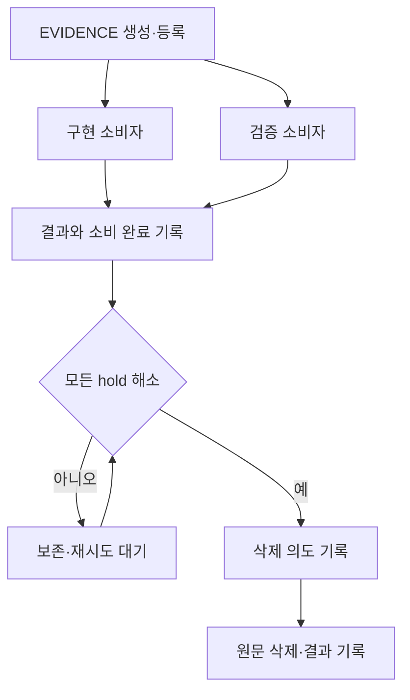

# OMK v1.5.5 다음 개선안

## 세션별 스킬 자동 로드 · 자율 진행 · DAG 실행 개선 · EVIDENCE 사용 후 정리

작성일: **2026-10-22 KST**  
검토 저장소: **dmae97/omk**, 공개 `main`  
기준 HEAD: **`741ac1c4734f66b4d6edb1d25e29198e66f26b20`**  
소스의 패키지 버전: **1.5.5**  
문서 상태: **현재 소스 검토를 바탕으로 한 구현 요구사항. 제품 패치 적용·릴리스는 수행하지 않음.**

> 요청의 “매 섹션”은 “매 세션”으로 해석했다. 목표는 각 작업 세션에서 관련 스킬을 최대 10개까지 자동으로 로드하고, 승인된 작업 범위에서는 추가 지시 없이 실행·검증을 이어가며, DAG의 독립 분기를 효율적으로 진행하고, 사용이 끝난 임시 EVIDENCE 원문을 자동 정리하는 것이다.

## 1. 가장 먼저 바꿀 것

**다음 개선의 중심은 기존 실행 경로에 일관된 계약을 연결하는 것이다.** 스킬 선택기, goal continuation, DAG 실행기, evidence 저장소가 이미 있으므로 새 오케스트레이터를 추가할 이유는 없다.

| 순서 | 개선 | 완료 시 달라지는 사용자 경험 |
| --- | --- | --- |
| 1 | 세션 공통 스킬 admission과 최대 10개 상한 | 스킬을 일일이 지정하지 않아도 필요한 본문이 로드되며, 명시 호출·자동 선택·worker 전달의 수량 기준이 일치한다. |
| 2 | 기존 goal controller에 작업 의도와 승인 범위 연결 | 조사·수정·관련 검사·실패 수정 사이에 반복적인 진행 확인을 요구하지 않는다. |
| 3 | 서브에이전트 lane의 의존성별 준비 큐와 실패 격리 | 한 분기의 정상 종료된 실패가 무관한 분기의 진행을 막지 않고, 준비된 후속 작업이 불필요한 배치 장벽을 기다리지 않는다. |
| 4 | 임시 EVIDENCE의 소비·보존·삭제 수명주기 | 검증과 복구에 필요한 동안 원문을 보존하고, 마지막 사용이 끝나면 원문을 지우되 필요한 최소 기록을 남긴다. |

네 항목을 연결하는 원칙은 하나다. **모델은 작업과 다음 행동을 제안하고, 호스트는 스킬 예산·실행 권한·의존성·검증·삭제 가능 여부를 결정한다.**

## 2. 검토 기준과 실제 확인 범위

### 2.1 이번 버전의 의미

별도 소스 첨부나 로컬 설치 경로가 지정되지 않아 현재 공개 저장소를 검토 대상으로 삼았다. 새 검토용 checkout에서 `main`, HEAD, 변경 파일, `AGENTS.md`, manifests, lockfile, `.npmrc`, 실행 스크립트와 관련 호출부를 확인했다. `git status --short`는 비어 있었다. 루트 및 coding-agent의 `package.json`과 루트 lockfile은 모두 1.5.5를 표시한다. [S01] [S02] [S03]

이 문서의 기준은 **버전 문자열만 같은 모든 설치본이 아니라 위 HEAD의 소스**다. 사용자 컴퓨터의 바이너리, npm `latest`, 배포 태그와 이 checkout의 일치 여부는 확인하지 않았다. 이전 1.5.4 감사 문서는 조사 단서로만 사용했다.

### 2.2 실제 수행한 검증

- 현재 소스의 스킬 선택·본문 확장·goal continuation·DAG·artifact 저장·GC 경로를 읽고 producer와 consumer를 대조했다.
- 원본 TypeScript 모듈을 Node **v24.19.0**에서 직접 import하여 스킬·임시 출력 관련 **6개 관측 시나리오**를 실행했다. 모든 assertion이 통과했고 프로세스 종료 코드는 0이었다.
- 원본 DAG builder와 launcher, permit pool을 사용하여 **독립 분기 차단, 배치 장벽, unsettled permit 보존**을 합성 callback으로 재현했다. 모든 assertion이 통과했고 종료 코드는 0이었다.
- DAG probe의 핵심 5개 모듈은 계산한 Git blob ID와 HEAD 객체가 일치했다. 스킬·출력 probe의 핵심 4개 모듈은 SHA-256을 기록했다.

**수행하지 않은 것:** 의존성 설치, 저장소 전체 테스트, `npm run check`, build, 실제 TUI/RPC 세션, 실제 LLM 호출, 실제 child process를 이용한 DAG 통합 시험, 플랫폼별 sandbox 시험, 성능·과금 비교, CI 성공 여부 확인.

따라서 아래의 “재현”은 **변경하지 않은 소스 모듈의 제한된 동작 관측**이다. 제품 전체의 검증 완료나 개선 효과 측정으로 확대하지 않는다. 실행 명령·결과와 재현 코드는 부록에 포함한다.

## 3. 현재 구현과 남은 간극

### 3.1 이미 있는 기능

| 영역 | HEAD에서 확인한 현재 상태 | 이번 개선에서의 처리 |
| --- | --- | --- |
| 스킬 | 기본 활성 목록, provider별 선택, BM25/metacon 검색, 첫 턴 prompt 고정과 이후 메시지 삽입이 있다. 이름·후보 노출과 실제 본문 로드는 다른 경로다. | 기존 선택기를 재사용하고 본문 admission만 공통화한다. [S04] [S05] [S06] [S07] [S08] [S09] |
| 자동 진행 | `/goal`은 기본 8 round의 continuation을 갖고, `agent_settled` 이후 승인된 acceptance check를 실행하여 실패 시 repair를 이어간다. | 새 반복 엔진 대신 기존 controller에 요청 의도와 정책을 연결한다. [S10] [S11] [S12] |
| 검사 결과 표시 | 현재 workspace fingerprint를 task fact로 전달하고, 최종 완료가 거절되면 앞서 발행한 pass fact를 낮추는 연결이 있다. | 이전 감사의 “freshness 연결 없음”을 미해결로 반복하지 않는다. `OMK_TASK_RESULT`는 기본 off다. [S11] [S13] |
| 필수 도구 | 승인된 검사에 `--requires` 선언을 연결하고 admission에서 필수 도구 누락을 처리하는 경로가 있다. | 기존 계약을 재사용한다. `OMK_REQUIRED_TOOLS`는 기본 off다. [S14] [S15] |
| 실패 로그 재조회 | `OMK_GOAL_OUTPUT_RECALL=1`에서 실패 출력 artifact와 읽기 안내를 repair follow-up에 연결한다. | 없는 기능으로 다시 만들지 않고 수명주기 관리에 연결한다. [S11] [S16] |
| 캐시 경계 | suffix만 변경될 때 stable prefix 경계를 유지하는 경로가 `OMK_PREFIX_BOUNDARY` 아래에 있다. | 스킬 본문 추가가 기존 prefix 정책을 불필요하게 깨지 않도록 연결한다. 기본 off인 실험 경로와 일반 경로를 구분한다. [S17] |
| 출력 정책 | 1.5.5 changelog와 정책 ID는 raw unredacted output을 명시한다. | 삭제가 어느 저장 사본에 적용되는지 정확히 기록한다. 과거 receipt를 소급 수정하지 않는다. [S18] |
| 실행 정리 | verified run GC는 파생 workspace를 정리하며 receipts·blobs·journal·attestations를 보존한다. | 이 GC에 임의 파일 패턴을 더하는 방식으로 evidence 삭제를 구현하지 않는다. [S24] |

위 항목은 소스 연결을 확인한 사실이다. 이번 조사에서 각 feature flag를 켠 실제 제품 세션까지 실행했다는 뜻은 아니다.

### 3.2 스킬 한도가 서로 다른 단위를 가리킨다

| 현재 수치 | 실제 의미 | 세션 전체 본문 로드 상한인가 |
| --- | --- | --- |
| 64 | `defaultActiveSkills` 설정에 허용하는 이름 수 | 아니오 |
| 3 | 기존 provider/lane selector의 선택 한도 | 아니오 |
| 기본 5, 최대 8 | `skill_search` 호출의 검색 결과 수 | 아니오 |
| 3 | prompt당 자동으로 제시하는 검색 후보 수 | 아니오 |
| 제한 없는 Set 합집합 | defaults·명시 선택·harness 활성 이름 병합 | 아니오 |

`active-skill-state.ts`의 원본 함수를 실행했을 때 기본 9개 + 명시 1개 + 신규 1개가 **11개**로 합쳐졌다. 이 실험은 활성 이름 병합에 10개 cap이 없음을 확인한다. **11개 본문이 실제 provider로 전송됐다는 실험은 아니다.** [S04] [S05] [S06] [S07] [S08] [S09]

### 3.3 DAG는 세 경로로 구분해야 한다

| 경로 | 현재 범위 | 우선 개선 지점 |
| --- | --- | --- |
| 기본 `dag-v2` tool scheduler | agent loop 안에서 tool-call 의존성과 자원 충돌을 처리한다. 준비 frontier와 최종 claims 재확인이 있다. | 이번에 새로 작성하지 않는다. [S19] |
| 선택적 subagent graph | extension → session lane authority → orchestration plan → lane launcher가 실제 연결돼 있다. | **배치 장벽과 전역 실패 차단**을 정밀하게 바꾼다. [S20] [S21] [S22] [S23] |
| 명시적 verified command DAG | CLI/SDK로 정적 command DAG를 실행·검사·재개한다. 최대 16 task, task당 최대 2 attempt, 동시성 기본 1·명시 2를 지원한다. | 기존 recovery·generation·receipt 계약을 보존한다. [S25] [S26] [S27] [S28] |

현재 verified command DAG는 task 간 writable scope 겹침을 거부한다. 이는 의도적인 계약 제약이며, 수치 상한을 늘리는 것과 별도로 다뤄야 한다. 일반 prompt를 자동으로 verified command DAG라고 표시해서도 안 된다.

## 4. 요구사항 A: 세션당 최대 10개 스킬 자동 로드

### 4.1 상한과 세션 정의

**기본 계약: 하나의 logical session에서 호스트의 공식 로딩 경로를 통해 admission한 고유 스킬 본문은 최대 10개다.** 10개는 채워야 할 목표 수가 아니다. 필요하지 않으면 0개, 초기에는 관련성이 높은 1–3개로 시작하고 작업 단계가 바뀔 때만 추가한다.

| 구분 | 제안 계약 |
| --- | --- |
| 로드로 집계하는 시점 | 스킬 본문을 모델에게 제공하기 전에 호스트가 admission을 확정하는 시점 |
| 집계하지 않는 것 | catalog의 이름·설명·경로 검색, 후보 목록 표시, 일반 프로젝트 소스 읽기 |
| 동일 스킬 재조회 | 같은 canonical ID·출처·content digest면 슬롯을 추가 소비하지 않는다. 전송 토큰은 별도 집계한다. |
| alias | 신뢰 출처와 동일 본문이 확인된 alias만 중복 제거한다. 이름만 같다는 이유로 승인이나 슬롯을 공유하지 않는다. |
| 버전 변경 | 세션은 admission한 digest에 묶인다. 새 본문 버전을 적용하면 새 admission으로 취급하며, 이전 본문을 이력에서 지웠다고 가정하지 않는다. |
| resume·compaction·model 전환 | 같은 logical session의 manifest와 누적 수를 유지한다. |
| 자동 continuation | 새 턴이 되어도 상한을 초기화하지 않는다. |
| worker | 초기 상속은 필요한 부모 스킬의 부분집합만 주입한다. 추가 스킬은 worker 자신의 logical-session cap과 부모의 전체 예산·권한 아래에서 admission한다. 별도 worker session도 자체 최대 10개를 적용하며, 상속받아 실제 제공된 본문도 집계한다. |
| 전체 작업 예산 | 부모와 모든 worker의 실제 토큰·비용·동시성은 합산한다. 스킬 cap을 피하려고 세션을 자동 생성하지 않는다. |
| 새 사용자 작업 세션 | 사용자가 시작한 별도 새 세션은 독립된 cap을 가진다. |

**부모와 모든 자식의 합집합을 무조건 10개로 묶는 정책은 이번 기본안이 아니다.** 사용자의 “매 세션”에 맞추되 worker 수 증가로 전체 자원 사용량이 무제한 늘지 않도록 기존 부모 예산을 유지한다.

호스트의 필수 안전 규칙과 기본 프로젝트 지침은 스킬 슬롯을 확보하려고 제거하지 않는다. 스킬의 참고 문서·예제는 같은 스킬 자료로 다루되 실제 본문 bytes와 토큰 예산에 포함한다. 다른 독립 스킬을 참고 문서라고 이름만 바꾸어 cap을 우회하지 않는다.

### 4.2 기존 경로를 하나의 admission에 연결

다음 경로가 동일한 호스트 함수를 통과해야 한다.

1. `defaultActiveSkills`에서 선택한 스킬.
2. provider harness와 기존 BM25/metacon이 선택한 스킬.
3. `/skill:`·bang invocation·SDK의 명시 호출.
4. `steer`·`followUp`에서 확장되는 스킬.
5. 등록 스킬 본문을 반환하는 native `read` 경로.
6. worker에 전달하거나 worker가 새로 로드하는 스킬.

`skill_search` 결과만 10개로 제한하는 변경은 요구사항을 충족하지 않는다. 추천된 이름을 active로 표시하는 것만으로 본문을 로드했다고 보고해서도 안 된다. [S06] [S07] [S08] [S09]

구현 위치는 `AgentSession`의 기존 소유 경계다. 후보 순위는 기존 선택기를 유지하고, 필요한 본문을 읽은 뒤 출처·digest·개수·요청 예산을 확인하여 admission한다. 상태에는 최소한 session ID, schema version, policy revision, canonical skill ID, content digest, 선택 출처, admission 상태, 연관 request ID를 기록한다.

**동시 로딩은 예약부터 원자적으로 처리한다.** 이미 9개가 있을 때 서로 다른 두 read가 동시에 들어와도 신규 1개만 허용되어야 한다. 기존 session owner/직렬화 경계를 사용하고, 필요한 경우 version CAS로 예약과 manifest 갱신을 묶는다. 예약 중인 슬롯도 10개 상한에 포함한다.

provider 전송 가능성이 있는 상태에서 프로세스가 종료되면 해당 슬롯을 임의로 되돌리지 않는다. 전송 전 실패가 확실할 때만 예약을 해제한다. 재개 시 손상된 manifest나 출처 불일치를 정상적인 빈 세션으로 취급하지 않는다.

### 4.3 토큰과 캐시

스킬 개수 cap과 context 예산은 별도다. 스킬 2개만으로도 큰 본문이면 요청을 초과할 수 있다.

- 본문을 넣은 **최종 provider 요청**에서 instructions, tools, wrappers, history, skill text를 모두 포함하여 계산한다.
- completion과 필수 검증에 필요한 여유를 먼저 확보한다.
- 선택적 스킬을 줄여 예산을 맞춘다. 필수 검증 도구를 숨기거나 필수 지침을 잘라 해결하지 않는다.
- 첫 system prompt의 안정 구간을 재사용하고, 나중에 admission한 본문은 기존 후속 메시지 경로에 연결한다.
- 슬롯이 찼다는 이유로 이전 스킬을 active 목록에서만 제거해 새로운 슬롯을 만들지 않는다. 누적 admission과 실제 이력의 의미를 유지한다.
- cap과 정책은 호스트가 관리한다. 모델이 “이제 잊었다”고 말하는 것은 슬롯 회수 근거가 아니다.

일반 `bash cat`·임의 extension·사용자 붙여넣기로 들어온 모든 텍스트를 의미적으로 식별하여 차단하는 보안 장치라고 주장하지 않는다. 이 요구는 **호스트가 관리하는 공식 스킬 로딩과 주입 경로의 일관성 계약**이다.

### 4.4 호환성과 예외 처리

기존 `defaultActiveSkills`의 64개 입력을 즉시 10개로 낮추면 기존 설정 때문에 시작이 실패할 수 있다. 입력 목록은 선호 후보로 유지하고, 실제 admission에서 최대 10개를 선택하는 migration을 권장한다.

과거 세션에 manifest가 없으면 호스트가 확인할 수 있는 기존 로딩 기록으로만 재구성한다. 기록이 없다는 이유로 사용량 0을 가정하지 않는다. 이미 10개를 넘긴 이력을 가진 세션은 `legacy_over_cap`으로 표시하고 신규 admission을 막되 기존 작업·증거를 파괴하지 않는다. 이런 세션이 새 cap을 소급 충족했다고 보고하지 않는다. 엄격한 신규 계약은 migration이 확인된 세션과 새 세션부터 적용하며, 상한을 피하려고 자동 fork하지 않는다.

필수라고 명시된 스킬이 11개라면 조용히 하나를 버리지 않는다. 이미 허용된 스킬과 일반 도구로 수행할 수 있는 범위를 먼저 진행하고, 남은 필수 충돌을 명시한다. 선택적 추천 실패는 사용자에게 매번 물을 이유가 아니다.

## 5. 요구사항 B: 추가 지시 없이 작업 이어가기

### 5.1 목표 동작

사용자가 수정·구현·조사·문서 작성을 요청하면, 그 작업에 필요한 스킬 선택 → 조사 → 변경 → 관련 검증 → 실패 수정 → 결과 정리를 승인 범위 안에서 이어간다. 단계 전환마다 “진행할까요?”를 물을 필요가 없다.

현재 `/goal`의 continuation과 acceptance loop를 재사용한다. 일반 질문까지 지속 실행 goal로 만들지 말고, **실행 요청이 있는 작업**에 작업 범위·예산·완료 조건을 붙인다. 단순 작업은 기존 단일 agent 경로로 끝낸다. [S10] [S11] [S12]

| 상황 | 진행 방식 |
| --- | --- |
| 관련 자료 읽기, 스킬 선택, 허용된 파일 수정, 로컬 검사 | 바로 진행 |
| 가역적인 구현 선택이 일부 불명확함 | 짧게 가정을 기록하고 진행 |
| 한 분기만 막힘 | 권한과 자원 범위가 독립인 다른 분기를 계속 진행 |
| 검사 실패 | 남은 예산 안에서 원문 진단 → 수정 → 필요한 재검사 |
| 사용자의 새 지시·중단 | 기존 큐보다 우선 반영하고 오래된 결과 수용을 막음 |
| 신규 공개·배포·외부 발송·과금 범위 확대·범위 밖 삭제 | 기존 승인에 포함되는지 검사하고, 포함되지 않을 때만 해당 효과 직전에 확인 |
| 필수 도구 부재·budget 고갈·회복 불가능한 오류 | blocker와 이미 완료한 범위를 정확히 반환 |

기존 승인된 모델 사용 예산 내 호출을 매번 새 과금 승인 대상으로 만들지 않는다. 작업 범위를 넓히는 비용과 이미 승인된 작업 수행 비용을 구분한다.

### 5.2 승인 재사용과 중단 기준

기존 `command-safety-gate`의 allow/confirm/block을 유지한다. **YOLO나 전역 assume-yes를 기본으로 켜서 요구사항을 달성하지 않는다.** 승인된 목적·대상·명령 또는 효과 종류·정책 revision·예산이 유효하면 같은 확인을 반복하지 않는 방식으로 연결한다. [S12] [S29]

현재 goal check 승인은 process-scoped이며 재시작 뒤 workspace journal만 보고 복원하지 않는다. 1차 구현은 이 경계 안에서 자동 진행을 완성한다. 재시작 후 확인까지 없애려면 별도로 호스트가 소유하는 승인 저장소와 freshness 계약을 마련해야 한다. 모델이 쓸 수 있는 세션 파일에 `approved=true`를 저장하는 것으로 대체하지 않는다.

종료 사유는 검증된 완료, 사용자 취소, 해결 불가 blocker, 명시된 비용·시간·round 한도 초과로 구분한다. 단순히 runnable node가 없거나 assistant가 답변을 마쳤다는 이유로 verified complete를 만들지 않는다. 확인되지 않은 외부 효과는 조회·조정 또는 idempotency 없이 재시도하지 않는다.

## 6. 요구사항 C: DAG 강화

### 6.1 이번 소스에서 재현된 두 가지 동작

아래 두 독립 경로를 입력했다.

| 분기 | 의존성 | 기존 builder의 배치 |
| --- | --- | --- |
| 첫 분기 | A 완료 후 B | 첫 배치 A·C, 다음 배치 B·D |
| 둘째 분기 | C 완료 후 D | 동일 |

**관측 1:** A가 실패하고 C가 완료되면 B와 D 모두 `blocked-dependency`였다. D는 C에만 의존한다. 원인은 launcher가 앞선 outcomes 중 하나라도 `completed`가 아니면 다음 batch 전체를 막기 때문이다.

**관측 2:** A가 완료된 상태에서 C를 대기시켰을 때 B는 시작하지 않았다. C가 끝난 뒤에야 B가 시작했다. batch마다 `Promise.all`을 기다리는 장벽이 있기 때문이다. [S21] [S22]

이는 현재의 보수적인 배치 실행 정책을 재현한 것이다. 기존 테스트에도 다음 배치 중단을 요구하는 사례가 있으므로 단순 오타 수정으로 취급하지 않는다. **정착한 실패의 영향 범위를 정밀화하고, 기존 자원 안전성을 유지하면서 실행 준비 판단을 개선하는 정책 변경**이다.

### 6.2 새 실행기의 추가보다 기존 plan 계약 보강

`SubagentOrchestrationPlan`에 launcher가 소비할 명시적인 effective dependency를 보존한다. 입력의 `dependsOn`만 복사해서는 안 된다. 현재 builder가 추가하는 receipt 소비 의존성과 writer 직렬화·scope 충돌도 포함해야 한다. 기존 `batches`는 호환 및 계획 설명용으로 유지할 수 있다. [S21]

실행 전과 dispatch 직전에 아래 조건을 확인한다.

1. 필수 선행 출력이 해당 attempt/generation에서 유효하게 준비되어 있다.
2. receipt 소비 또는 검증 edge가 요구하는 추가 조건을 충족했다.
3. 실행 중인 노드와 read/write 범위가 충돌하지 않는다.
4. 부모 admission·caller cap·공유 heavy permit의 한도를 넘지 않는다.
5. 취소·권한 철회·unsettled 효과·stale graph revision이 없다.

ready queue의 초기 우선순위는 기존 source order를 유지한다. 새 점수 함수나 LLM scheduler는 필요하지 않다. 준비된 노드가 끝날 때마다 영향을 받는 후속 노드만 다시 평가한다.

### 6.3 실패·대기·미정착을 분리

| 노드 결과 | 후속 처리 |
| --- | --- |
| 실행 종료·결과 수용 | 해당 출력의 소비자를 준비 후보로 갱신 |
| 확실히 종료된 실패 | 실패 결과를 필수로 요구하는 descendants를 차단 |
| 무관한 정상 분기 | 범위·권한·예산이 유효하면 계속 진행 |
| 자원 일시 부족 | `waiting_resource` 성격의 대기로 다루고, 즉시 dependency 실패로 전파하지 않음 |
| `unsettled`·실행 종료 불명·공통 권한 철회 | 신규 dispatch를 보수적으로 중단하고 기존 자원 예약 유지 |
| 부모 취소 | 미시작 노드를 중단하고 실제 실행 종료를 확인할 때까지 accounting 유지 |
| 이전 attempt의 늦은 결과 | 현재 출력·완료 상태·소비 ACK에 반영하지 않음 |

실패한 writer가 공유 workspace에 부분 변경을 남겼다면 그 변경의 영향도 확인해야 한다. 의존성 edge가 없다는 이유만으로 안전한 독립 분기라고 간주하지 않는다. **현재 subagent의 문맥 격리를 OS 수준 workspace 격리로 표현하지 않는다.**

독립 분기 D가 끝나도 실패한 A·B를 요구하는 전체 목표는 미완료다. 부분 진행 확대와 전체 성공 판정은 별개다.

### 6.4 실행 상태와 검증 상태

lane callback의 `completed`는 실행 정착을 뜻한다. 그것만으로 산출물의 정확성이 검증됐다고 올리지 않는다.

일반 실행 edge는 수용된 출력에 의존하고, 검증이 필요한 edge는 호스트 receipt에 의존하도록 계약을 구분한다. 상태와 evidence에는 최소한 `session/run`, `graph revision`, `node`, `attempt`, `generation`을 연결한다. 이미 verified command DAG에 있는 generation·recovery·receipt 코드를 별도 새 런타임으로 복제하지 않는다.

### 6.5 복구 범위는 별도 단계

현재 subagent graph의 결과·완료 목록 일부는 호출 내 메모리 상태다. worker checkpoint 지원을 parent graph 전체의 durable resume라고 간주할 수 없다. [S23]

1차는 기존 프로세스 안의 dependency frontier와 실패 격리를 완성한다. 2차로 graph 계획·attempt·출력 digest·소비 상태를 기존 session/run journal에 영속화한다. 계획 변경은 version을 올리고 대기 중 admission·GC 결정을 재검사한다. 기록 replay는 새 모델 실행·새 side effect와 구분한다.

## 7. 요구사항 D: EVIDENCE 사용 후 자동 삭제

### 7.1 삭제 대상부터 분리

**기본 자동 삭제 대상은 OMK가 생성·등록한 임시 진단·중간 EVIDENCE 원문이다.** 이름에 `EVIDENCE`가 들어간 모든 파일을 삭제하는 기능이 아니다.

| 자료 | 기본 정책 | 이유 |
| --- | --- | --- |
| 실패 진단 로그, read/bash spill, 중간 분석 본문 | 소비·검증·복구 hold 해소 후 원문 자동 삭제 | 이번 요구의 주 대상 |
| 사용자에게 전달할 최종 MD·패치·보고서·이미지 | 자동 삭제 제외 | 최종 산출물의 소유권과 보존 의도 유지 |
| 사용자가 제공한 소스·업로드 파일·명시적 EVIDENCE 문서 | 자동 삭제 제외 | OMK의 임시 생성물과 구분 |
| 기존 receipt·attestation·contract·journal·issuer key | 기존 형식과 reader 계약대로 보존 | 검증 bundle을 요약하거나 축소하면 기존 무결성 검사가 깨질 수 있음 |
| 새 artifact lifecycle·삭제 receipt | 필요한 최소 metadata 유지 | 원문을 복제하지 않고 생성·사용·삭제 내역을 설명 |
| 현재 reader·publish·recovery가 요구하는 candidate blob | 보호 | 기존 무결성·복구 계약이 직접 참조함 |
| 이미 재구성 가능한 derived workspace | 기존 verified-run GC 사용 | 현재 owner와 keep 조건을 재사용 |
| 출처·owner가 불명확한 과거 임시 파일 | 자동 채택·삭제하지 않음 | 별도 명시적 migration에서만 등록 가능 |

원문과 metadata의 분리는 임시 진단의 보존 비용을 줄이기 위한 것이다. 최소화 대상은 새 lifecycle·삭제 기록이며, 기존 검증 bundle과 `issuer.key`를 요약본으로 바꾸는 제안이 아니다. **해시·요약만 남겼다고 원본 재검증이나 원문 복구가 가능해지는 것은 아니다.** [S24] [S33]

### 7.2 현재 저장 경로에 붙일 접점

- `goal-output-recall.ts`는 실패 출력을 파일당 4 MiB의 본문 예산으로 보존한다. 초과 시 head 1 MiB와 tail 3 MiB 및 생략 표시를 사용하므로 정확한 파일 크기는 표시 문구만큼 더 클 수 있다. 현재 제한은 goal당 3개·디렉터리당 20개이며 mtime 기준으로 오래된 것을 지운다. clear/replace에도 정리 경로가 있다. [S16]
- `RecallAccessTracker`는 읽기 횟수 관측이다. ACK나 삭제 권한이 아니다. 실제 probe에서도 read를 기록한 후 파일은 남았다. [S30]
- 현재 goal의 pass에서는 새 writer를 discard하지만, 과거 실패 로그 전체를 “사용 완료” 기준으로 정리하는 연결은 해당 경로에 없다. [S11]
- native read는 `tools/read.ts` → `artifact-spill.ts`에서 임시 디렉터리에 전체 출력을 저장한다. 조사한 생성·read 경로에는 성공적으로 만들어진 spill의 소비 완료 cleanup 연결이 없었다. probe에서도 읽은 후 파일이 남았다. [S31]
- tool bash는 `tools/bash.ts` → `tools/output-accumulator.ts`에서 별도의 `omk-bash-*.log`를 만든다. `OutputAccumulator.closeTempFile()`은 flush·close이며 삭제가 아니다. 이 producer에도 artifact owner와 소비 완료를 연결해야 한다. [S39] [S41]
- interactive/RPC에서 사용하는 별도 `core/bash-executor.ts`의 실행 경로도 `omk-bash-*.log`를 만든다. 결과에 노출하지 않는 일부 임시 파일과 오류 경로는 이미 정리한다. 새 lifecycle은 사용자에게 반환한 `fullOutputPath`의 등록·보존·소비 후 정리를 맡는다. 모든 bash 출력이 `artifact-spill.ts`를 통과한다고 가정하지 않는다. [S40]
- `session-artifacts.ts`는 세션 파일을 삭제할 때 대응 artifact 디렉터리를 정리한다. 이 동작을 정상 세션 종료나 모든 임시 경로의 자동 정리로 확대해서 설명하면 안 된다. [S32]
- `session-bash-runtime.ts`의 verified bash receipt는 `${sessionFile}.evidence` 또는 `.omk/session-evidence/`에 저장한다. 이 저장 family는 `<session>.artifacts/`와 다르며, 임시 spill과 묶어 삭제하지 않는다. [S42]
- `run-gc.ts`는 명시적으로 derived workspace만 삭제한다. `readRunEvidence()`는 candidate·receipts 등 보존 자료를 다시 읽으므로 현재 blob을 지우고 해시만 남기면 기존 reader와 충돌한다. [S24] [S33]

즉, 정리 함수 자체는 이미 여러 개 있다. 추가로 필요한 것은 **artifact의 의미·소비자·보존 이유를 연결하는 공통 수명주기와 실제 호출 연결**이다. 물리 저장소를 하나로 옮기거나 새 전역 캐시 서버를 만들 필요는 없다.

새 보존 정책을 붙일 때 기존 `keepNewest`·`enforceCaps()`·goal clear/replace의 `deleteGoalRecallFiles()`도 같은 owner의 삭제 가능 판단을 거치게 한다. 새 GC만 lease를 확인하고 기존 count pruner가 원문을 먼저 지우는 상태로 두면 요구사항은 충족되지 않는다. 세션 삭제 시 artifact 제거도 해당 owner와 조정한다. 명시적인 사용자 세션 삭제는 일반 자동 정리와 별도의 삭제 범위·실행 정착 정책을 적용한다.

현재 recall의 `nextAttempt()`는 남아 있는 파일명에서 최대 번호를 구한다. 새 자동 삭제로 같은 goal·round·revision의 마지막 파일까지 지우면 다음 capture가 과거 경로를 다시 사용할 수 있다. **신규 artifact ID뿐 아니라 물리 파일명에도 영속 증가 번호 또는 충분한 충돌 방지 nonce를 사용하고, 삭제된 경로를 새 결과에 재사용하지 않는다.** 기존 대화의 출력 링크가 다른 실행의 원문을 가리키는 문제를 막기 위한 요구사항이며, 현재 코드 읽기에서 도출한 삭제 기능 추가 시의 회귀 위험이다. [S16]

### 7.3 “사용 완료”의 정확한 조건

자동 삭제는 아래 조건이 모두 참일 때만 가능하다.

1. 호스트가 생성·등록한 disposable artifact다.
2. producer가 해당 원문을 다 썼고 결과를 확정했다.
3. 필요한 consumer 목록이 현재 graph revision에서 닫혀 있다.
4. 모든 필수 consumer가 결과 commit과 함께 소비 완료를 영속 기록했다.
5. 활성 reader·worker·process lease가 없다.
6. 필수 verification·retry·recovery·publication hold가 없다.
7. pin이나 최종 산출물 보존 의도가 없다.
8. 최소 receipt 및 삭제 의도를 영속 기록할 수 있다.
9. 최종 삭제 직전 artifact generation·graph revision·경로 identity·권한이 여전히 일치한다.

consumer ACK는 “파일을 한번 읽었다”가 아니라 **그 입력으로 필요한 결과를 확정하여 해당 원문을 다시 요구하지 않는 상태**다. 부분 읽기·발췌·모델의 “확인 완료” 발언·telemetry의 read count는 ACK를 대신하지 않는다.

### 7.4 fan-out과 실패 복구



두 consumer 중 하나만 끝났으면 보존한다. 실패한 검사 결과를 수정자가 읽었다고 해서 바로 삭제하지 않는다. 수정 확인 검사, 최종 통합, 재시도, 복구가 그 자료를 요구하는지 먼저 확인한다.

취소·CLI 종료·`dispose()`·`prompt_settled`는 자동으로 사용 완료가 아니다. resume 가능한 작업은 recovery hold를 유지한다. 종료된 작업의 실패 진단은 초기 제안으로 24시간 보존할 수 있지만, 이는 **활성 소비·복구 hold가 해제된 뒤 적용하는 보존 기간**이다. TTL이 지났다는 이유로 살아 있는 작업의 원문을 지우지 않는다.

진행 중 새 소비자를 붙이는 재계획은 삭제와 같은 상태 소유자에서 직렬화한다. 삭제 예약이 완료된 artifact에는 새 소비를 허용하지 않거나 원문을 재생성해야 한다. 이때 재생성은 새 attempt이며, 과거 실행 기록을 replay했다고 표현하지 않는다.

### 7.5 원자적 정리 절차

물리 삭제와 journal 갱신을 하나의 filesystem transaction으로 가정하지 않는다. 다음과 같이 재시작 가능한 절차를 쓴다.

| 단계 | 동작 | 실패 시 |
| --- | --- | --- |
| 1 | 기존 owner lease/상태 버전 아래에서 삭제 가능 조건 재검사 | hold 이유를 반환하고 보존 |
| 2 | artifact를 `deleting`으로 CAS 전환하고 삭제 의도 기록을 durable commit | 원문 삭제를 시작하지 않음 |
| 3 | 새 reader lease를 막고 허용된 관리 경로·파일 identity 재확인 | `delete_pending` 또는 보존, 원인 기록 |
| 4 | 해당 원문만 unlink/관리 경로 내 제거 | OS 잠금·I/O 실패 시 제한된 재시도 |
| 5 | 필요한 디렉터리 동기화 후 `deleted`와 삭제 bytes·시각·이유 기록 | 재시작 시 존재 여부와 기존 의도를 대조해 마무리 |

`delete_pending`과 `deleted`를 구분한다. 재시작 뒤 실제 파일이 남았는데 성공으로 표시하거나, 이미 없는 파일을 다시 지우다가 전체 작업을 실패시키지 않는다. 필수 receipt 기록이 실패하면 먼저 원문을 지우지 않는다.

삭제 API는 임의 문자열 경로보다 등록된 artifact ID를 입력으로 받는다. 최종 파일 경계에서 경로 탈출·symlink·대상 교체를 검사한다. 같은 사용자 권한의 임의 코드까지 이러한 metadata 검사만으로 격리했다고 주장하지 않는다.

### 7.6 용량 예산과 원문 가용성

초기 정책은 현재 4 MiB recall 예산을 재사용하고, 공통 managed ephemeral store에 세션별 bytes·entries 상한을 추가한다. 구체적인 전체 상한은 실제 다중 세션 사용량을 측정하여 정하며, 아래 24시간 실패 진단 보존도 **초기 제안값**이다.

공간이 부족하면 삭제 가능한 임시 원문부터 정리한다. 남은 자료가 모두 필수 hold 상태이면 신규 capture 또는 신규 작업 admission을 제한한다. 필수 evidence를 조용히 제거하고 검증 성공을 유지하는 방식으로 예산을 맞추지 않는다. 선택적 진단 capture 실패는 `unavailable`을 기록하고, 필수 verification evidence 실패는 완료를 막는다.

삭제 이후 조회에는 `present`, `deleted_after_use`, `expired`, `missing_unexpectedly`처럼 이유가 구분된 결과를 제공한다. 삭제된 원문을 가리키는 경로를 정상적인 “Full output” 링크처럼 계속 표시하지 않는다. 저장 과정에서 중간이 생략된 출력은 전체 원문이라고 부르지 않는다.

기존 검증 receipt의 authenticity, 특정 시점의 검증 결과, 현재 원문 가용성, 현재 환경에서의 재실행 가능성을 분리한다. 1차 구현은 기존 `readRunEvidence`·publish·recovery가 요구하는 자료를 보존하여 호환성을 유지한다. 검증 bundle 자체를 삭제하는 기능은 reader 계약과 schema migration을 포함한 별도 변경이다.

### 7.7 삭제 범위

1.5.5의 raw 출력 정책 때문에 디스크 원문 보존·삭제는 실사용 의미가 있다. 다만 관리 파일을 지웠다는 사실이 이미 대화 이력에 들어간 text, session journal의 별도 사본, 외부 provider 전송분, 백업까지 지웠다는 뜻은 아니다. [S18]

완료 메시지는 **어느 managed artifact를 지웠는지**와 남은 hold/실패만 보고한다. 전송된 내용을 소급 삭제했다거나 보안 삭제·완전 삭제를 보장한다고 표시하지 않는다. 불필요한 원문 복제를 새로 만들지 않는 것이 우선이다.

## 8. 제안 설정과 사용자 표시

### 8.1 목표 설정 계약

아래는 **새 구현을 위한 제안 schema**다. 현재 1.5.5에서 그대로 지원하는 설정이 아니므로 기존 설정 파일에 붙여 넣으면 동작한다고 안내하지 않는다. 실제 구현에서는 기존 SettingsManager와 설정 우선순위에 맞추어 이름을 확정한다.

```json
{
  "skillLoading": {
    "automatic": true,
    "maxLoadedPerSession": 10,
    "initialAutomaticLimit": 3,
    "countScope": "logical-session"
  },
  "taskExecution": {
    "continueWithinApprovedScope": true,
    "independentBranchFailurePolicy": "continue"
  },
  "evidenceRetention": {
    "temporaryPayloads": "delete-after-use",
    "keepRequiredReceipts": true,
    "failedDiagnosticsAfterTerminalMs": 86400000
  }
}
```

`maxLoadedPerSession`의 허용 상한은 10으로 검증한다. 사용자·프로젝트·worker 설정이 부모 권한이나 이번 상한을 임의로 늘리지 못하게 한다. `automatic=false`여도 명시 로딩의 수량 계약과 예산 검사는 유지한다.

목표 기본 동작은 자동 로드·승인 범위 내 진행·사용 후 임시 원문 정리다. 초기 배포에서는 기존 feature flag 또는 작은 실험 gate로 검증한 뒤 기본값으로 승격한다. “설계만 있고 계속 기본 off”인 상태를 요구사항 완료라고 보고하지 않는다.

### 8.2 표시 예시

아래 문구는 새 UI의 제안이며 현재 명령이나 필드라고 주장하지 않는다.

- `스킬 3/10 · 자동 2 · 명시 1`
- `진행 4 · 대기 1 · 차단 1 · 검증 대기 1`
- `임시 원문 6개 정리 · 2개는 복구 대기`
- `작업 일부 완료 · 필수 검사 1개 실패`

모델 내부 selector 이름이나 raw manifest를 기본 사용자 흐름에 노출할 필요는 없다. 상세 진단에는 선택 이유·지연 이유·삭제 보류 이유를 조회할 수 있게 한다. TUI·print·RPC는 같은 호스트 상태 projection을 소비해야 한다.

## 9. 실제 수정 접점

아래는 **현재 존재하는 파일을 기준으로 한 변경 계획**이며 이미 수정했다는 목록이 아니다.

| 기존 파일·영역 | 변경 책임 |
| --- | --- |
| `core/active-skill-state.ts`, `core/settings-manager.ts` | 선호 후보와 admitted 본문을 분리하고 설정 migration 연결 |
| `core/agent-session.ts` | defaults·explicit·harness·`/skill:`·steer/followUp을 공통 admission으로 연결 |
| `core/prompt-skill-message.ts` | 첫 prompt 안정성 유지와 후속 본문 삽입·provenance |
| `core/skill-search-gate.ts`, `core/skill-search.ts` | 후보·검색 결과와 실제 로드 상태 구분, 기존 순위 재사용 |
| `core/tools/read.ts` | 등록 스킬 본문 read를 호스트 admission과 연결 |
| 기존 session 저장·복구 owner | versioned skill manifest와 누적 슬롯 복원 |
| `examples/extensions/subagent/{index,worker-env,capabilities}.ts` | worker subset·cap·부모 예산 전달 및 빈 grant 의미 명확화 |
| `core/extensions/builtin/goal-controller.ts`, `goal-controller-acceptance.ts` | 작업 의도·자동 continuation·acceptance 완료와 lifecycle 연결 |
| `core/subagent-orchestration.ts`, `subagent-lane-input.ts`, `lane-input-snapshot.ts` | effective dependencies·scope 제약·plan version을 immutable 입력으로 보존 |
| `core/subagent-lane-launcher.ts`, `subagent-lane-authority.ts` | ready frontier·정착 실패 격리·자원 회수·late result 처리 |
| `core/goal-output-recall.ts`, `goal-output-recall-access.ts`, `core/tools/artifact-spill.ts` | managed artifact 등록·소비 상태 연결·기존 pruner 조정·경로 재사용 방지 |
| `core/tools/bash.ts`, `core/tools/output-accumulator.ts`, `core/bash-executor.ts` | bash 출력 producer별 owner 등록·flush 완료·반환 경로의 소비 후 정리 |
| `core/session-artifacts.ts`, `core/verified-run/run-gc.ts` | 기존 cleanup의 범위 유지, 공통 정책과 결과 projection 연결 |
| `core/verified-run/evidence.ts`, `evidence-read-projection.ts` | 필요한 원문을 보존하고, 향후 삭제 상태를 지원할 경우 명시적인 reader 버전 계약 |

위 `core/`는 `packages/coding-agent/src/core/`를 뜻한다. 새 상태 보조 모듈이 필요하면 기존 owner 아래의 작은 순수 모듈로 제한한다. 새로운 공개 API 이름·파일명은 구현 시 실제 구조를 확인해 결정한다.

사용자 문서는 기존 `packages/coding-agent/docs/skills.md`, `docs/dag-evidence.md`, `docs/acceptance-checks.md`, 설정·verified-run 관련 문서를 갱신한다. 루트 `docs/`는 이 저장소에서 git-ignore되는 작업 영역이므로 배포 문서 링크를 만들지 않는다. [S03]

## 10. 작은 변경 단위와 완료 기준

| 변경 단위 | 범위 | 완료 기준 |
| --- | --- | --- |
| PR 1 | 스킬 manifest·10개 cap·공식 로딩 경로 통합 | 실제 session request에서 cap이 유지되고 resume·병렬 read·명시 호출을 통과 |
| PR 2 | 자동 선택·자동 본문 로드·worker 전달 | 별도 스킬 지시 없이 관련 본문을 제공, 무관한 질의 0개 허용, 전체 요청 예산 충족 |
| PR 3 | 기존 goal의 승인 범위 내 자동 진행 | 여러 repair round를 중간 확인 없이 진행, 사용자 steer·cancel·budget 경계 유지 |
| PR 4 | lane effective dependency와 실패 격리·frontier | A→B/C→D 반례 해결, writer 충돌·unsettled permit 회귀 없음 |
| PR 5 | 임시 artifact 등록과 terminal 작업 정리 | 완료/보존 상태가 정확하고 기존 receipt·publish·resume 회귀 없음 |
| PR 6 | DAG consumer ACK 기반 진행 중 정리 | fan-out·retry·재계획·crash·삭제 실패에서도 조기 삭제 없음 |

PR 1–2와 PR 4의 소스 조사·세부 설계는 독립적으로 진행할 수 있다. PR 6은 artifact 수명주기와 effective dependency가 확정된 뒤 연결한다. 기능별 한도·owner·projection을 먼저 정하고 테스트를 약화하여 맞추지 않는다.

PR 4는 위험을 더 줄이려면 먼저 배치를 유지한 채 실패 범위를 분리하고, 다음 변경에서 자원 제약이 보존된 ready frontier를 적용할 수 있다. 임시로 실패 차단을 없애는 한 줄 수정으로 병렬화를 열지 않는다.

## 11. 인수 테스트

아래는 **앞으로 구현해야 할 회귀·통합 검증**이다. 현재 probe 통과와 혼동하지 않는다.

### 11.1 필수 시나리오

| ID | 시나리오 | 기대 결과 |
| --- | --- | --- |
| SK1 | defaults 6 + explicit 3 + auto 5 | 본문 admission은 최대 10, 제외 사유 기록 |
| SK2 | 9개 상태에서 서로 다른 신규 스킬 2개 동시 요청 | 신규 1개만 성공, 예약 포함 cap 유지 |
| SK3 | `/skill:`·read·SDK·steer·followUp 경로 교차 | 공통 cap과 provenance 적용 |
| SK4 | alias·동일 본문 재조회·같은 이름 다른 출처·버전 변경 | 올바른 중복 제거, 출처·버전 혼동 없음 |
| SK5 | resume·compaction·provider 전환 | 누적 admission 유지, 슬롯 초기화 없음 |
| SK6 | 큰 스킬 2개 또는 worker 다수 | 최종 요청 예산과 전체 작업 예산 유지 |
| SK7 | manifest 없는 과거 세션 또는 기존 본문 사용량 10개 초과 | 확인 가능한 이력만 재구성, 0으로 초기화 금지, 초과 세션 신규 admission 차단 |
| AU1 | 승인된 수정→검사 실패→수정→pass | 단계마다 재확인 없이 실제 완료까지 진행 |
| AU2 | 중간 사용자 steer·cancel·권한 철회 | 이후 dispatch·late result 수용 차단 |
| AU3 | 명령·검사 계약·대상 범위 변경 | 이전 승인 부당 재사용 금지 |
| AU4 | round·deadline·비용 한도, outcome unknown | 정확한 중단 사유, blind side-effect retry 없음 |
| DG1 | A→B, C→D에서 A만 정착 실패 | B 차단, C와 D 진행, 전체 목표는 미완료 |
| DG2 | A 완료·C 대기, B와 C의 자원 범위 분리 | 빈 슬롯이 있으면 B 시작 |
| DG3 | 두 부모를 가진 join | 모든 필수 선행 조건 충족 전에는 미시작 |
| DG4 | writer 충돌·read/write 충돌·receipt 의존성 | eager 전환 후에도 기존 직렬화 제약 유지 |
| DG5 | timeout 후 child가 살아 있음 또는 settlement reject | permit·child accounting 유지, 신규 효과 보수적 중단 |
| DG6 | 이전 attempt/generation 결과 도착 | 현재 출력·검증·consumer ACK에 반영하지 않음 |
| EV1 | EVIDENCE를 B·C가 소비하며 B만 완료 | 원문 보존 |
| EV2 | read·부분 읽기·검색·실패 진단 열람만 수행 | 읽기 횟수만으로 삭제하지 않음 |
| EV3 | producer 완료 후 verification/retry/recovery hold 존재 | 원문 보존 |
| EV4 | 삭제 후보 결정과 신규 소비자 등록 경합 | revision/CAS로 하나의 일관된 결과 |
| EV5 | 삭제 의도 기록 후 crash, unlink 후 결과 기록 전 crash | idempotent 재개, 파일 존재와 상태 일치 |
| EV6 | OS 잠금·권한 오류·I/O 오류·metadata 기록 실패 | `deleted` 오표시 없음, bounded retry와 보류 이유 |
| EV7 | symlink·경로 교체·다른 세션 파일·최종 산출물 | 등록·권한·보존 경계 밖 삭제 없음 |
| EV8 | 모든 자료가 필수 hold인데 저장 한도 초과 | 필수 evidence 삭제 대신 capture/작업 admission 제한 |
| EV9 | 삭제된 원문을 재조회·resume에서 요구 | 명시적인 부재 사유 또는 새 attempt, 가짜 복구 없음 |
| EV10 | 기존 verified-run GC·evidence·publish·recovery | 기존 계약이 요구하는 자료 유지 |
| EV11 | 같은 goal·round·revision의 recall 전부 정리 후 재실행 | 새 원문은 새 경로, 과거 출력 링크가 새 결과를 가리키지 않음 |
| EV12 | native read·tool bash·interactive/RPC 출력 생성 후 소비 완료 | 각 producer의 실제 반환 경로를 등록·정리하며, 노출하지 않는 출력의 기존 cleanup 유지 |
| EV13 | count cap·goal clear/replace·세션 삭제가 활성 reader와 경합 | 공통 owner의 lease·명시적 삭제 정책을 우회하지 않음 |

### 11.2 기존 테스트 접점

스킬: `default-active-skills.test.ts`, `active-skill-state.test.ts`, `prompt-skill-message.test.ts`, `skill-selector.test.ts`, `skill-search.test.ts`, `sdk-skills.test.ts`, `suite/skill-search-session.test.ts`, `session-turn-admission.test.ts`.

자동 진행: `goal-controller-acceptance.test.ts`, `suite/goal-acceptance-loop.test.ts`, `agent-session-command-safety.test.ts`, `command-safety-gate.test.ts`, `rpc-bash-command-safety.test.ts`.

DAG: `subagent-lane-launcher.test.ts`, `subagent-lane-ownership.test.ts`, `improvement-lane-settlement.test.ts`, `improvement-subagent-graph.test.ts`, `live-subagent-lane-integration.test.ts`, `phase3-lane-input-boundaries.test.ts`.

원문·복구: `goal-output-recall.test.ts`, `bash-output-tail.test.ts`, `session-bash-runtime.test.ts`, `regression/bash-temp-file-perms.test.ts`, `verified-run-gc.test.ts`, `verified-run-dag-frontier.test.ts`, `verified-run-dag-retry.test.ts`, `verified-run-dag-cancellation.test.ts`, `verified-run-dag-parallel-safety.test.ts`.

위 파일은 `packages/coding-agent/test/` 아래에 있다. 현재 테스트 일부는 read 또는 child callback을 stub으로 사용하고, goal loop 시험은 sandbox를 끄는 경우도 있다. 새 기능의 완료 판정에는 **실제 native read/host admission, 실제 child 정착, 실제 저장·재시작**을 필요한 범위에서 추가해야 한다. 테스트 파일명에 `live`가 있다는 이유로 외부 provider·OS sandbox 검증까지 수행됐다고 쓰지 않는다.

### 11.3 구현 후 실행할 명령

저장소가 지정한 Node `>=22.19.0`, npm `11.14.1`과 lockfile을 유지한다. 아래는 **향후 구현자가 실행할 명령**이며 이번에 실행한 결과가 아니다. [S03]

```bash
# packages/coding-agent에서: 변경에 해당하는 파일을 선택한다.
node ../../node_modules/vitest/dist/cli.js --run test/active-skill-state.test.ts test/default-active-skills.test.ts
node ../../node_modules/vitest/dist/cli.js --run test/subagent-lane-launcher.test.ts test/subagent-lane-ownership.test.ts
node ../../node_modules/vitest/dist/cli.js --run test/goal-output-recall.test.ts test/verified-run-gc.test.ts

# 저장소 루트에서: 런타임 변경 후 저장소 필수 gate.
npm run check
```

위 명령만으로 모든 신규 요구가 검증되는 것은 아니다. 새 회귀 테스트와 영향을 받는 native 통합 시험을 함께 실행한다. 전체 suite나 build는 저장소 지침과 해당 변경의 필요 범위에 따라 별도로 수행한다. 검증 환경에서 실제 사용자 자격증명과 provider 접근이 섞이지 않도록 기존 테스트 격리 방식을 따른다.

## 12. 측정과 승격 기준

### 12.1 공통 지표

| 지표 | 정의·해석 |
| --- | --- |
| 검증 완료율 | 독립된 작업별 acceptance를 통과한 수 / 전체 시작 작업 수 |
| 거짓 완료 | 완료로 보고했지만 독립 grading에서 실패한 수. 전체 작업 대비와 완료 보고 대비 분모를 각각 표시 |
| 검증 완료당 비용 | 실패·재시도·worker·보조 호출을 포함한 총비용 / 검증 완료 수 |
| 지연 | 작업별 wall time과 준비된 노드의 대기시간, p50/p95 |
| 스킬 | 고유 admission 수, 실제 본문 토큰, cap/예산 거절, resume 일치율 |
| DAG | 무관한 분기 차단 수, 자원 충돌, stale result 거절, unsettled 예약 잔존 |
| EVIDENCE | 생성·보존·삭제 bytes, 마지막 필수 소비 완료부터 삭제까지 지연, hold 이유, 삭제 실패, 예상치 못한 부재 |
| 전체 자원 | root·worker의 process-tree RAM, 디스크 보존량, 총 요청 토큰 |
| 사용자 개입 | 중복 확인 횟수와 실제 권한 확대 때문에 필요한 확인 횟수를 구분 |

스킬 로드 수·병렬 worker 수·캐시 hit·삭제 bytes만 늘려 성공으로 판단하지 않는다. 완료 품질·복구·비용이 함께 개선되어야 한다.

### 12.2 비교 방법

먼저 결정적 회귀 시나리오로 cap·권한·충돌·조기 삭제를 확인한다. 그다음 같은 모델·provider·effort·도구 권한·작업·총예산에서 기존 경로와 변경 경로를 paired 비교한다. 단일 agent baseline을 유지하고, 여러 기능을 한 번에 켠 결과만으로 개별 효과를 주장하지 않는다.

파일럿은 비용·실패 유형·차이 분산 추정에 사용한다. 실제 비교에서는 task 단위 effect size와 신뢰구간을 보고하며, 반복 trial을 독립 task로 세지 않는다. 통계 검정이 필요하면 사전에 정한 검정·유의수준·단위를 공개한다. 이번 소스 probe에는 확률적 성능 비교가 없으므로 p-value나 성공 확률을 만들지 않는다.

기본값 승격 전 조건은 cap 위반·권한 확대·필수 evidence 유실 같은 회귀가 없고, 실제 세션 통합 시험이 통과하며, 선택적 복잡성이 얻는 효과가 비용을 정당화하는 것이다. 테스트에서 오류가 0회였다는 사실을 운영 위험 0이라고 표현하지 않는다.

## 13. 배포와 rollback

1. 기존 상태·입력 형식을 읽을 수 있는 reader와 migration을 먼저 배포한다.
2. 스킬 cap·자동 본문 로드는 좁은 session cohort에서 검증한다. selector 성능 실험과 수량 계약을 분리한다.
3. DAG는 기존 batch 모드로 되돌릴 수 있게 하되, 실행 중인 graph의 의미를 중간에 바꾸지 않는다. 새 run부터 적용한다.
4. evidence는 처음에는 삭제 후보·hold 이유를 관측하고, 이어 terminal 작업의 managed ephemeral 원문부터 실제 정리한다.
5. 진행 중 삭제는 consumer ACK·lease·재시작 검증이 완성된 뒤 켠다.
6. 안정화한 목표 동작을 기본값으로 승격하고 사용자 문서와 실제 CLI/SDK 동작을 맞춘다.

삭제 rollback은 **앞으로의 삭제를 중단**하는 것이다. 이미 지운 원문을 해시나 tombstone으로 복구할 수는 없다. 필요한 자료는 삭제 전 pin/export하고, 기존 receipt·contract·journal을 소급 재작성하지 않는다.

이번 작업은 문서 작성과 검토용 probe 실행이다. 제품 코드를 변경하지 않았으므로 적용된 제품 패치를 되돌리는 절차는 필요하지 않다.

## 14. 구현 세션에 전달할 작업 지시

아래 지시는 이 문서의 구현 범위를 압축한 것이다.

> 현재 checkout과 HEAD, dirty 파일, AGENTS.md, manifests와 호출부를 먼저 확인한다. 이 문서의 기준 HEAD와 다르면 이미 수정된 사항부터 재대조한다.
>
> 기존 AgentSession·skill selector·goal controller·lane authority·artifact owner를 재사용하여 다음을 구현한다.
>
> 1. logical session별 고유 스킬 본문 admission을 최대 10개로 제한한다. defaults, 자동 선택, 명시 호출, read, SDK, steer/followUp, worker 전달이 같은 계약을 사용한다. resume·compaction으로 수를 초기화하지 않는다.
> 2. 필요한 스킬은 추가 지시 없이 자동 로드한다. 10개를 채우지 않으며 최종 provider 요청 예산과 필수 도구를 보존한다.
> 3. 승인된 작업 범위에서 조사·수정·관련 검사·실패 수정을 이어간다. 권한 확대와 범위 밖 효과에만 기존 gate를 적용한다. YOLO를 기본으로 켜지 않는다.
> 4. subagent lane plan에 effective dependency와 자원 제약을 보존하고, 정착한 실패는 영향을 받는 descendants에만 전파한다. 무관한 branch는 진행하되 writer 충돌·unsettled·취소 경계를 유지한다.
> 5. 임시 EVIDENCE 원문을 등록하고 consumer ACK·verification·retry·recovery hold가 모두 해제된 뒤 자동 정리한다. read를 사용 완료로 간주하지 않으며, 최종 산출물과 기존 proof reader가 요구하는 자료는 보호한다.
> 6. 각 변경을 실제 native 사용자 경로에 연결하고, 관련 회귀·통합 시험과 저장소 gate를 실행한다. 설계·구현·연결·실행·측정·릴리스를 구분하여 보고한다.
>
> 결과에는 변경 파일, 실제 연결 경로, 실행 명령, 통과·실패·미검증 범위, 비용·복구 trade-off와 rollback을 포함한다. 성능 향상률은 측정 전 주장하지 않는다.

## 부록 A. 이번 소스 probe 결과

### A.1 실제 실행 명령

```bash
git clone --depth 1 https://github.com/dmae97/omk.git omk-current

# 검토 checkout에서 실행
git status --short
git branch --show-current
git rev-parse HEAD
git log -1 --format='%H%n%aI%n%s'
node --version
npm --version

# 검토 workspace에서 실행
node --experimental-strip-types analysis/current-version-probe.mjs ./omk-current
node audit_probes/dag_source_probe.mjs
```

Node는 v24.19.0으로 지원 하한을 만족했다. 확인한 npm은 11.9.0으로 저장소의 고정값 11.14.1과 달랐다. **npm 설치·build·저장소 gate를 실행하지 않았고, probe는 외부 npm 의존성 없이 원본 모듈을 import했으므로 이를 고정 toolchain 제품 gate 통과로 취급하지 않는다.**

초기 일반 network 경로의 저장소 조회와 자료 다운로드는 연결 실패가 있었으며, 허용된 네트워크 실행 경로에서 checkout을 확보했다. DAG probe 초안 내부의 Git subprocess는 `EPERM`으로 실패하여 Git 객체 비교를 별도 shell 검증으로 분리했다. 아래 결과는 수정된 probe가 성공한 실행 결과다. 소스 변경은 없었다.

### A.2 스킬·출력 관측

| 관측 | 실제 결과 | 해석 한계 |
| --- | --- | --- |
| 활성 스킬 union | 11개, 중복 이름은 제거 | 본문 11개 실제 전송 증거는 아님 |
| recall 기본값 | off, 정확한 `1`에서 on | 실제 goal loop 실행은 아님 |
| recall 파일 읽기·추적 | readCalls 1, 파일 유지 | 소비 ACK·삭제 기능이 아님 |
| 같은 goal에 출력 4개 생성 | 오래된 1개 제거, 3개 유지 | 소비 필요성을 판정한 삭제가 아님 |
| goal 정리 | 해당 goal 삭제, 이름이 비슷한 다른 goal 보존 | 동시 다중 프로세스·공격적 경로 교체 시험은 아님 |
| spill 읽기 | 읽은 뒤 파일 유지 | 세션 전체의 모든 cleanup 경로를 실행한 것은 아님 |

### A.3 DAG 관측

| 관측 | 실제 결과 |
| --- | --- |
| builder | `[[A,C],[B,D]]`, blockers 없음 |
| A 실패·C 완료 | B와 D 모두 `blocked-dependency` |
| A 완료·C 대기 | C 종료 전 B 미시작 |
| A unsettled | permit activeWeight 1 유지, settlement 후 0 |

callback은 합성이다. 실제 LLM·OS child·CLI·extension 세션의 end-to-end 검증이 아니며, 지연 단축률이나 작업 성공률 향상은 측정하지 않았다.

### A.4 원본 파일 무결성

| 원본 파일 | SHA-256 |
| --- | --- |
| `core/active-skill-state.ts` | `95045dc1af7c914beb2dfc9dc3b7c3a4e499b95b462ce0b3034f4b94635a8527` |
| `core/goal-output-recall.ts` | `df675cdb873364e073cc3bfc7149502d588fba9a6b81cb950d162490ca846464` |
| `core/goal-output-recall-access.ts` | `b59edcfe9085e82b8b0f994f30ba70041834d77ae212b9fa1dea012ab8954ba8` |
| `core/tools/artifact-spill.ts` | `76be2f760869d64c5603dbbb225d99cf76d20d69acef60643adeab17cfadec74` |
| `core/subagent-orchestration.ts` | `6c0266a60f7df2600cf22bada35beda5922df737a1ba9b2486ce9ba7a6536384` |
| `core/subagent-lane-launcher.ts` | `820c2791388e661c1c651a9fd2eed0a6ef933144f9fc1575e070e119182f7048` |

위 `core/`는 `packages/coding-agent/src/core/`다. 모든 source 링크는 아래 기준 HEAD에 고정한다.

## 부록 B. 현재 소스 근거

모든 링크는 검토 HEAD의 원본 소스에 고정했다. 변경 여부는 해당 파일과 실제 호출 경로를 함께 확인한다.

| 근거 | 현재 소스 |
| --- | --- |
| S01 | [package.json](https://github.com/dmae97/omk/blob/741ac1c4734f66b4d6edb1d25e29198e66f26b20/package.json) |
| S02 | [package-lock.json](https://github.com/dmae97/omk/blob/741ac1c4734f66b4d6edb1d25e29198e66f26b20/package-lock.json) |
| S03 | [AGENTS.md](https://github.com/dmae97/omk/blob/741ac1c4734f66b4d6edb1d25e29198e66f26b20/AGENTS.md) |
| S04 | [packages/coding-agent/src/core/settings-manager.ts](https://github.com/dmae97/omk/blob/741ac1c4734f66b4d6edb1d25e29198e66f26b20/packages/coding-agent/src/core/settings-manager.ts) |
| S05 | [packages/coding-agent/src/core/active-skill-state.ts](https://github.com/dmae97/omk/blob/741ac1c4734f66b4d6edb1d25e29198e66f26b20/packages/coding-agent/src/core/active-skill-state.ts) |
| S06 | [packages/coding-agent/src/core/skill-selector.ts](https://github.com/dmae97/omk/blob/741ac1c4734f66b4d6edb1d25e29198e66f26b20/packages/coding-agent/src/core/skill-selector.ts) |
| S07 | [packages/coding-agent/src/core/skill-search-mode.ts](https://github.com/dmae97/omk/blob/741ac1c4734f66b4d6edb1d25e29198e66f26b20/packages/coding-agent/src/core/skill-search-mode.ts) |
| S08 | [packages/coding-agent/src/core/skill-search.ts](https://github.com/dmae97/omk/blob/741ac1c4734f66b4d6edb1d25e29198e66f26b20/packages/coding-agent/src/core/skill-search.ts) |
| S09 | [packages/coding-agent/src/core/prompt-skill-message.ts](https://github.com/dmae97/omk/blob/741ac1c4734f66b4d6edb1d25e29198e66f26b20/packages/coding-agent/src/core/prompt-skill-message.ts) |
| S10 | [packages/coding-agent/src/core/extensions/builtin/goal-controller.ts](https://github.com/dmae97/omk/blob/741ac1c4734f66b4d6edb1d25e29198e66f26b20/packages/coding-agent/src/core/extensions/builtin/goal-controller.ts) |
| S11 | [packages/coding-agent/src/core/extensions/builtin/goal-controller-acceptance.ts](https://github.com/dmae97/omk/blob/741ac1c4734f66b4d6edb1d25e29198e66f26b20/packages/coding-agent/src/core/extensions/builtin/goal-controller-acceptance.ts) |
| S12 | [packages/coding-agent/src/core/goal-acceptance.ts](https://github.com/dmae97/omk/blob/741ac1c4734f66b4d6edb1d25e29198e66f26b20/packages/coding-agent/src/core/goal-acceptance.ts) |
| S13 | [packages/coding-agent/src/core/extensions/builtin/goal-acceptance-task-facts.ts](https://github.com/dmae97/omk/blob/741ac1c4734f66b4d6edb1d25e29198e66f26b20/packages/coding-agent/src/core/extensions/builtin/goal-acceptance-task-facts.ts) |
| S14 | [packages/coding-agent/src/core/required-tools.ts](https://github.com/dmae97/omk/blob/741ac1c4734f66b4d6edb1d25e29198e66f26b20/packages/coding-agent/src/core/required-tools.ts) |
| S15 | [packages/coding-agent/src/core/extensions/builtin/goal-controller-required-tools.ts](https://github.com/dmae97/omk/blob/741ac1c4734f66b4d6edb1d25e29198e66f26b20/packages/coding-agent/src/core/extensions/builtin/goal-controller-required-tools.ts) |
| S16 | [packages/coding-agent/src/core/goal-output-recall.ts](https://github.com/dmae97/omk/blob/741ac1c4734f66b4d6edb1d25e29198e66f26b20/packages/coding-agent/src/core/goal-output-recall.ts) |
| S17 | [packages/coding-agent/src/core/system-prompt-cache-boundary.ts](https://github.com/dmae97/omk/blob/741ac1c4734f66b4d6edb1d25e29198e66f26b20/packages/coding-agent/src/core/system-prompt-cache-boundary.ts) |
| S18 | [packages/coding-agent/CHANGELOG.md](https://github.com/dmae97/omk/blob/741ac1c4734f66b4d6edb1d25e29198e66f26b20/packages/coding-agent/CHANGELOG.md) |
| S19 | [packages/agent/src/agent-loop.ts](https://github.com/dmae97/omk/blob/741ac1c4734f66b4d6edb1d25e29198e66f26b20/packages/agent/src/agent-loop.ts) |
| S20 | [packages/coding-agent/src/core/subagent-lane-authority.ts](https://github.com/dmae97/omk/blob/741ac1c4734f66b4d6edb1d25e29198e66f26b20/packages/coding-agent/src/core/subagent-lane-authority.ts) |
| S21 | [packages/coding-agent/src/core/subagent-orchestration.ts](https://github.com/dmae97/omk/blob/741ac1c4734f66b4d6edb1d25e29198e66f26b20/packages/coding-agent/src/core/subagent-orchestration.ts) |
| S22 | [packages/coding-agent/src/core/subagent-lane-launcher.ts](https://github.com/dmae97/omk/blob/741ac1c4734f66b4d6edb1d25e29198e66f26b20/packages/coding-agent/src/core/subagent-lane-launcher.ts) |
| S23 | [packages/coding-agent/examples/extensions/subagent/index.ts](https://github.com/dmae97/omk/blob/741ac1c4734f66b4d6edb1d25e29198e66f26b20/packages/coding-agent/examples/extensions/subagent/index.ts) |
| S24 | [packages/coding-agent/src/core/verified-run/run-gc.ts](https://github.com/dmae97/omk/blob/741ac1c4734f66b4d6edb1d25e29198e66f26b20/packages/coding-agent/src/core/verified-run/run-gc.ts) |
| S25 | [packages/protocol/src/run-dag.ts](https://github.com/dmae97/omk/blob/741ac1c4734f66b4d6edb1d25e29198e66f26b20/packages/protocol/src/run-dag.ts) |
| S26 | [packages/coding-agent/src/core/verified-run/dag-phase.ts](https://github.com/dmae97/omk/blob/741ac1c4734f66b4d6edb1d25e29198e66f26b20/packages/coding-agent/src/core/verified-run/dag-phase.ts) |
| S27 | [packages/coding-agent/src/core/verified-run/dag-recovery.ts](https://github.com/dmae97/omk/blob/741ac1c4734f66b4d6edb1d25e29198e66f26b20/packages/coding-agent/src/core/verified-run/dag-recovery.ts) |
| S28 | [packages/coding-agent/src/commands/verified-run-cli-args.ts](https://github.com/dmae97/omk/blob/741ac1c4734f66b4d6edb1d25e29198e66f26b20/packages/coding-agent/src/commands/verified-run-cli-args.ts) |
| S29 | [packages/coding-agent/src/core/extensions/builtin/command-safety-gate.ts](https://github.com/dmae97/omk/blob/741ac1c4734f66b4d6edb1d25e29198e66f26b20/packages/coding-agent/src/core/extensions/builtin/command-safety-gate.ts) |
| S30 | [packages/coding-agent/src/core/goal-output-recall-access.ts](https://github.com/dmae97/omk/blob/741ac1c4734f66b4d6edb1d25e29198e66f26b20/packages/coding-agent/src/core/goal-output-recall-access.ts) |
| S31 | [packages/coding-agent/src/core/tools/artifact-spill.ts](https://github.com/dmae97/omk/blob/741ac1c4734f66b4d6edb1d25e29198e66f26b20/packages/coding-agent/src/core/tools/artifact-spill.ts) |
| S32 | [packages/coding-agent/src/core/session-artifacts.ts](https://github.com/dmae97/omk/blob/741ac1c4734f66b4d6edb1d25e29198e66f26b20/packages/coding-agent/src/core/session-artifacts.ts) |
| S33 | [packages/coding-agent/src/core/verified-run/evidence.ts](https://github.com/dmae97/omk/blob/741ac1c4734f66b4d6edb1d25e29198e66f26b20/packages/coding-agent/src/core/verified-run/evidence.ts) |
| S34 | [packages/coding-agent/src/core/agent-session.ts](https://github.com/dmae97/omk/blob/741ac1c4734f66b4d6edb1d25e29198e66f26b20/packages/coding-agent/src/core/agent-session.ts) |
| S35 | [packages/coding-agent/src/core/task-result.ts](https://github.com/dmae97/omk/blob/741ac1c4734f66b4d6edb1d25e29198e66f26b20/packages/coding-agent/src/core/task-result.ts) |
| S36 | [packages/coding-agent/src/core/session-turn-admission.ts](https://github.com/dmae97/omk/blob/741ac1c4734f66b4d6edb1d25e29198e66f26b20/packages/coding-agent/src/core/session-turn-admission.ts) |
| S37 | [packages/coding-agent/examples/extensions/subagent/capabilities.ts](https://github.com/dmae97/omk/blob/741ac1c4734f66b4d6edb1d25e29198e66f26b20/packages/coding-agent/examples/extensions/subagent/capabilities.ts) |
| S38 | [packages/coding-agent/examples/extensions/subagent/worker-env.ts](https://github.com/dmae97/omk/blob/741ac1c4734f66b4d6edb1d25e29198e66f26b20/packages/coding-agent/examples/extensions/subagent/worker-env.ts) |
| S39 | [packages/coding-agent/src/core/tools/output-accumulator.ts](https://github.com/dmae97/omk/blob/741ac1c4734f66b4d6edb1d25e29198e66f26b20/packages/coding-agent/src/core/tools/output-accumulator.ts) |
| S40 | [packages/coding-agent/src/core/bash-executor.ts](https://github.com/dmae97/omk/blob/741ac1c4734f66b4d6edb1d25e29198e66f26b20/packages/coding-agent/src/core/bash-executor.ts) |
| S41 | [packages/coding-agent/src/core/tools/bash.ts](https://github.com/dmae97/omk/blob/741ac1c4734f66b4d6edb1d25e29198e66f26b20/packages/coding-agent/src/core/tools/bash.ts) |
| S42 | [packages/coding-agent/src/core/session-bash-runtime.ts](https://github.com/dmae97/omk/blob/741ac1c4734f66b4d6edb1d25e29198e66f26b20/packages/coding-agent/src/core/session-bash-runtime.ts) |

[S01]: https://github.com/dmae97/omk/blob/741ac1c4734f66b4d6edb1d25e29198e66f26b20/package.json
[S02]: https://github.com/dmae97/omk/blob/741ac1c4734f66b4d6edb1d25e29198e66f26b20/package-lock.json
[S03]: https://github.com/dmae97/omk/blob/741ac1c4734f66b4d6edb1d25e29198e66f26b20/AGENTS.md
[S04]: https://github.com/dmae97/omk/blob/741ac1c4734f66b4d6edb1d25e29198e66f26b20/packages/coding-agent/src/core/settings-manager.ts
[S05]: https://github.com/dmae97/omk/blob/741ac1c4734f66b4d6edb1d25e29198e66f26b20/packages/coding-agent/src/core/active-skill-state.ts
[S06]: https://github.com/dmae97/omk/blob/741ac1c4734f66b4d6edb1d25e29198e66f26b20/packages/coding-agent/src/core/skill-selector.ts
[S07]: https://github.com/dmae97/omk/blob/741ac1c4734f66b4d6edb1d25e29198e66f26b20/packages/coding-agent/src/core/skill-search-mode.ts
[S08]: https://github.com/dmae97/omk/blob/741ac1c4734f66b4d6edb1d25e29198e66f26b20/packages/coding-agent/src/core/skill-search.ts
[S09]: https://github.com/dmae97/omk/blob/741ac1c4734f66b4d6edb1d25e29198e66f26b20/packages/coding-agent/src/core/prompt-skill-message.ts
[S10]: https://github.com/dmae97/omk/blob/741ac1c4734f66b4d6edb1d25e29198e66f26b20/packages/coding-agent/src/core/extensions/builtin/goal-controller.ts
[S11]: https://github.com/dmae97/omk/blob/741ac1c4734f66b4d6edb1d25e29198e66f26b20/packages/coding-agent/src/core/extensions/builtin/goal-controller-acceptance.ts
[S12]: https://github.com/dmae97/omk/blob/741ac1c4734f66b4d6edb1d25e29198e66f26b20/packages/coding-agent/src/core/goal-acceptance.ts
[S13]: https://github.com/dmae97/omk/blob/741ac1c4734f66b4d6edb1d25e29198e66f26b20/packages/coding-agent/src/core/extensions/builtin/goal-acceptance-task-facts.ts
[S14]: https://github.com/dmae97/omk/blob/741ac1c4734f66b4d6edb1d25e29198e66f26b20/packages/coding-agent/src/core/required-tools.ts
[S15]: https://github.com/dmae97/omk/blob/741ac1c4734f66b4d6edb1d25e29198e66f26b20/packages/coding-agent/src/core/extensions/builtin/goal-controller-required-tools.ts
[S16]: https://github.com/dmae97/omk/blob/741ac1c4734f66b4d6edb1d25e29198e66f26b20/packages/coding-agent/src/core/goal-output-recall.ts
[S17]: https://github.com/dmae97/omk/blob/741ac1c4734f66b4d6edb1d25e29198e66f26b20/packages/coding-agent/src/core/system-prompt-cache-boundary.ts
[S18]: https://github.com/dmae97/omk/blob/741ac1c4734f66b4d6edb1d25e29198e66f26b20/packages/coding-agent/CHANGELOG.md
[S19]: https://github.com/dmae97/omk/blob/741ac1c4734f66b4d6edb1d25e29198e66f26b20/packages/agent/src/agent-loop.ts
[S20]: https://github.com/dmae97/omk/blob/741ac1c4734f66b4d6edb1d25e29198e66f26b20/packages/coding-agent/src/core/subagent-lane-authority.ts
[S21]: https://github.com/dmae97/omk/blob/741ac1c4734f66b4d6edb1d25e29198e66f26b20/packages/coding-agent/src/core/subagent-orchestration.ts
[S22]: https://github.com/dmae97/omk/blob/741ac1c4734f66b4d6edb1d25e29198e66f26b20/packages/coding-agent/src/core/subagent-lane-launcher.ts
[S23]: https://github.com/dmae97/omk/blob/741ac1c4734f66b4d6edb1d25e29198e66f26b20/packages/coding-agent/examples/extensions/subagent/index.ts
[S24]: https://github.com/dmae97/omk/blob/741ac1c4734f66b4d6edb1d25e29198e66f26b20/packages/coding-agent/src/core/verified-run/run-gc.ts
[S25]: https://github.com/dmae97/omk/blob/741ac1c4734f66b4d6edb1d25e29198e66f26b20/packages/protocol/src/run-dag.ts
[S26]: https://github.com/dmae97/omk/blob/741ac1c4734f66b4d6edb1d25e29198e66f26b20/packages/coding-agent/src/core/verified-run/dag-phase.ts
[S27]: https://github.com/dmae97/omk/blob/741ac1c4734f66b4d6edb1d25e29198e66f26b20/packages/coding-agent/src/core/verified-run/dag-recovery.ts
[S28]: https://github.com/dmae97/omk/blob/741ac1c4734f66b4d6edb1d25e29198e66f26b20/packages/coding-agent/src/commands/verified-run-cli-args.ts
[S29]: https://github.com/dmae97/omk/blob/741ac1c4734f66b4d6edb1d25e29198e66f26b20/packages/coding-agent/src/core/extensions/builtin/command-safety-gate.ts
[S30]: https://github.com/dmae97/omk/blob/741ac1c4734f66b4d6edb1d25e29198e66f26b20/packages/coding-agent/src/core/goal-output-recall-access.ts
[S31]: https://github.com/dmae97/omk/blob/741ac1c4734f66b4d6edb1d25e29198e66f26b20/packages/coding-agent/src/core/tools/artifact-spill.ts
[S32]: https://github.com/dmae97/omk/blob/741ac1c4734f66b4d6edb1d25e29198e66f26b20/packages/coding-agent/src/core/session-artifacts.ts
[S33]: https://github.com/dmae97/omk/blob/741ac1c4734f66b4d6edb1d25e29198e66f26b20/packages/coding-agent/src/core/verified-run/evidence.ts
[S34]: https://github.com/dmae97/omk/blob/741ac1c4734f66b4d6edb1d25e29198e66f26b20/packages/coding-agent/src/core/agent-session.ts
[S35]: https://github.com/dmae97/omk/blob/741ac1c4734f66b4d6edb1d25e29198e66f26b20/packages/coding-agent/src/core/task-result.ts
[S36]: https://github.com/dmae97/omk/blob/741ac1c4734f66b4d6edb1d25e29198e66f26b20/packages/coding-agent/src/core/session-turn-admission.ts
[S37]: https://github.com/dmae97/omk/blob/741ac1c4734f66b4d6edb1d25e29198e66f26b20/packages/coding-agent/examples/extensions/subagent/capabilities.ts
[S38]: https://github.com/dmae97/omk/blob/741ac1c4734f66b4d6edb1d25e29198e66f26b20/packages/coding-agent/examples/extensions/subagent/worker-env.ts
[S39]: https://github.com/dmae97/omk/blob/741ac1c4734f66b4d6edb1d25e29198e66f26b20/packages/coding-agent/src/core/tools/output-accumulator.ts
[S40]: https://github.com/dmae97/omk/blob/741ac1c4734f66b4d6edb1d25e29198e66f26b20/packages/coding-agent/src/core/bash-executor.ts
[S41]: https://github.com/dmae97/omk/blob/741ac1c4734f66b4d6edb1d25e29198e66f26b20/packages/coding-agent/src/core/tools/bash.ts
[S42]: https://github.com/dmae97/omk/blob/741ac1c4734f66b4d6edb1d25e29198e66f26b20/packages/coding-agent/src/core/session-bash-runtime.ts

## 부록 C. 재현 코드

아래 코드는 이번 조사에서 실행한 관측용 코드다. **개선 패치가 아니다.** 고정 HEAD의 검토 checkout과 동일한 디렉터리 배치에서 실행한다. 실제 provider 호출이나 제품 side effect는 수행하지 않으며, 스킬·출력 probe는 자신이 생성한 합성 임시 파일만 정리한다.

### C.1 스킬·출력 관측: analysis/current-version-probe.mjs

아래 내용을 해당 경로에 저장한 뒤 부록 A의 명령으로 실행한다.

```javascript
import assert from 'node:assert/strict';
import { createHash } from 'node:crypto';
import { existsSync, mkdtempSync, readFileSync, readdirSync, rmSync, utimesSync } from 'node:fs';
import { dirname, join, resolve } from 'node:path';
import { pathToFileURL } from 'node:url';

const repository = resolve(process.argv[2] ?? './omk-current');
const source = (path) => pathToFileURL(join(repository, path)).href;
const skillsPath = 'packages/coding-agent/src/core/active-skill-state.ts';
const recallPath = 'packages/coding-agent/src/core/goal-output-recall.ts';
const accessPath = 'packages/coding-agent/src/core/goal-output-recall-access.ts';
const spillPath = 'packages/coding-agent/src/core/tools/artifact-spill.ts';
const { createActiveSkillState, addActiveSkills } = await import(source(skillsPath));
const { goalOutputRecallEnabled, OutputArtifactWriter, deleteGoalRecallFiles, outputRecallDir } = await import(source(recallPath));
const { RecallAccessTracker } = await import(source(accessPath));
const { spillTruncatedOutput } = await import(source(spillPath));

const results = [];
function observe(name, work) {
  const details = work();
  results.push({ name, status: 'observed', details });
}
const ownedRoot = mkdtempSync(resolve('analysis/omk-probe-'));
let ownedSpillDirectory;
try {
  observe('active_skill_union_exceeds_ten', () => {
    const defaults = Array.from({ length: 9 }, (_, i) => `skill-${i + 1}`);
    const state = createActiveSkillState(defaults, ['skill-10'], 'explicit');
    const extended = addActiveSkills(state, ['skill-11', 'skill-1'], 'harness');
    assert.equal(extended.names.length, 11);
    return { count: extended.names.length, duplicatesDeduplicated: true };
  });
  observe('recall_is_opt_in', () => {
    assert.equal(goalOutputRecallEnabled({}), false);
    assert.equal(goalOutputRecallEnabled({ OMK_GOAL_OUTPUT_RECALL: '1' }), true);
    return { defaultEnabled: false, enabledWithExactOne: true };
  });
  function writeArtifact(goalId, text) {
    const writer = OutputArtifactWriter.open({ cwd: ownedRoot, goalId, round: 1, revision: 1 });
    assert.ok(writer);
    writer.write(Buffer.from(text));
    const artifact = writer.finish();
    assert.ok(artifact);
    return artifact;
  }
  const first = writeArtifact('probe', 'Synthetic failure 1\n');
  observe('recall_read_tracking_does_not_delete', () => {
    const tracker = new RecallAccessTracker();
    tracker.start(first);
    readFileSync(first.absolutePath);
    tracker.observe('read', { path: first.displayPath }, ownedRoot);
    const counts = tracker.take();
    assert.equal(counts.readCalls, 1);
    assert.equal(existsSync(first.absolutePath), true);
    return { readCalls: counts.readCalls, existsAfterRead: true };
  });
  observe('count_cap_prunes_oldest_without_consumer_ack', () => {
    const old = new Date('2020-01-01T00:00:00Z');
    utimesSync(first.absolutePath, old, old);
    for (let i = 2; i <= 4; i++) writeArtifact('probe', `Synthetic failure ${i}\n`);
    const files = readdirSync(outputRecallDir(ownedRoot)).filter((name) => name.endsWith('.log'));
    assert.equal(files.length, 3);
    assert.equal(existsSync(first.absolutePath), false);
    return { retained: files.length, firstRemoved: true, consumerAckSupplied: false };
  });
  observe('goal_cleanup_preserves_other_goal', () => {
    const other = writeArtifact('probe-1', 'Other goal\n');
    deleteGoalRecallFiles(ownedRoot, 'probe');
    assert.equal(existsSync(other.absolutePath), true);
    const files = readdirSync(outputRecallDir(ownedRoot)).filter((name) => name.endsWith('.log'));
    assert.equal(files.length, 1);
    return { otherGoalPreserved: true, retained: files.length };
  });
  observe('spill_persists_after_read', () => {
    const spill = spillTruncatedOutput({ kind: 'read', preview: 'preview', full: 'Synthetic full output\n', truncated: true, path: '/synthetic/source.txt' });
    ownedSpillDirectory = dirname(spill.path);
    assert.equal(readFileSync(spill.path, 'utf8'), 'Synthetic full output\n');
    assert.equal(existsSync(spill.path), true);
    return { existsAfterRead: true };
  });
} finally {
  rmSync(ownedRoot, { recursive: true, force: true });
  if (ownedSpillDirectory !== undefined) rmSync(ownedSpillDirectory, { recursive: true, force: true });
}
const sources = Object.fromEntries([skillsPath, recallPath, accessPath, spillPath].map((path) => [path, createHash('sha256').update(readFileSync(join(repository, path))).digest('hex')]));
process.stdout.write(`${JSON.stringify({ node: process.version, scope: 'direct source leaf modules; synthetic local data; no provider or native session', observations: results.length, results, sources }, null, 2)}\n`);
```

### C.2 DAG 관측: audit_probes/dag_source_probe.mjs

```javascript
import assert from "node:assert/strict";
import { createHash } from "node:crypto";
import { readFileSync } from "node:fs";
import { fileURLToPath } from "node:url";
import { setImmediate as nextTurn } from "node:timers/promises";
import { buildSubagentOrchestrationPlan } from "../omk-current/packages/coding-agent/src/core/subagent-orchestration.ts";
import { launchSubagentLanes } from "../omk-current/packages/coding-agent/src/core/subagent-lane-launcher.ts";
import { WorkloadPermitPool } from "../omk-current/packages/coding-agent/src/core/workload-permit-pool.ts";

// Direct imports of unchanged source; lane callbacks below are synthetic.
// This does not exercise an LLM provider, child process, extension, OS sandbox or CLI.
const repo = fileURLToPath(new URL("../omk-current", import.meta.url));
// The accompanying shell verification checks these blob identities against this HEAD.
const head = "741ac1c4734f66b4d6edb1d25e29198e66f26b20";
const sourcePaths = [
  "packages/coding-agent/src/core/subagent-orchestration.ts",
  "packages/coding-agent/src/core/subagent-lane-launcher.ts",
  "packages/coding-agent/src/core/lane-input-snapshot.ts",
  "packages/coding-agent/src/core/workload-permit-pool.ts",
  "packages/coding-agent/src/core/permit-deadline.ts",
];
const sources = sourcePaths.map((path) => {
  const bytes = readFileSync(`${repo}/${path}`);
  const gitBlob = createHash("sha1").update(`blob ${bytes.length}\0`).update(bytes).digest("hex");
  return { path, gitBlob, sha256: createHash("sha256").update(bytes).digest("hex") };
});
const decision = {
  schemaVersion: 1, decisionId: "dag-probe", snapshotDigest: "fixture",
  pressure: "normal", action: "allow", maxToolConcurrency: 2,
  maxParallelLanes: 2, maxHeavyProcesses: 2, reasons: [],
  decidedAt: "2026-10-22T00:00:00.000Z",
};
const lanes = [
  { id: "A", role: "security", task: "A" },
  { id: "B", role: "security", task: "B", dependsOn: ["A"] },
  { id: "C", role: "security", task: "C" },
  { id: "D", role: "security", task: "D", dependsOn: ["C"] },
];
const makePlan = (items = lanes) => buildSubagentOrchestrationPlan({
  runId: "dag-probe", spawnThreshold: 16, maxParallelLanes: 2,
  inventory: { tools: [], skills: [], mcp: [], hooks: [] }, lanes: items,
});
const plan = makePlan();
assert.deepEqual(plan.blockers, []);
assert.deepEqual(plan.batches.map((batch) => batch.laneIds), [["A", "C"], ["B", "D"]]);

const startedOnFailure = [];
const failed = await launchSubagentLanes({
  plan, promptRunId: "failed-A", decision,
  permitPool: new WorkloadPermitPool({ capacity: 2 }),
  heavyLaneIds: new Set(),
  launchLane: async ({ laneId }) => {
    startedOnFailure.push(laneId);
    if (laneId === "A") return { status: "failed" };
  },
});
assert.deepEqual(startedOnFailure, ["A", "C"]);
assert.deepEqual(failed.outcomes, [
  { laneId: "A", status: "failed" },
  { laneId: "C", status: "completed" },
  { laneId: "B", status: "blocked-dependency" },
  { laneId: "D", status: "blocked-dependency" },
]);

let releaseC;
const cGate = new Promise((resolve) => { releaseC = resolve; });
let sawC;
const cStarted = new Promise((resolve) => { sawC = resolve; });
const trace = [];
const parallel = launchSubagentLanes({
  plan, promptRunId: "slow-C", decision,
  permitPool: new WorkloadPermitPool({ capacity: 2 }),
  heavyLaneIds: new Set(),
  launchLane: async ({ laneId }) => {
    trace.push(`start:${laneId}`);
    if (laneId === "C") { sawC(); await cGate; }
    trace.push(`finish:${laneId}`);
  },
});
await cStarted;
await nextTurn();
const traceBeforeCRelease = [...trace];
assert.ok(trace.includes("finish:A"));
assert.ok(!trace.includes("start:B"));
releaseC();
await parallel;
assert.ok(trace.indexOf("finish:C") < trace.indexOf("start:B"));

let settleA;
const settlement = new Promise((resolve) => { settleA = resolve; });
const pool = new WorkloadPermitPool({ capacity: 1 });
const unsettled = await launchSubagentLanes({
  plan: makePlan(lanes.slice(0, 2)), promptRunId: "unsettled-A", decision,
  permitPool: pool, heavyLaneIds: new Set(["A"]),
  launchLane: async () => ({ status: "unsettled", settlement }),
});
assert.deepEqual(unsettled.outcomes, [
  { laneId: "A", status: "unsettled" },
  { laneId: "B", status: "blocked-dependency" },
]);
const heldWeight = pool.snapshot().activeWeight;
assert.equal(heldWeight, 1);
settleA();
await settlement;
await nextTurn();
const releasedWeight = pool.snapshot().activeWeight;
assert.equal(releasedWeight, 0);

console.log(JSON.stringify({
  head, node: process.version, sources,
  scope: "unchanged source imports with synthetic lane callbacks; no native child or provider execution",
  cases: {
    canonicalPlan: { batches: plan.batches, blockers: plan.blockers },
    settledFailureBlocksUnrelatedDescendant: { started: startedOnFailure, outcomes: failed.outcomes },
    waveBarrier: { traceBeforeCRelease, finalTrace: trace },
    unsettledPermitRetention: { outcomes: unsettled.outcomes, heldWeight, releasedWeight },
  },
  assertions: "all passed",
}, null, 2));
```

