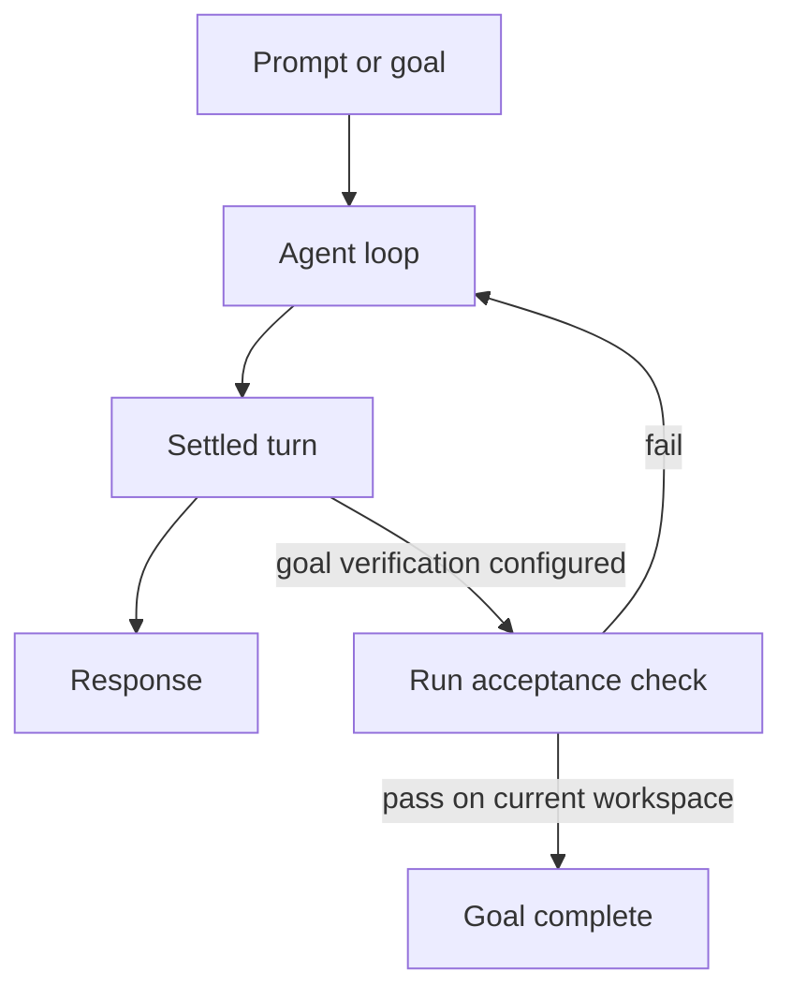
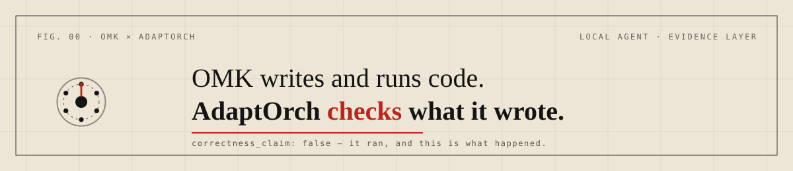

<h1 align="center">OMK</h1>

<p align="center">
  <strong>Open Multi-Agent Kit</strong><br />
  Make “done” pass a check.
</p>

<p align="center">
  An open-source multi-agent coding CLI for your terminal: switch models in one
  session and finish a goal only when your test passes.
</p>

<p align="center">
  <a href="https://www.npmjs.com/package/open-multi-agent-kit"></a>
  <a href="https://www.npmjs.com/package/open-multi-agent-kit"></a><br />
  <a href="https://github.com/dmae97/omk/releases/latest"></a>
  <a href="https://github.com/dmae97/omk/actions/workflows/ci.yml"></a>
  <a href="https://github.com/dmae97/omk/stargazers"></a><br />
  <a href="LICENSE"></a>
  
  <a href="https://discord.gg/zgCX5uRy4"></a>
</p>

<p align="center">
  <a href="#60-second-start">60-second start</a> ·
  <a href="#quick-start">Quick start</a> ·
  <a href="#what-runs-by-default">Default or opt-in?</a> ·
  <a href="#context-cache-and-memory">Context &amp; memory</a> ·
  <a href="#evidence-and-limits">Evidence and limits</a><br />
  <a href="#faq">Choosing OMK</a> ·
  <a href="packages/coding-agent/docs/index.md">Documentation</a> ·
  <a href="https://discord.gg/zgCX5uRy4">Discord</a>
</p>

<!-- Community PR authors: non-owner, non-bot accounts with a pull request directly in dmae97/omk.
     Include open, merged, and closed PRs; keep the profiles in alphabetical order. -->
<h2 align="center">Built with our community</h2>

<p align="center">
  Thank you to everyone who has opened a pull request directly in OMK.<br />
  Your time, ideas, and care help this project grow.
</p>

<table align="center">
  <tr>
    <td align="center"><a href="https://github.com/2409324124"><br /><sub><strong>2409324124</strong></sub></a></td>
    <td align="center"><a href="https://github.com/Abhinav3499"><br /><sub><strong>Abhinav3499</strong></sub></a></td>
    <td align="center"><a href="https://github.com/AndreIsraelAO"><br /><sub><strong>AndreIsraelAO</strong></sub></a></td>
    <td align="center"><a href="https://github.com/anhnt256"><br /><sub><strong>anhnt256</strong></sub></a></td>
    <td align="center"><a href="https://github.com/AnushreeKasturi"><br /><sub><strong>AnushreeKasturi</strong></sub></a></td>
    <td align="center"><a href="https://github.com/dannyward630"><br /><sub><strong>dannyward630</strong></sub></a></td>
  </tr>
  <tr>
    <td align="center"><a href="https://github.com/HangMine"><br /><sub><strong>HangMine</strong></sub></a></td>
    <td align="center"><a href="https://github.com/imsurya26"><br /><sub><strong>imsurya26</strong></sub></a></td>
    <td align="center"><a href="https://github.com/laozhej"><br /><sub><strong>laozhej</strong></sub></a></td>
    <td align="center"><a href="https://github.com/lj1166"><br /><sub><strong>lj1166</strong></sub></a></td>
    <td align="center"><a href="https://github.com/Muhtasim-Munif-Fahim"><br /><sub><strong>Muhtasim-Munif-Fahim</strong></sub></a></td>
    <td align="center"><a href="https://github.com/nova-loop"><br /><sub><strong>nova-loop</strong></sub></a></td>
  </tr>
  <tr>
    <td align="center"><a href="https://github.com/pemalama12"><br /><sub><strong>pemalama12</strong></sub></a></td>
    <td align="center"><a href="https://github.com/Shellghostt"><br /><sub><strong>Shellghostt</strong></sub></a></td>
    <td align="center"><a href="https://github.com/shishir2305"><br /><sub><strong>shishir2305</strong></sub></a></td>
    <td align="center"><a href="https://github.com/shoaibriazdev"><br /><sub><strong>shoaibriazdev</strong></sub></a></td>
    <td align="center"><a href="https://github.com/Sudhakar7J"><br /><sub><strong>Sudhakar7J</strong></sub></a></td>
    <td align="center"><a href="https://github.com/Unluckyathecking"><br /><sub><strong>Unluckyathecking</strong></sub></a></td>
  </tr>
</table>

<p align="center">
  <sub>Open, merged, and closed pull requests · <a href="https://github.com/dmae97/omk/pulls?q=is%3Apr">Explore OMK pull requests</a></sub>
</p>

---

| **CONTROL** | **CHOICE** | **EVIDENCE** |
| :--- | :--- | :--- |
| Keep the work in your terminal and repository. | Switch providers and models in one session. | Define a check before a goal can complete. |

OMK is a lightweight, MIT-licensed AI coding agent for your terminal, written in
TypeScript. Switch models in one session, add subagents when you need them, and
mark a goal done only when your own check passes. It is a standalone CLI, so it
can serve as an open-source alternative to a single-provider agent such as
Claude Code.

## 60-second start

You need Node.js 22.19 or newer and a git repository that has a test command.

```bash
npm install -g open-multi-agent-kit --ignore-scripts
cd your-project
omk
```

On the first run OMK opens `/login` (subscription, API key, or local model).
Then, inside OMK, give it a goal and name the check:

```text
/goal Fix the failing test without changing its assertions.
/goal verify npm test
```

OMK asks you to approve the command, runs it, and runs it again after each
settled turn. The goal completes only when it exits 0. Swap `npm test` for your
project's own check.

No global install? Run `npx --ignore-scripts open-multi-agent-kit`. The
standalone binary and the setup details are in [Quick start](#quick-start).

<!-- TODO: terminal demo GIF goes here (install, `omk`, a `/goal verify` run passing).
     Record a real session; do not use a mock-up. -->

## Why OMK

An AI saying “done” is not an acceptance check. With `/goal verify`, you choose
the command that checks your goal. OMK runs it after each settled turn and
completes the goal only when it passes on the current workspace. A later edit
makes that evidence stale. The result is only as strong as the check you choose.

```text
/goal Fix the failing test without changing its assertions.
/goal verify node --test check.test.mjs
```

Use a test that exists in your project, or follow the
[small, reproducible goal demo](packages/coding-agent/docs/goal-demo.md).
This is an explicit workflow; ordinary prompts do not enable the gate.

Choose a model, work on your repository, then switch models with `/model` when
another one suits the next step. The conversation stays in the same session.
You can also stop and return later with `/resume` or `omk -c`.

OMK is a standalone CLI, not a plugin for Claude Code or OpenCode. It supports
[subscription providers, API keys, and local models](packages/coding-agent/docs/providers.md).
Start with one agent that reads files, edits code, and runs commands. Add
subagents or explicit verification workflows when you need them; neither is
required for your first task.

### At a glance

- **Done means a passing check.** `/goal verify <command>` completes a goal only when your check passes on the current workspace.
- **One session, many models.** Switch with `/model` mid-conversation; resume later with `/resume` or `omk -c`.
- **Sandboxed by default.** Built-in bash runs under `sandbox-exec` or `bwrap`, without network, and fails closed.
- **Opt-in power.** Subagents, MCP servers, skills and extensions load only when you configure them.
- **Honest evidence.** Claims below link to the docs that back them, and the limits are stated next to them.



The loop uses your selected model and available tools. Subagents, MCP, skills,
and extensions depend on your configuration.

## Quick start

Install from npm (Node.js 22.19 or newer), then start in your repository:

```bash
npm install -g open-multi-agent-kit --ignore-scripts
cd your-project
omk
```

Or run `npx --ignore-scripts open-multi-agent-kit` without a global install.

Or install the standalone binary, which needs no Node.js (macOS, Linux):

```bash
curl -fsSL https://github.com/dmae97/omk/releases/latest/download/install.sh | sh
```

The script checks the download against the release's `SHA256SUMS` and installs
to `~/.omk/bin`; add that folder to your `PATH` as it tells you. Windows builds
are attached to each [release](https://github.com/dmae97/omk/releases/latest).

1. On a first run OMK opens `/login` for you: sign in with a subscription or an
   API key. An existing Claude Code or Codex CLI login can be reused with
   `omk provider adopt`.
2. Run `/model` to choose another available model at any time.
3. Try a read-only first task:

```text
Summarize this repository and identify the commands used to check it.
Read the project configuration to support your answer. Do not edit files.
```

After the reply, use `/model` to choose another configured model and ask it to
review the answer. You stay in the same session. This is manual model switching,
not parallel agents or an independent correctness check.

Ready to see a test-backed goal? Try the [goal demo](packages/coding-agent/docs/goal-demo.md),
then share your result or a reproducible failure in a
[GitHub issue](https://github.com/dmae97/omk/issues). If this workflow is useful,
[star OMK](https://github.com/dmae97/omk) to help other developers find it.

For a bug fix, name the failing behavior and ask for a regression test, the
smallest fix, and the check commands with their exit codes. Review the diff and
those results yourself; a request to run tests does not enable a verification
gate.

Built-in local bash requires `sandbox-exec` on macOS or `bwrap` plus
unprivileged user namespaces on Linux (`sudo apt install bubblewrap` on Debian
and Ubuntu). It blocks network access and fails closed if the backend is missing.
`omk doctor` checks the runtime, credentials, the model a first session would
pick, and the sandbox, and prints the fix for this machine. See
[Bash sandbox setup](packages/coding-agent/docs/sandbox-setup.md), the
[safety boundary](#verification-boundary) and the
[full quickstart](packages/coding-agent/docs/quickstart.md).

## What runs by default

A fresh install starts one agent/tool loop after provider setup. It does not
turn each prompt into a multi-agent workflow or automatically certify its
answer.

| Capability | Fresh-install behavior | Where to start |
| --- | --- | --- |
| File editing, shell commands, saved sessions | Built in; tools run when called by the agent | [Usage](packages/coding-agent/docs/usage.md), [sessions](packages/coding-agent/docs/sessions.md) |
| Tool-call scheduling | `dag-v2` schedules resource conflicts within the agent loop; it does not launch a team | [Runtime algorithms](packages/coding-agent/docs/runtime-algorithms.md#tool-scheduling-and-settlement) |
| Subagents | Optional extension; load it and supply agent definitions | [Subagent setup and examples](packages/coding-agent/examples/extensions/subagent/README.md) |
| MCP servers, extra skills and extensions | Require configured servers or installed resources | [MCP](packages/coding-agent/docs/mcp.md), [skills](packages/coding-agent/docs/skills.md), [extensions](packages/coding-agent/docs/extensions.md) |
| Durable goals | Built in; `/goal <objective>` continues after each settled turn, up to 8 rounds. With `/goal verify <command>` the goal completes only when that check passes on the current workspace | [Acceptance checks](packages/coding-agent/docs/run-protocol.md#acceptance-checks) |
| Protocol verification and advisory judging | Explicit API/workflow opt-in; not a gate on ordinary prompts | [Run protocol](packages/coding-agent/docs/run-protocol.md) |
| Verified runs (`omk run`) | Opt-in CLI and SDK on Linux with `bwrap`; runs an approved command in an isolated copy, checks the result, and supports resume, cancel and cleanup | [Verified run](packages/coding-agent/docs/verified-run.md) |
| Context budgeting | Off by default | [Settings](packages/coding-agent/docs/settings.md#context-budget) |
| AdaptOrch integration | Optional and separate; no service calls by default | [OMK + AdaptOrch](#omk--adaptorch) |

The internal lane launcher and automatic command-sharding primitives are not
connected to the default CLI path. Installing their packages is not the same
as enabling an orchestration workflow.

## Context, cache and memory

OMK manages several distinct resources. A prompt-cache boundary, a local cache,
and the process's RAM are not the same thing; provider cache hits and costs
depend on the provider and the request.

| Layer | What OMK does | Default and scope |
| --- | --- | --- |
| **Prompt prefix** | Preserves the cache boundary when an extension changes only the dynamic tail and the prefix matches byte for byte. | On by default; this does not guarantee a provider cache hit. [`OMK_PREFIX_BOUNDARY`](packages/coding-agent/docs/environment-variables.md) |
| **Context Budget V2** | Reserves response and safety space, keeps required items, and selects representations of optional context that fit. | Off by default; enable globally or for a process. [Context selection](packages/coding-agent/docs/runtime-algorithms.md#context-selection) |
| **Local context cache** | Reuses eligible representation and negative-result entries; cached plans stay in session memory. | Only when Context Budget V2 is enabled. Representations persist per workspace by default; a memory-only option is available. [Settings](packages/coding-agent/docs/settings.md#context-budget) |
| **Session history** | Compaction can summarize earlier context; saved sessions support resume. | Compaction and its settings are separate from persistent knowledge and provider-side caches. [Sessions](packages/coding-agent/docs/sessions.md) |
| **Host resources** | The resource governor can observe host capacity and admission decisions. | `observe` is the default; adaptive throttling requires configuration. [Resource governor](packages/coding-agent/docs/settings.md#resource-governor) |

For one process, opt into context budgeting and keep its cache in session memory:

```bash
OMK_CONTEXT_GOVERNOR=1 OMK_CONTEXT_GOVERNOR_CACHE=memory omk
```

Memory-only changes where entries are kept; it is not a guarantee of lower RAM
use. Cache effectiveness, memory use, latency and cost depend on the workload.
Measure them before claiming an improvement; [turn metrics](packages/coding-agent/docs/metrics.md)
show what can be recorded.

## Evidence and limits

One dated comparison is available below: OMK and mini-SWE-agent on
Terminal-Bench 2.1 with the same base model. The observed success-rate
difference is not statistically significant, and the time budgets differed.
It does not establish overall harness superiority, multi-agent gains, or how
much verification reduces false completion.

OMK targets state-of-the-art quality as a CLI coding-agent harness.
SOTA is not verified.

The evidence you can inspect today covers specific failure modes:

| Behavior covered | Regression evidence | Scope |
| --- | --- | --- |
| Missing test observations produce `inconclusive`; a required failing test produces `fail` | [Protocol tests](packages/protocol/test/protocol.test.ts) | Explicit protocol evaluation, without a waiver |
| Changed artifacts, wrong command bindings, or missing ledger evidence block acceptance | [Evidence binding tests](packages/coding-agent/test/evidence-gate-binding.test.ts) | Strict evidence gate and selected workspace scope |
| A relevant workspace mutation after verification makes the receipt stale | [Freshness tests](packages/coding-agent/test/evidence-freshness.test.ts) | Configured receipt and mutation tracking |
| A durable goal with an approved acceptance check completes only on a passing receipt, and an edit after the check makes that receipt stale | [Goal acceptance tests](packages/coding-agent/test/goal-controller-acceptance.test.ts), [live loop tests](packages/coding-agent/test/suite/goal-acceptance-loop.test.ts) | Approval held by the running OMK process; git work tree; static command lines |
| An effect that may still be live keeps its resource claims through expiry, cancellation and authority restart, until a supervisor confirms termination | [Coordination broker tests](packages/coding-agent/test/coordination-broker.test.ts) | In-process broker with canonical claim keys; no OS fencing |
| A publication is refused unless its read versions, parent revision and receipt binding all still match | [Publication tests](packages/coding-agent/test/coordination-integration.test.ts) | Single accepted snapshot pointer; no multi-file filesystem atomicity |
| Cancellation after dispatch is never reported as cancelled-before-dispatch; the outcome stays unknown until settled | [Operation lifecycle tests](packages/coding-agent/test/coordination-operation.test.ts) | Pure state machine; does not itself stop a remote effect |
| Zero trials is reported as absent evidence rather than zero risk, and a point estimate is not an error rate | [Risk bound tests](packages/coding-agent/test/metacognition-risk.test.ts) | Binomial model under a fixed policy and adequately independent samples |

These tests exercise the gates, not the rate at which they catch real bugs.
An ordinary prompt finishes when its tool loop and queued work settle;
`prompt_settled` is not a correctness verdict.

A useful comparison must hold the model, provider configuration, tasks, budget,
and tool permissions constant, and label default versus opt-in workflows.
Report task success, cost, latency, and false completion (reported complete but
failing the declared checks), with its denominator and per-task outcomes.
The [measurement protocol](packages/coding-agent/docs/metrics.md#controlled-comparison-contract)
defines the reproducibility and privacy requirements. `omk stats` shows local
turn costs and tool failures; it does not score task correctness.

If you evaluate OMK, share a sanitized report and reproduction steps in a
[GitHub issue](https://github.com/dmae97/omk/issues). Include failed and
interrupted runs, not just successful examples.

### Terminal-Bench 2.1 · R8

| Self-measured result | OMK evaluation build | mini-SWE-agent 2.4.6 |
| --- | ---: | ---: |
| Observed success | 75.8% (200/264) | 71.6% (189/264) |
| Recorded cost per trial | $0.581 | $0.759 |
| Median wall time per trial | 482 s | 376 s |

**75.8% observed success · approximately 23% lower recorded model cost per
graded trial.** OMK took longer: 482 s median, compared with 376 s for
mini-SWE-agent. Both used xAI `grok-4.7` at reasoning effort `xhigh` in a
2026-10-05–06 KST run of 89 tasks, with 3 trials per task per harness.

The +4.2 percentage-point success difference is **not statistically significant**
(95% task-level paired-bootstrap CI: −1.9 to +10.2 pp). OMK alone had **150 s
extra per trial** for snapshots, so the time budgets were unequal. This result
covers the **1.3.0 evaluation build `78cc483`**, including unmerged changes,
rather than the published npm package. It is not an official leaderboard result.

<details>
<summary>Benchmark data and evaluation limits</summary>

| Harness | Success rate (88 tasks × 3 trials) | Cost per trial (all 267 trials) | Median wall time per trial (all 267 trials) |
| --- | --- | --- | --- |
| OMK | 75.8% (200/264) | $0.581 | 482 s |
| mini-swe-agent 2.4.6 | 71.6% (189/264) | $0.759 | 376 s |

- The difference is +4.2 percentage points with a 95% confidence interval of
  [−1.9, +10.2] (task-level paired bootstrap). The interval includes zero, so
  this is **not** a statistically significant improvement.
- OMK cost about 23% less per trial but was slower: 482 s median per trial
  against 376 s.
- Audit corrections: trials that tried to read Terminal-Bench sources or
  answers score 0, which turned 4 mini-swe-agent passes and 1 OMK pass into
  failures.
  `prove-plus-comm` is excluded from both sides because our OMK adapter failed
  to start in that task's working directory. Two transient provider errors were
  retried; no trial was excluded.
- OMK failed all three `pytorch-model-recovery` trials because the CLI rejected
  an instruction starting with a dash and a space (fixed in #84). Without that
  task the difference is +5.4 pp [0.0, +10.7].
- Not a leaderboard run: 3 trials instead of the official 5, our own network
  allowlist and apt cache proxy, and OMK alone had 150 s extra for a workspace
  snapshot used in rescoring.

- Costs count only the graded attempt, excluding prior failed retry attempts and
  42 auxiliary model calls made by code inside one mini-SWE-agent task. They are
  not total experiment spend.

Method, per-difficulty results, audit and reproduction notes:
[Terminal-Bench 2.1 report](packages/coding-agent/docs/benchmarks/r8-terminal-bench-2.1.md).

</details>

[Editable figure](readmeasset/omk-terminal-bench-r8.svg) · [Original report review](https://github.com/dmae97/omk/pull/86)

## OMK//CONTROL

The terminal UI shows the selected model, tools, and session status. Additional
signals depend on the integrations you configure.

| In the terminal | What it shows |
| --- | --- |
| Model | Selected provider and model |
| Tools | Available tools and their activity |
| Session | Status and the current conversation |

The header reads `omk v<package.version> · OMK//CONTROL`; the installed package
version is the source of truth.

## Control loop

<details>
<summary>How scope, routing, verification, and replay fit together</summary>

OMK's provider-neutral coding-agent CLI also exposes a multi-agent control
plane for explicitly configured workflows. The stages describe that design,
not what every prompt automatically runs.

| **01 SCOPE** | **02 ROUTE** | **03 VERIFY** | **04 REPLAY** |
| --- | --- | --- | --- |
| Define the task and boundaries. | Choose models and configured tools. | Run the declared checks. | Retain state and evidence for recovery. |

The v0.98.3 SDK rejects incomplete first-party judge responses and exposes
deterministic ties; it is not an automatic TUI judge.

1. Scope the goal, paths, resources, and acceptance predicates. A selected
   orchestration workflow may also supply a DAG; an ordinary prompt remains
   one agent/tool loop.
2. Route work to models, agent skills, MCP tools, and extensions without
   changing the evidence contract.
3. Verify declared checks in explicit evidence workflows. Required failing
   checks block those workflows; advisory judging cannot replace them.
4. Preserve receipts and replay state for bounded session recovery; continue
   durable goals from explicit reducer state.

</details>

## Verification boundary

`AgentSession` built-in local bash uses OS sandbox enforcement by default:
`sandbox-exec` on macOS and `bwrap` plus unprivileged user namespaces on Linux.
Local shell spawns restrict writes to the workspace and OS temporary directory,
disable network access, and fail closed with `sandbox.backend_missing` when an
enforcement backend is unavailable.

This is **not** read-confidentiality or whole-process containment. Other file
tools, extension and custom-tool code, injected or remote `BashOperations`, and
the OMK process keep the permissions of the process running them. Use
[containerization](packages/coding-agent/docs/containerization.md) when the
boundary must cover more than built-in local bash. Explicit evidence workflows
cannot treat missing required evidence as a verified result.

## Providers

<details>
<summary>Provider integrations and published packages</summary>

OMK keeps routing separate from control and evidence. Codex, Claude Code,
OpenCode Zen/Go, Kimi, GLM/ZAI, native xAI/Grok, NVIDIA NIM, and local providers
can participate through `omk-ai` while the run contract stays stable.

Native `xai` keeps subscription OAuth and `XAI_API_KEY` billing separate. See
[provider setup](packages/coding-agent/docs/providers.md),
[provider resilience](packages/coding-agent/docs/provider-resilience.md), and
[Grok integration](packages/coding-agent/docs/grok-harness.md).

## Published packages

| Package | Purpose |
| --- | --- |
| [`open-multi-agent-kit`](packages/coding-agent) | Interactive coding-agent CLI and control plane |
| [`omk-agent-core`](packages/agent) | Agent runtime, tool execution, and DAG scheduling |
| [`omk-ai`](packages/ai) | Unified multi-provider LLM API |
| [`omk-protocol`](packages/protocol) | Versioned run contracts and semantic reducers |
| [`omk-adaptorch-wpl`](packages/adaptorch-wpl) | Work Packet Loop runtime |
| [`omk-book-to-skill`](packages/book-to-skill) | Optional document-to-skill compiler |
| [`omk-tui`](packages/tui) | Differential-rendered terminal UI library |

```bash
npm install omk-agent-core
npm install omk-ai
npm install omk-protocol
omk install npm:omk-book-to-skill@0.98.3
npm install omk-tui
```

</details>

## Repository understanding

<details>
<summary>Optional indexes, retrieval settings, and trust limits</summary>

`v0.97.0` shipped the OpenWiki policy and workflow, but no versioned corpus or
integrity checker. The following integrity/output guards shipped in v0.98.0;
the generated corpus remains optional and is not bundled:

- **`openwiki/`** — absent. The previous untracked corpus was removed after the
  hardened gate proved it carried fabricated evidence: 8 frontmatter symbols
  that no declared source path defines (`AgentLoop`, `getModel`, `DeepWall`,
  `loadExtensions`, `createExtensionRuntime`, `main`), 45 references to `@omk/*`
  package names this repository does not publish, and a
  restatement of this README's `Scope -> Route -> Verify -> Replay` loop as a
  strict engine state machine, which is not what the source implements.
  CI regenerates the corpus; nothing is lost.
- **`scripts/check-openwiki.mjs`** — shipped integrity checker. An `interrupted` corpus
  now fails unless `openwiki/.manual-review.json` binds a review to the exact
  corpus digest, and every frontmatter symbol must bind to one of that page's
  own `source_paths` as a whole identifier.
- **`scripts/check-openwiki-output.mjs`** — output gate. The scheduled workflow
  may write, upload, and open a PR for `openwiki/` and nothing else, so a model
  reading this repository cannot reach `AGENTS.md`, `CLAUDE.md`, or the workflow
  that runs it. The gate runs once before the artifact leaves the read-only
  generating job and again before the PR, because the publishing job holds write
  permissions the first one does not.
- **`.understand-anything/`** — optional local structural graph used by Pi Lens;
  it is not published or injected into prompts by default. To reach a session,
  attach it through OMK's [MCP client](packages/coding-agent/docs/mcp.md) like
  any other server; there is no second, bespoke path for it.

Source and tests remain authoritative. Shipped guards do not turn a generated
index into authority: treat corpus pages as local advisory data and recheck source.

### Retrieval

A corpus no session can read is documentation of a plan, not a feature, so the
pages are now candidates for prompt budgeting. Enable `contextBudget.openwiki`
alongside `contextBudget.enabled`
([settings](packages/coding-agent/docs/settings.md#repository-wiki-retrieval))
and each page becomes a low-priority `evidence` item ranked against the turn's
query. Pages compete for leftover budget and can never displace instructions or
skills; most turns carry titles and declared symbols alone, and a page's text
arrives only when the query earns it.

Admission mirrors `scripts/check-openwiki.mjs` rather than restating it. A
complete corpus at the current `HEAD` offers page text; one whose `HEAD` has
moved offers titles only and is marked stale; an interrupted corpus is refused
unless a review binds to its exact digest. The default is off, and with the
setting off the prompt is byte-identical to one built without a corpus.

</details>

## Prior art

<details>
<summary>Research references, not OMK benchmark results</summary>

The design decisions behind OMK's context, routing, memory, and orchestration
layers are grounded in published work rather than invented in isolation. Each
row below was retrieved and read directly; claims are at abstract level, which
is the evidence grade this table asserts and no more.

| Paper | Mechanism it establishes | OMK implementation or design reference |
| --- | --- | --- |
| [arXiv:2608.22752](https://arxiv.org/abs/2608.22752) — *The Compaction Cliff in Long-Running AI Agent Memory* | Uniform summarization erodes rules and episodic logs at the same rate; measured safety-rule retention falls to 53% after one compaction and 10% after five. Type-tagged deterministic operators fix it. | Type-aware compaction triage: rule-typed items survive N rounds byte-identical |
| [arXiv:2608.23023](https://arxiv.org/abs/2608.23023) — *Most of the LLM Routing Gap Is Task Type* | Most routing gain is reachable with a fixed task-type table; run-to-run flips must not be credited as wins. | Frozen task-class table plus the 2-run stability rule in the promotion gate |
| [arXiv:2506.16655](https://arxiv.org/abs/2506.16655) — *Arch-Router: Aligning LLM Routing with Human Preferences* | Indirection: a classifier emits a label, a policy table maps label to decision, so models change without retraining. | `classifyTaskV4` plus `TASK_CLASS_THINKING_LEVELS` |
| [arXiv:2605.09894](https://arxiv.org/abs/2605.09894) — *Deterministic vs. LLM-Controlled Orchestration* | Holding model, prompts, and tools constant and varying only execution control, deterministic orchestration matched accuracy, improved worst-case robustness, and cut tokens up to 3.5x. | Deterministic scheduler and planned lanes; execution control is never delegated to the model |
| [arXiv:2608.15565](https://arxiv.org/abs/2608.15565) — *Admission Without Answers* | Label-free admission on execution success alone admits substantial contamination; an accept/abstain/escalate decision is required. | Verified-memory admission design (spec 019), abstain is not stored |
| [arXiv:2608.23471](https://arxiv.org/abs/2608.23471) — *InjecMEM: Memory Injection Attack on LLM Agent Memory Systems* | Single-interaction memory injection is a reproduced attack frame against agent memory. | Retrieved memory is injected only as provenance-tagged data, never fused into instruction position |

Entries include implemented mechanisms and design proposals; check the
[runtime status guide](packages/coding-agent/docs/runtime-algorithms.md) for
availability. The wider survey, including approaches not adopted, is working
material that is not published with the repository.

</details>

## Documentation

- [Documentation index](packages/coding-agent/docs/index.md)
- [Usage](packages/coding-agent/docs/usage.md)
- [Turn metrics and harness evaluation](packages/coding-agent/docs/metrics.md)
- [Providers and models](packages/coding-agent/docs/providers.md)
- [Automation and SDK](packages/coding-agent/docs/sdk.md)
- [Run protocol](packages/coding-agent/docs/run-protocol.md)
- [Runtime algorithms and direction](packages/coding-agent/docs/runtime-algorithms.md)
- [Specification index](specs/README.md)
- [Sessions and recovery](packages/coding-agent/docs/sessions.md)
- [Security](packages/coding-agent/docs/security.md)
- [Containerization](packages/coding-agent/docs/containerization.md)
- [Public skill catalog](SKILLS.md)
- [Changelog](packages/coding-agent/CHANGELOG.md)
- [Release notes for v1.5.13](.github/RELEASE_NOTES_v1.5.13.md)
- Latest public release: [GitHub Releases](https://github.com/dmae97/omk/releases/latest). The source-version notes linked above can describe a candidate until its tag workflow completes.

## Development

```bash
npm ci --ignore-scripts
npm run build
npm run check
npm test
npm run release:local
```

Direct dependencies are pinned, CI installs with `--ignore-scripts`, and the
published CLI includes a generated `npm-shrinkwrap.json`. Read
[CONTRIBUTING.md](CONTRIBUTING.md) and the
[development guide](packages/coding-agent/docs/development.md) before sending a
change.

## FAQ

### What is OMK?

OMK (Open Multi-Agent Kit) is an open-source coding agent CLI for the terminal.
It reads files, edits code, and runs commands in your repository. You can switch
models inside one session, add subagents when a task needs them, and use
`/goal verify` so a goal only counts as done when your chosen check passes. It
is MIT-licensed and written in TypeScript.

### How do I install OMK?

With Node.js 22.19 or newer, run
`npm install -g open-multi-agent-kit --ignore-scripts`, then `omk` in your
project. Without Node.js, use the standalone installer on macOS or Linux:
`curl -fsSL https://github.com/dmae97/omk/releases/latest/download/install.sh | sh`.
See [Quick start](#quick-start).

### Why use OMK instead of Claude Code?

Use it for provider choice within one CLI session, or to build workflows
against its public runtime and evidence APIs. For a single-provider workflow,
your current agent may be sufficient. Try the [read-only task above](#quick-start)
before moving existing work.

### How is this different from OpenCode with plugins?

OMK is a separate runtime with its own CLI, sessions, tool scheduler, and SDK.
One reason to choose it is to build your own acceptance workflow: define
required test observations in the [run protocol](packages/coding-agent/docs/run-protocol.md),
then have your automation reject `fail` or `inconclusive` results. Receipt
integrity and freshness still need their own configured checks.

For adding a tool or prompt to an existing OpenCode setup, a plugin may be the
smaller change. OMK's protocol is opt-in, not proof of better performance.

### Does multi-agent mean better results or automatic verification?

Not automatically. Subagents require setup, and verification must be part of
the chosen workflow. Its result covers the declared checks, not all behavior. See
[what runs by default](#what-runs-by-default) and [evidence and limits](#evidence-and-limits).

## Recent releases

<details>
<summary>Release notes and historical corrections</summary>

> Historical correction: the immutable v0.97.0 notes below announced a
> versioned OpenWiki corpus, but that release still ignored `/openwiki/` and did
> not contain the corpus or checker. See the current repository-understanding
> section above for the shipped guards and optional-corpus boundary.

<!-- releases:start -->

## Release v1.5.13

### Added

- `AuthStorageBackend.withRefreshLock(key, fn)` is an optional backend method that serializes one provider's token refresh across the processes sharing the backend. `FileAuthStorageBackend` and `InMemoryAuthStorageBackend` implement it; a custom backend without it runs refreshes unserialized (#408).
- `AuthStorage.getApiKey(provider, { background: true })` and `ModelRegistry.getApiKeyForProvider(provider, { background: true })` mark a caller nobody is waiting on, such as polling. Such a call skips an OAuth refresh that failed recently instead of repeating it (#409).

### Fixed

- An account rate limit no longer spends the whole retry budget in 14 seconds. A 429 or `rate_limit_error` that is not quota exhaustion and carries no `Retry-After` hint now waits 8 times the configured backoff per attempt, capped at 60 seconds, minus up to 25% jitter so sessions throttled together do not retry together. With `retry.baseDelayMs: 2000` and `retry.maxRetries: 3` the retries span 81 to 108 seconds instead of 14. A `Retry-After` hint, a retry on a route OMK just switched to and `retry.baseDelayMs: 0` behave as before. See [rate limits and credential retries](packages/coding-agent/docs/provider-resilience.md#rate-limits-and-credential-retries).
- Compaction and branch-summary calls wait out a rate limit the same way, and honor a `Retry-After` hint in the error text (capped at 60 seconds). They used the plain 2, 4 and 8 second backoff.
- A request whose stored OAuth login could not be resolved (the token endpoint was unreachable, or another session held the credential store) is retried within the normal retry budget instead of ending the turn. No request and no other key is sent for the failed attempt; if the login never resolves, the turn ends with the message naming `/login <provider>`. When the token endpoint refuses the refresh (HTTP 400 or 401, `invalid_grant`), the turn ends at once with that message, because the refresh token is dead. A credential the provider rejected is still not retried.
- A logged-in session no longer sends the `models.json` provider key when its stored OAuth login cannot be resolved. With `anthropic.apiKey: "$ANTHROPIC_API_KEY"` and a dead key in the environment, a request that could not take the credential lock used to go out with that key and end the turn with `401 invalid x-api-key`. An unexpired stored token is now used as it is, and an unresolved login is reported as an authentication failure (#407).
- Sessions sharing `auth.json` no longer wait on each other's OAuth refresh. The refresh request runs outside the credential store lock, under a per-provider refresh lock, so an expired token is still refreshed once; the store lock is held only to read and to write, and is taken without yielding the event loop. The Kimi refresh request gets the 30 second timeout the other providers use (#408).
- The usage rail no longer sends a token request every minute for a login that cannot refresh. A failed OAuth refresh is remembered per provider for the refresh token that was tried, and usage polling waits before trying that token again: one minute, doubling with each consecutive failure up to thirty minutes. A request you are waiting on always tries, and a new login or another account is tried at once. Each session remembers this for itself (#409).

Release notes live in [RELEASE_NOTES_v1.5.13.md](.github/RELEASE_NOTES_v1.5.13.md).

## Release v1.5.12

### Changed

- The bundled subagent extension gives every effort, including Ultra, finite limits per tool call: concurrent workers, logical tasks and a default execution budget of 1 / 4 / 2 min (off, minimal), 1 / 4 / 3 min (low), 2 / 6 / 4 min (medium), 2 / 8 / 6 min (high and unknown), 3 / 8 / 8 min (xhigh), 4 / 12 / 10 min (max) and 4 / 16 / 14 min (ultra). Ultra no longer removes the task, concurrency, internal deadline or outer tool-timeout caps; the outer timeout is 855 seconds. Host admission and permits can narrow these further. These are engineering limits, not measured latency or memory results. See [subagent execution budgets](packages/coding-agent/docs/subagents.md) (#403).
- Outside Ultra, the subagent extension used to run up to 4 workers at once, accept 8 parallel or graph tasks and default to a 14 minute budget at every effort. Concurrency is now 1 at low and below and 2 at medium and high, the task limit also applies to `chain` calls, and the default budget follows the effort. A call over the task limit is rejected before any worker starts. An explicit `executionBudgetMs` (60,000 to 840,000) still replaces the default budget (#403).
- Subagent workers receive the parent's effort as `--thinking`; the worker clamps it to its resolved model. When the host run has a deadline, worker budgets leave 30 seconds for the lead's integration and verification, and the remaining time is checked again immediately before each spawn. With no capacity left the call returns an incomplete result instead of starting a worker (#403).
- Skill discovery decides whether a directory has `.gitignore`, `.ignore` or `.fdignore` from the directory listing it already read, instead of probing for the three files in every directory, and resolves paths with one native `realpath` call. The discovered skill set is unchanged (#394).

### Fixed

- Single and chain subagent launches now go through the same session lane authority as graph and parallel work. A worker whose process termination is unconfirmed keeps its child ownership and resource reservation; a timeout alone no longer marks it complete or lets a new dispatch bypass it (#403).
- Automatic skill loading checks the current retained context before skipping a body admitted earlier. A relevant body removed by compaction or branch navigation is loaded again in its existing admission slot; a body still present is not duplicated, and a changed body still needs a new slot. `skill-autoload.jsonl` records `contextChecked`, `contextAbsent` and `restoredFromHistory`. See [automatic skill loading](packages/coding-agent/docs/skills.md#automatic-loading-checks-the-current-context) (#402).
- After `mcpCheckHealth({ reconnectFailed: true })` reconnects a server, the session uses the replacement server's admitted tool catalog, including changed names and schemas, instead of handles bound to the closed connection. Disabled tool selections are kept, and a call made against the old connection is not replayed against the new one. See [native MCP attachment](packages/coding-agent/docs/mcp.md) (#401).
- An automatic failover or route rotation no longer becomes the saved default model. The switch is recorded in the session only, so the next session starts on the model you chose (#395).
- When the model a failover switched to rejects the request outright (for example `403 Access to model denied`, an authentication error or an unsupported model), OMK marks it failed for the turn and tries the next authenticated candidate instead of ending the turn there. With a `--model`/`--provider` pin, a denied candidate still ends the turn. See [provider resilience](packages/coding-agent/docs/provider-resilience.md#failover-behavior) (#395).

Release notes live in [RELEASE_NOTES_v1.5.12.md](.github/RELEASE_NOTES_v1.5.12.md).

## Release v1.5.11

### Added

- `OMK_ONTOLOGY_SHADOW=1` (experimental, default off) records a worktree-scoped comparison between native Context Budget selection and a bounded local metadata index. It requires active Context Budget, never changes prompt selection, and stores no raw prompts, queries, commands or absolute paths. See [ontology shadow index](packages/coding-agent/docs/ontology-shadow.md) (#379).
- META usage in the status rail: with a Meta OAuth login, OMK reads the current and weekly windows from the official Muse Code CLI (`muse serve` with writes and shell disabled, MSP `usage/read`, no prompt or model call). An unobserved host shows `no observed usage yet`, not 0%. See [providers](packages/coding-agent/docs/providers.md).
- `subscriptionUsageProviders` (global settings only) limits which subscription usage groups the status rail shows and requests. Omitted keeps every configured group; `[]` hides them all and makes no usage requests. A project settings file cannot change it, and an invalid value fails closed. See [settings](packages/coding-agent/docs/settings.md).
- `/rnode <runId> [--state-dir DIR]` binds a verified run read-only and shows its R·NODE graph (run, proof, feed, outcome axes, nodes by dependency depth) in the pinned status sidebar, under RUN and VERIFY, or in the expanded control pane. It never executes, retries or approves, and never appears in the scrollback header. When rows run short it drops the outcome-axis rows before any node. See [R·NODE](packages/coding-agent/docs/rnode-tui.md).
- `OMK_TMUX_STATUS_RAIL=1` (opt-in, already inside tmux) moves the pinned status rail into a separate 40-column tmux pane, so the chat and editor keep their own terminal, cursor and scrollback. `Ctrl+Q` hides or restores it; the pane scrolls with `PageUp`/`PageDown`, arrows, `j`/`k` and `g`/`G` without sending input to the agent. Terminals narrower than 114 columns, a failed split or a closed viewer keep the native layout, and OMK removes only its own pane and temporary frames. See [tmux status pane](packages/coding-agent/docs/tui.md#isolated-tmux-status-pane).
- `omk explore <question>` searches the current workspace read-only and prints a JSON evidence pack of file paths and line ranges instead of whole files. It uses ripgrep when available and a Node directory walk otherwise, reads within a fixed budget, and reports what it skipped in `coverage.notVisited` and `budget.truncated`. See [explorer](packages/coding-agent/docs/explorer.md) (#316).
- `omk run graph RUN_ID` and the SDK's `readRunGraph()` print one read-only `omk.run-graph.v1` snapshot of a verified run's ledger and authority state. They never execute, recover, publish or edit the ledger. Exit 0 means the read succeeded, not that the run passed; a bad argument exits 2 and a missing run or damaged evidence exits 1. See [run graph](packages/coding-agent/docs/run-graph.md) (#343).
- `/goal verify --reuse` skips the acceptance run when the passing receipt in the current goal generation still matches the workspace; `--force` or `--rerun` runs it anyway. A new approved command, a workspace change or an earlier failure always runs it. Plain `/goal verify` still runs every time. See [usage](packages/coding-agent/docs/usage.md#durable-goals) (#315).
- MCP startup failures now carry one of a fixed set of codes with a remediation hint: `mcp.spawn_not_found`, `mcp.spawn_permission_denied`, `mcp.spawn_failed`, `mcp.server_exited`, `mcp.request_timeout`, `mcp.invalid_initialize_result` and `mcp.unsupported_protocol`. The code comes only from Node spawn errors and exit metadata, never from server stderr or JSON-RPC payloads; other errors stay opaque (#326).

### Changed

- The Kimi quota read (`GET https://api.kimi.com/coding/v1/usages`) now sends `User-Agent: omk` and no `X-Msh-Platform`/`X-Msh-Version` headers, instead of identifying as Kimi CLI. This matches the other USAGE providers; the endpoint answers the same for OAuth and API-key credentials.
- The startup deck drops its own status column while the pinned status rail is on screen, so RUN, VERIFY, TODO and SESSION are no longer drawn twice side by side. Once the deck scrolls into scrollback it keeps its layout.
- The pinned status panel now renders with OpenTUI by default: an offscreen renderer process returns ANSI rows while `omk-tui` keeps terminal and input ownership. It shows model, run, verification, host CPU/RAM, context, usage, MCP, the session's `update_todo` progress, the running tool and a bound `/rnode` run first; `Ctrl+O` adds details. Set `OMK_OPENTUI_STATUS_RAIL=0` for the native sidebar; Node below 26.4, a missing optional `@opentui/core` and renderer failures or timeouts fall back to it. See [hybrid status panel](packages/coding-agent/docs/tui.md#hybrid-opentui-status-panel).
- The native status sidebar shows a SYSTEM block near the top: whole-host CPU and RAM meters, physical memory used/total, and a separate `omk` row for this process's CPU and RSS. Missing samples stay `?`/unavailable, the activity sparkline tracks host CPU, and the MCP roster gives up its rows to these meters on short terminals. See [pinned status resources](packages/coding-agent/docs/tui.md#pinned-status-resources).
- A custom footer set with `ctx.ui.setFooter` now owns the status slot: the pinned status rail steps aside while it is set, instead of hiding the extension footer. `footerData.getSubscriptionUsage()` gives extension footers the host's subscription usage snapshots through the rail's existing reader, with no second poller. See [custom footer](packages/coding-agent/docs/tui.md#pattern-6-custom-footer).
- The MCP client offers protocol `2025-11-25` and accepts servers that answer `2024-11-05`, `2025-03-26` or `2025-06-18`. Unknown revisions are still rejected (#326).
- MCP server labels that do not start with a letter now get an `mcp_` prefix in tool names, because Kimi's anthropic-messages endpoint rejects a whole request when any tool name starts with a non-letter. A server labeled `21st` now exposes `mcp_21st__search` instead of `21st__search`; update allow and deny lists that use the old name (#326).
- MCP `tools/call` results accept any JSON value in `structuredContent`, not only objects. This is looser than the MCP spec, which defines it as an object. NaN and Infinity, functions, undefined properties, accessor and non-plain objects, and nesting deeper than 100 levels are still rejected (#326).
- The bundled pstack skills and agents target OMK only. Delegation uses the `subagent` extension, model roles default to `inherit-parent` (the session model), and skill, transcript and model-settings paths live under `.omk/` and `~/.omk/agent/`. See [pstack](packages/coding-agent/docs/pstack.md) (#313).
- `glob` 14.0.3 and `minimatch` 11.0.3 replace 13.0.6 and 10.2.6 to resolve GHSA-3g3m-2fjr-6pw4 and GHSA-g3hv-75wg-m249, including the root override and the published shrinkwrap (#332).
- The npm `author` of `open-multi-agent-kit`, `omk-ai`, `omk-tui` and `omk-agent-core` is now Geunbin Yu, with Mario Zechner listed in `contributors`; the repository `NOTICE` records that OMK started as a fork of pi (#318).

### Fixed

- Failed `edit` calls now append bounded recovery hints: read ranges for indentation-only differences, original candidate positions for ambiguous matches, and an observation when the replacement text is already present. Failures still write nothing, including multi-edit calls; successful responses, run-log records, write permissions and match rules are unchanged. See [edit recovery](packages/coding-agent/docs/edit-recovery.md).
- The `edit` tool now rejects an `oldText` that matches at overlapping positions instead of replacing the first one. Replacing `aaa` in `aaaa` used to write `Za`; it now leaves the file unchanged and returns the existing `Found 2 occurrences ... Please provide more context to make it unique.` error. The same applies to CRLF, BOM and fuzzy-normalized matches and to each entry of `edits[]`, and the run-log failure class for these calls is now `multiple_matches`. Unique matches are unaffected.
- An extension component whose `render()` or `invalidate()` throws no longer breaks the TUI. The failed instance shows `Extension render failed` and is not called again; tool rows keep their raw result, custom messages keep their content, a failed custom editor restores the default editor, and failed custom UI rejects instead of leaving its tool pending. See [extensions](packages/coding-agent/docs/extensions.md#fallback).
- MCP servers that answer the handshake with protocol `2025-03-26` no longer fail to connect (#326).
- `open-multi-agent-kit`, `omk-ai`, `omk-tui`, `omk-agent-core`, `omk-protocol` and `omk-adaptorch-wpl` now ship the repository's MIT `LICENSE` in their npm tarballs; `omk-book-to-skill` keeps its own license (#320).

### Security

- Update `undici` from 8.12.3 to 8.12.4, including the fix for ASCII-whitespace integrity metadata bypass (GHSA-r4pc-4jcp-7pqc). The OMK dispatcher fetch now rejects mismatched hashes surrounded by tabs, line breaks, carriage returns or form feeds. Use the explicit npm implementation on Bun instead of its native shim, and preserve the method, headers and body of pre-created Requests across lazy installation. Cache/redirect-specific upstream advisories require the affected interceptors; this does not claim that every advisory was reachable in OMK or that updating npm undici changes Node's built-in fetch.
- Update `glob` to 14.0.4 and the direct/root-override `minimatch` pin to 11.0.5. Verify the published default ESM/CJS bundles as well as the external dependency tree; retain existing import paths, `brace-expansion` and TypeBox pins. No startup or per-worker memory reduction is claimed.

Release notes live in [RELEASE_NOTES_v1.5.11.md](.github/RELEASE_NOTES_v1.5.11.md).

<!-- releases:end -->

</details>

## Contributing

Issues and pull requests are welcome. Read [CONTRIBUTING.md](CONTRIBUTING.md)
first, run `npm run check` and `npm test` before opening a pull request, and
report security issues as described in [SECURITY.md](SECURITY.md).

## OMK + AdaptOrch

<a href="https://adaptorch.com/?utm_source=github&utm_medium=readme&utm_campaign=omk-contributing">
  
</a>

OMK writes and runs the code. **AdaptOrch** checks what it wrote. When an
agent's "done" is not enough for your review, AdaptOrch gives you a record of
what actually ran and what happened, and every report says
`correctness_claim=false` so nobody mistakes it for a proof.

AdaptOrch is a separate, optional product. Installing OMK does not create an
AdaptOrch account, and OMK does not call it by default. To wire it in, start
with [OMK + AdaptOrch](packages/coding-agent/docs/omk-adaptorch.md), then
[review the plans](https://adaptorch.com/?utm_source=github&utm_medium=readme&utm_campaign=omk-contributing#pricing)
and the
[claim boundary](https://adaptorch.com/claim-boundary?utm_source=github&utm_medium=readme&utm_campaign=omk-contributing).

<sub>The AdaptOrch name and marks identify that separate proprietary product
and appear here with permission. They are excluded from this repository's MIT
grant — see [TRADEMARKS.md](TRADEMARKS.md).</sub>

## Star OMK

If a check-backed “done” is useful to you, a
[star on GitHub](https://github.com/dmae97/omk/stargazers) helps other
developers find OMK.

<p align="center">
  <a href="https://star-history.com/#dmae97/omk&Date">
    
  </a>
</p>

## Acknowledgments

OMK builds on [pi](https://github.com/badlogic/pi-mono) — Mario Zechner's
MIT-licensed coding-agent harness — and began from the
[oh-my-pi](https://github.com/can1357/oh-my-pi) fork. The vendored tree was
removed in this release line; OMK `0.9x` is OMK-native (see
[`specs/constitution.md`](specs/constitution.md)), and the design debt to both
projects stands. Thank you.

## License

MIT
