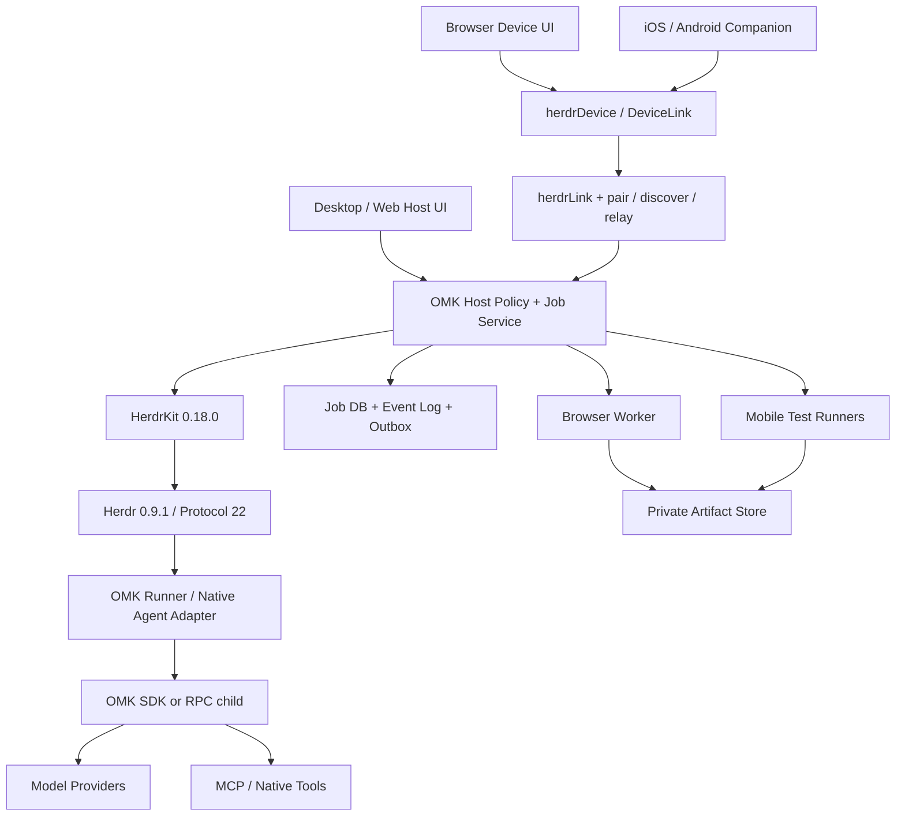

# OMK → HerdR 마이그레이션·웹 자동화·모바일 앱 통합 계획

- 문서 버전: 0.2 / 작성일: 2026-11-01, Asia/Seoul
- 상태: **구현 전 설계안**. 아래 신규 컴포넌트·API·성능 수치는 구현 사실이 아니라 개발 계약과 검증 목표다.
- 목적: OMK의 모델·도구·스킬·검증 기능을 보존하고 HerdR의 프로세스 관리와 연결해 데스크톱·웹·모바일에서 같은 작업을 운영한다.
- 보관 경로: `dmae97/omk`의 `docs/herdr-migration-2026-11-01` 브랜치, `packages/coding-agent/docs/herdr-migration-plan.md`. 원본 저장소의 public 공개 상태를 따른다.
- Harness 영향: **advance**. OMK 실행 의미와 credential 경계는 **preserve**. 비교 baseline·회귀 기준·측정 명령·증거는 §17에서 고정한다.

## 1. 먼저 결정할 방향

**OMK 실행 엔진을 유지하고, 새 TypeScript 라이브러리 `@byokit/herdr`를 host/device 연결 계층으로 도입한다.** 공개 npm registry와 저장소를 다시 조사해 2026-10-31 배포된 0.18.0을 확인했다. 이 라이브러리는 기존 Herdr runtime을 앱·웹·폰에서 제어하는 kit이며, OMK의 모델·인증·도구 실행 엔진을 대체하지 않는다.

중요한 구분: `@byokit/herdr` 0.18.0은 **기존 Herdr 0.9.1 / socket protocol 22**에 맞춰져 있다. 앞서 조사한 새 `herdr-core(hc) + herdr-app`은 별도 runtime이다. SDK의 pane API를 새 hc의 terminal API나 OSC 7501 상태와 섞지 않는다. 이 문서의 기본 이관 경로는 라이브러리이며, hc 전환은 별도 후속 adapter 검증 과제다.

최종 사용 흐름:

1. 장시간 실행되는 Node host가 `HerdrKit`을 소유한다. desktop/web 화면은 host의 viewer다.
2. host가 OMK 작업을 시작하고, 사용자가 화면·폰 연결을 닫아도 host의 작업은 유지한다.
3. 웹·폰은 `herdrDevice`와 pairing link로 상태·터미널·질문을 보고 허용된 제어를 요청한다.
4. OMK 전용 job·generation·승인·검증 원장은 host policy/runner가 관리한다.
5. browser 자동화와 모바일 앱 테스트는 별도 worker lane으로 추가한다.

이번 변경 범위는 공개 기술 계획의 작성·검토·전용 브랜치 보관이다. 라이브러리 설치, 실제 Herdr/OMK 프로세스 실행, credential 이전, 앱 배포와 유료 벤치마크는 후속 구현 작업이다. 라이브러리 README도 in development로 표시하며, 예시의 폰 화면은 fake Herdr+phone-sized Chromium 테스트다. 실제 iPhone/Android 검증으로 해석하지 않는다. [패키지 정보][K-PACKAGE], [사용 안내][K-README].

## 2. 고정한 기준 소스

| 구성 | 고정 commit / version | 계획에서의 역할 |
| --- | --- | --- |
| OMK | `61fedca36247eb3394d041ee20383d1273cac044` / **1.5.10** | agent engine, SDK/RPC, provider, resource, evidence 기준 |
| **@byokit/herdr** | `119837d445bf81395422eec03a488d67282cf872` / **0.18.0** | 이번 이관의 주 라이브러리. npm gitHead와 source HEAD 일치 |
| SDK가 고정한 Herdr runtime | **0.9.1 / protocol 22** | 별도 binary 필요, npm dependency가 자동 설치하지 않음 |
| Link optional peers | `@byokit/pair` **0.11.0**, `@byokit/discover` **0.8.7**, `@byokit/relay` **0.8.4** | 웹/폰 link entry를 사용할 때 명시적으로 추가 |
| 별도 후속 후보: herdr-core | `e07c2a1bedd62cf4787ee026ee23ee79c7d95491` / **0.1.16** | 현 SDK와 다른 protocol. 현재 이관 경로에서 사용하지 않음 |
| 별도 후속 후보: herdr-app | `7c1569ac62bfdc20ec58bd24ec31ba7cfc94e8fa` / **0.1.11** | 새 core용 GPUI desktop app, 현 SDK의 모바일 앱이 아님 |

기준은 [OMK source][O-ROOT], [SDK manifest][K-PACKAGE], [SDK constants][K-CONSTANTS]로 고정한다. Node 요구는 OMK의 `>=22.19.0`이 SDK의 `>=22.18`보다 엄격하므로 공통 실행 환경은 OMK 기준을 따른다. bare npm `herdr`, `@byokit/herdr`, Herdr binary, `hc`를 같은 패키지로 취급하지 않는다.

외부 운영 리소스와 개인별 스킬·플러그인 구성은 별도 importer 입력이다. 이를 OMK 기본 배포 기능이나 현재 검증된 제품 번들로 간주하지 않는다. 이 공개 문서에는 개인 credential·세션·corpus·로컬 운영 설정을 포함하지 않는다.

### 2.1 기존 제공 기능과 신규 개발의 경계

| SDK가 이미 제공하는 것 | OMK 제품에서 추가하거나 검증할 것 |
| --- | --- |
| `HerdrKit` own/adopt, snapshot/onChange, refresh, pane/tab/workspace 제어 | 장시간 host service 수명, OMK runner·job identity·원장 |
| `prompt`, `waitPromptable`, `wait`, `read`, `PromptReceipt` | OMK native admission, task 성공·검증·취소의 의미 보존 |
| `blocked/onBlocked/answer`와 질문 revision 확인 | OMK 승인 대상·workspace digest·generation의 원자적 검증 |
| `herdrLink`/`herdrDevice`, workspace scope, view/control grant | 앱의 승인 UX·host policy·계정별 cwd/env 제약·폐기·운영 |
| browser/React Native용 device export와 sealed notices | iOS/Android 앱 UI·store build·실기기·offline 동기화 |
| `runTurn`과 결과 파일 validator | monitoring cancellation과 agent interrupt 구분, semantic acceptance receipt |
| `ensureHerdr`의 opt-in pinned binary fetch+SHA-256 확인 | 독립 release 서명·배포 정책·exact rollback artifact 관리 |
| stand-in Herdr와 contract testing | 실제 pinned runtime·실제 OMK·기기별 통합 검증 |

SDK가 pairing과 grant 검사를 제공하므로 이를 처음부터 다시 구현하지 않는다. 다만 durable fleet job, billing/budget, arbitrary browser automation, OMK custom agent-kind 호환, exactly-once 외부 effect는 해당 API가 존재한다는 이유만으로 완성됐다고 간주하지 않는다. [Kit 구현][K-KIT], [link][K-LINK], [device][K-DEVICE], [turn][K-TURN].

## 3. 기능 보존 매트릭스

표의 P0~P7은 §15의 단계다. “보존”은 기존 구현을 adapter 뒤에서 계속 사용한다는 뜻이며 HerdR upstream이 그 기능을 제공한다는 뜻이 아니다. 모든 행은 대응 테스트 또는 사유가 있는 유예 기록을 가져야 한다.

| ID | 기능 | 현재 상태 | 이관 방식 / 완료 조건 | 단계 |
| --- | --- | --- | --- | --- |
| F01 | agent/tool loop·streaming | OMK 내장 | 기존 SDK/RPC 보존, event 순서·취소·usage 동등성 | P1 |
| F02 | CLI/TUI·print·JSON·RPC | OMK 내장 | 터미널 UI와 구조화 API 분리, standalone CLI 유지 | P1 |
| F03 | provider·모델·effort 선택 | OMK 내장 | provider/account/model/effort 각각 보존, UI 재연결로 변경 금지 | P1 |
| F04 | subscription OAuth·API key·local model | 설정에 따라 사용 | worker-local 인증 유지, 원격 기기에는 credential reference만 노출 | P1 |
| F05 | quota·사용량·비용 | provider별 관측 범위 상이 | 측정 시각·미지원·추정치를 표시, unknown을 0으로 처리 금지 | P2 |
| F06 | retry·provider resilience | 설정·원인별 정책 | 취소·영구 오류·예산 소진을 다른 계정 재시도로 바꾸지 않음 | P2 |
| F07 | read/write/edit/bash | OMK 내장 | workspace별 실행 권한 보존, 작업 디렉터리와 파일 경계 검증 | P1 |
| F08 | bash sandbox | OS/backend 조건 있음 | 실행 호스트의 실제 sandbox 상태 표시, 모바일 UI와 구분 | P2 |
| F09 | session 저장·resume·fork·tree | JSONL schema 3 | 원본 보존, tree/id/tool-result/usage 검증, 이관 manifest 생성 | P1 |
| F10 | live session control | 지원 persisted POSIX에서 기본 on | exact session ID·owner·generation 확인, 실패 시 파일 append fallback 금지 | P2 |
| F11 | close·abort·settlement | OMK lifecycle 계약 존재 | `await session.close()`와 effect 종료 확인, uncertain 결과 유지 | P2 |
| F12 | durable goal·pause/resume | OMK 내장, 기본 continuation 8회 | goal/round/generation/budget/deadline 별도 저장·표시 | P2 |
| F13 | goal autonomy | 최신 flag 기본 on | 사용자 budget/deadline·steering pause 보존, 무단 증액·재개 금지 | P2 |
| F14 | acceptance·receipt·freshness | 명시적 검증 workflow | 현재 workspace·generation·명령에 결합된 receipt로만 verified 표시 | P2 |
| F15 | verified run | 선택형 Linux/bwrap | 호스트 capability에 따라 제공, 일반 prompt 자동 검증으로 표현 금지 | P2 |
| F16 | goal recall·출력 회수 | 기본 on, raw 출력 가능 | 원문은 호스트 보관, 앱에는 허용된 preview만 전달 | P2 |
| F17 | compaction·context budgeting | V2 budget 기본 off | 원래 설정 보존, UI history pagination과 모델 입력 축약 분리 | P1 |
| F18 | source-quote memory | flag 기본 on, V2 필요 | quote/digest/span/TTL/revoke 유지, cross-device memory는 별도 설계 | P3 |
| F19 | skill admission·auto load | 최신 기본 on, child 차이 있음 | lead/worker 설정 fingerprint·고정 prefix 동작 보존 | P1 |
| F20 | 대량 skill 검색 | 일부 검색 실험 기능 기본 off | catalog·온디맨드 로드·source digest, 문서와 실행 backend 상태 분리 | P3 |
| F21 | prompts·themes·resource 우선순위 | OMK 내장 discovery | 중복·disable·user override·manifest 규칙 유지 | P1 |
| F22 | npm/git/local package | script 기본 비활성 | lock/pin·platform rebuild·provenance 검증, node_modules 통째 배포 금지 | P3 |
| F23 | project code trust | 별도 신뢰 gate | host/workspace별 재판정, 기존 trust 파일을 다른 장치로 복사하지 않음 | P2 |
| F24 | 기존 extensions | 신뢰된 in-process 코드 | 호환 worker에서 보존, per-plugin OS sandbox가 있다고 표시하지 않음 | P3 |
| F25 | MCP 설정·attach·health | 설정된 stdio 서버 | discovered/connected/active/offered/withheld/failed 구분 | P2 |
| F26 | project MCP trust | 설정 원문 SHA별 신뢰 | 변경 시 재검토, 제한 env 상속 보존, global trust와 분리 | P2 |
| F27 | MCP schema budget | 모델별 tool 제공 제한 | UI에 withheld 원인 표시, 도구 개수를 가용성으로 대체 금지 | P3 |
| F28 | subagents·DAG·lane budget | 선택형 extension | semantic task와 terminal을 분리, 중복 child 실행·취소 검증 | P3 |
| F29 | tool conflict scheduling | live scheduler 존재 | 다중 pane이 write 충돌 방지 기능을 대체하지 않도록 보존 | P3 |
| F30 | metrics·journal·telemetry | 서로 다른 저장·전송 경로 | 원문과 analytics 분리, 개인 기존 설정과 opt-out 보존 | P2 |
| F31 | 설정·환경변수·model overlay | 계층·scope 존재 | dry-run→충돌 검토→atomic apply→rollback | P0~P3 |
| F32 | terminal/process 관측·재연결 | Kit + Herdr runtime | viewer disconnect와 own-mode server stop 구분, binding 재검증 | P1 |
| F33 | 웹·폰과 remote host 연결 | pair/discovery/relay 제공 | host별 grant·workspace scope 재사용, fleet/SSH 운영은 별도 adapter | P2 |
| F34 | desktop job·diff·승인 패널 | host 앱 UI 신규 | SDK 상태·원장 projection으로 구현, 새 herdr-app mod와 혼동 금지 | P3 |
| F35 | 웹 대시보드·인증 API | Kit link/device 기반 제공 | pairing·grant는 재사용, job 정책·durable event·UI는 신규 | P2 |
| F36 | DOM 기반 웹 자동화 | 신규 제품 lane | Playwright worker·관측·정책·effect receipt 구현 | P4 |
| F37 | screenshot·수동 takeover | 신규 | 관측 채널과 제어 lease 분리, 동시 입력 방지 | P4 |
| F38 | iOS/Android companion | device export/예제 제공, 제품 앱 신규 | pair/link 재사용, native build·실기기·offline·job UI 검증 | P5 |
| F39 | 모바일 앱 개발·테스트 자동화 | 별도 신규 lane | iOS/macOS runner·Android emulator/device·Appium driver 분리 | P6 |
| F40 | fleet scheduler·대규모 update | 신규 | resource claim·lease·drain·canary·rollback·호환성 gate | P7 |
| F41 | 배포·license·release governance | OMK/upstream 별도 규약 | OMK 7개 package lockstep과 앱/core/스토어 version을 분리 관리 | P0~P7 |
| F42 | 사용자 운영 리소스·평가 도구·업무 CLI 연동 | 별도 importer 입력, 제품 기본 기능과 구분 | reference 기반 이관, 모듈·해시·metrics·실제 backend 각각 검증, 인증 누락 상태 유지 | P0~P3 |
| F43 | 이미지 SDK·이미지 입력/결과 | AI package API와 provider별 지원 | provider capability·비용·artifact 전달 보존, 영상/음성은 실제 plugin/driver가 있을 때만 제공 | P3 |
| F44 | Book-to-Skill·OpenKB 읽기 | 선택형 package/외부 CLI | Python/extractor preflight, provenance 검증과 읽기/ingest 권한 구분 | P3 |
| F45 | Atelier·status/sidebar·tmux UI | checkout의 선택형 extension | TUI 경로는 유지하고 desktop mod에 상태를 투영, footer/editor·pane 소유권 충돌 검증 | P1~P3 |
| F46 | AdaptOrch·Work Packet Loop | 선택형 bridge와 별도 서비스 | 기존 opt-in·budget·receipt 경계 유지, pane 생성만으로 서비스/분산 orchestration 활성화 금지 | P3~P7 |

OMK 근거는 [SDK][O-SDK], [RPC][O-RPC], [provider][O-PROVIDER], [settings][O-SETTINGS], [resources][O-PACKAGES], [보안 경계][O-SECURITY], [goals][O-RUN], [constitution][O-CONSTITUTION], [이미지 API][O-IMAGES], [Book-to-Skill][O-BOOK], [Atelier][O-ATELIER], [AdaptOrch][O-ADAPTORCH]에서 추적한다. F42는 사용자별 외부 리소스 이관을 위한 계약이며, pinned monorepo에 개인 자료가 포함돼 있다는 주장이 아니다.

## 4. 목표 구조와 소유권



| 소유자 | 책임 | 맡기지 않는 상태 |
| --- | --- | --- |
| OMK | provider·credential·tool loop·session·goal·검증 receipt | desktop layout·push·global queue |
| HerdrKit + legacy runtime | workspace/tab/pane·agent snapshot·prompt 전달·terminal stream | OMK 검증 verdict·durable fleet 원장·OS sandbox |
| herdrLink / pair | paired device transport·grant·workspace scope·sealed notices | 모든 업무의 승인·예산·외부 effect 원장 |
| Runner / Host policy | OMK custom integration·admission·generation·원격 허용 동작 | provider 구현 복제·모바일에 credential 노출 |
| Job service | 사용자 권한·job/operation·durable event·승인·예산 | raw CLI/socket을 폰에 그대로 공개 |
| Browser / Device worker | 해당 session/device의 action·관측·effect 결과 | job간 계정·cookie·filesystem 공유 |
| Client UI | typed 요청·상태·diff·증거 표시 | snapshot revision을 작업 성공 증거로 간주 |

초기 개인 호스트는 SQLite WAL + 단일 실행 소유자를 사용한다. fleet 단계에서 job/event store는 PostgreSQL + transactional outbox로 확장한다. SDK snapshot은 Herdr의 현재 상태 projection이고 durable job 원장은 아니다. 메시지 큐는 전달 수단이며 권한·상태의 원장으로 쓰지 않는다.

## 5. 라이브러리 연동 상세

### 5.1 own/adopt와 host 수명

- **own:** app-owned `stateDir`와 explicit Herdr `bin`으로 새 서버를 소유한다. 기존 사용자의 Herdr 설치·기본 상태 디렉터리를 덮어쓰지 않는다.
- **adopt:** 사용자가 선택한 기존 `bin + socketPath`에 연결한다. 기존 workspace·agent를 공유하므로 별도 발견·선택·권한 표시가 필요하다.
- `HerdrKit.stop()`은 own mode에서 소유 server/process group을 종료하는 경로가 있다. 단순 viewer/폰 연결 해제 때 호출하지 않는다. adopt mode의 transport disconnect와 동일한 효과로 취급하지 않는다.
- Node host service가 Kit을 소유하고 UI는 별도 client로 둔다. host service 종료·OS 재시작·upgrade의 복구는 별도 검증하며, 새 hc의 holder 기능을 이 protocol-22 경로의 보장으로 가져오지 않는다.

SDK 설치/import는 Herdr binary를 자동 다운로드하지 않는다. `ensureHerdr` 호출은 별도 opt-in이다. 최초 구현에서는 pin·platform·hash를 확인하고 app-owned binary 경로를 저장한다. [supervisor][K-SUPERVISE], [binary helper][K-BINARY].

### 5.2 OMK 시작과 제어 두 경로

**경로 A — 기존 TUI:** Kit의 pane placement와 host-owned launcher로 OMK interactive CLI를 실행한다. `kind: 'omk'`가 이미 지원된다고 가정하지 않는다. 실제 agent-kind registry·launch/resume/status 계약을 검증하고 OMK adapter를 추가한다. Pi의 후손이라는 이유로 `kind: 'pi'`나 `hostLaunch: true`를 OMK에 그대로 적용하지 않는다.

**경로 B — 구조화 앱 제어:** Herdr pane에서 OMK runner를 실행하고 runner가 OMK RPC child의 stdin/stdout pipe를 소유한다. SDK의 pane·agent 관측은 UI projection이고, OMK 명령·approval·검증은 native 구조화 경로로 처리한다. OMK RPC stdout에는 JSONL만 남긴다.

```text
Node Host Service
  ├─ HerdrKit -> Herdr 0.9.1 / pane
  │                 └─ omk-herdr-runner
  │                      └─ omk --mode rpc  # private JSONL pipes
  └─ OMK policy / durable job & operation ledger
```

일반 pane에 프로그램을 실행하는 기능과 agent로 인식해 `prompt/wait/blocked`를 사용하는 기능은 다르다. `unknown agent`, `unsupported session`, `missing binary`, `unknown sign-in`을 성공으로 숨기지 않는다. cwd·executable·model·env는 host에서 검증하고 shell 문자열 결합 대신 검토된 launcher 계약을 사용한다.

OMK provider/account/model/effort와 credential root를 명시적으로 유지한다. SDK의 Pi 전용 model/env guard가 존재하더라도 OMK launch 경계의 검증을 대신하지 않는다. sign-in 상태는 비밀 파일을 읽지 않는 native metadata/API로 확인하고 미지원은 unknown이다. [공개 types][K-TYPES], [agents][K-AGENTS].

### 5.3 SDK receipt·revision·대기·취소 의미

| 관측 | 실제 의미 | 앱 처리 |
| --- | --- | --- |
| `PromptReceipt` | prompt 전달 대상 pane/terminal/revision/status; 선택적 agentSession | 전달 접수와 작업 완료를 구분 |
| snapshot `revision` | Kit tree 변경 revision | stale UI/scope 검증에 사용, durable cursor·prompt generation과 분리 |
| `waitPromptable` | SDK의 현재 readiness gate 충족 | OMK 작업 성공으로 표시하지 않음 |
| `runTurn` 완료·result validator 통과 | agent 관측과 결과 JSON의 형식 검증 | 별도 OMK acceptance receipt가 필요 |
| `runTurn` 취소 | monitoring 취소일 수 있으며 agent는 계속 실행 가능 | physical interrupt/종료 확인 전 claim 유지 |
| `blocked.answer` revision 확인 | 현재 질문을 읽고 key를 전송하는 bounded 검사 | OMK 승인 원장의 원자적 effect 승인으로 대체하지 않음 |
| `stalled/reconnecting/needs-update` | runtime/link 상태 | 업무 실패·성공과 별도 표시 |
| `closePlan/closePane` | 실제 pane의 tab/workspace 확대 범위 검사 | 닫기 scope가 넓어지면 명시된 범위로 재검증 |

Herdr protocol 22에는 별도 prompt generation counter가 있다고 가정하지 않는다. 식별자는 `jobId/attemptId/omkSessionId/workerIncarnation/promptGeneration/operationId`와 `{serverEpoch,paneId,terminalId}`를 분리한다. SDK reconnect 뒤 fresh snapshot으로 binding을 확인하고 durable event cursor는 별도 원장에 둔다.

현재 OMK RPC의 `abort`는 generation 필드가 없는 요청이며, POSIX IPC generation도 모든 로컬 TUI turn을 대표하지 않는다. Runner는 admission을 직렬화하고 dispatch 직전에 동일 producer를 확인한다. 다음 producer가 시작될 수 있는 경합을 원자적으로 막을 수 없으면 해당 원격 cancel은 unsupported로 둔다. 단순 `sendKeys(Ctrl-C)` 성공이나 monitoring 취소를 작업 종료 증거로 쓰지 않는다. [turn 구현][K-TURN], [질문 answer 구현][K-APPROVALS], [OMK session control][O-SESSION].

### 5.4 웹·폰 연결: 기존 SDK 재사용 범위

Host는 `herdrLink(kit, { scopeOf })`와 pair Host를 연결하고, client는 `herdrDevice(DeviceLink)`를 사용한다. `@byokit/herdr/device`는 browser/React Native export를 제공하며 host/Node import를 폰 bundle에 넣지 않는다. optional peer 버전을 lockfile로 고정한다.

기본 workspace scope는 빈 목록으로 시작하고 view/control grant·허용 workspace를 서버에서 검증한다. 예시의 무조건 승인 callback을 제품에 복사하지 않는다. raw `hd.call` pass-through는 기본 비활성으로 유지한다. host의 raw `kit.call/cli`는 신뢰 코드용이며 모바일에 generic proxy로 노출하지 않는다.

특히 control grant는 새 workspace 생성을 허용할 수 있고 start 요청은 cwd/args/env를 전달한다. 빈 기존-workspace 목록이 모든 실행을 막는 sandbox라고 해석하지 않는다. 제품은 OMK launch 전용 host handler/facade에서 executable·workspace root·account·model·budget을 검증한다. 이 검증이 없다면 client에 control grant를 주지 않고 view-only로 시작한다. raw `passThrough` callback을 허용하는 경우에도 typed handler의 role/scope 검사가 자동 적용된다고 가정하지 않는다.

Scope 축소는 grant metadata 수정만으로 기존 event/terminal stream까지 즉시 철회된다고 약속하지 않는다. revoke·stream teardown·새 grant 발급을 정책으로 묶고 검증한다. relay push는 영속 store와 `RelayClient.revoke` cleanup을 따로 확인한다. 같은 pane의 연속 질문도 알림이 도착하도록 pane ID와 질문 revision을 결합한 notification key를 검토한다. [link][K-LINK], [pair host][K-PAIR-HOST], [relay 보안][K-RELAY-SECURITY].

기존 link가 pairing·grant·notice·terminal 채널을 제공하므로 MVP에서는 그대로 재사용한다. 별도 `/v1` API는 §6의 durable job·조직/fleet·검증 기능을 위한 제안이다. transport 암호화와 workspace grant만으로 arbitrary cwd/env/계정·예산·업무 승인까지 집행된다고 가정하지 않는다. [link 구현][K-LINK], [device 구현][K-DEVICE], [pair package][K-PAIR].

### 5.5 새로운 hc/core 경로는 별도 후속 adapter

`@byokit/herdr`의 protocol 22 pane API와 `herdr-core`의 JSON-RPC/OpenRPC terminal API는 호환되지 않는다. 후속 hc adapter를 추가하면 runtimeKind, generation, status transport, ownership, reconnect, updater를 별도 conformance fixture로 구현한다. OSC 7501, `hc connect`, core `doc.set`, holder·parent 수명 규칙은 그 경로에서만 적용한다. 현 라이브러리 지원을 새 hc 지원으로 표시하지 않는다.

## 6. 원격 API와 작업 원장

다음은 SDK link 위에 추가할 선택형 product gateway v1 설계다. 기존 `hd.*`/OMK endpoint와 구분해 `/v1` namespace를 둔다. 개인 LAN MVP는 pair/link를 재사용하며, durable job·조직/fleet 기능에 필요한 API만 추가한다.

| API | 요청 전제 | 응답·재시도 계약 |
| --- | --- | --- |
| `POST /v1/devices/pair` | 호스트에서 발급한 일회성 challenge, 사용자 세션 | device 등록; pairing 원문·provider key 반환 금지 |
| `GET /v1/workspaces` | 사용자별 workspace 읽기 권한 | capability·host availability·revision 포함 |
| `POST /v1/jobs` | workspace 권한, `Idempotency-Key`, config/prompt reference | 202 + jobId; 실행 완료 응답이 아님 |
| `GET /v1/jobs/{id}` | 소유권/ACL | snapshotVersion·state·lastEventId·staleness |
| `GET /v1/events?cursor=...` | 사용자·workspace scope | SSE snapshot+증분; 만료 cursor는 명시적 resync |
| `POST /v1/jobs/{id}/commands` | expectedJobVersion·operationId·generation | typed steer/follow-up/pause/resume/cancel; 저장된 operation 결과 조회 |
| `POST /v1/approvals/{id}/decision` | 만료 전, scope·workspace·plan digest·generation 일치 | 승인/거절 ledger commit 후 한 번 dispatch |
| `GET /v1/operations/{id}` | operation 소유권 | admitted/dispatched/settling/confirmed/unknown 구분 |
| `POST /v1/browser-sessions` | 해당 job의 browser capability | 새 session/lease; 기존 개인 browser profile 자동 연결 금지 |
| `POST /v1/artifacts/{id}/access` | artifact class·사용자 권한 | 짧은 수명의 제한 URL 또는 gateway stream |
| `DELETE /v1/devices/{id}` | 재인증·device 소유권 | 토큰·lease 폐기; 실행 task 종료 여부는 별도 표시 |

### 6.1 최소 데이터 모델

| 테이블 | 핵심 필드 / 제약 |
| --- | --- |
| workspace | owner/ACL, hostId, rootCapability, repository revision |
| job / attempt | taskId, sessionId, configDigest, budgetRevision, generation, status, expectedVersion |
| operation | principalId, operationId, requestDigest, state, dispatchLease, resultRef; scope별 unique key |
| worker_lease | workerId, jobId, leaseEpoch, expiresAt, lastHeartbeat, stopEvidence |
| approval | purpose, allowedEffect, targetDigest, workspaceDigest, generation, expiresAt, decision |
| event / outbox | durable eventId, jobVersion, kind, payloadClass, producedAt, delivery state |
| resource_binding | resource kind, source revision/digest, platform, trust state, resolved host capability |
| artifact | classification, digest, object reference, retention, redacted preview reference |
| device | user, public key/reference, capabilities, revokedAt, notification token reference |

Idempotency key는 사용자+workspace+operation kind 범위에서 unique다. `requestDigest`는 HTTP method, canonical target route, job/session ID, 정규화 payload, schema/policy version을 포함한다. 같은 key/같은 digest는 기존 결과를 반환하고, 다른 대상이나 body로 key를 재사용하면 409로 거부한다. operation 등록과 outbox 발행은 같은 transaction이다.

Worker는 외부 dispatch 직전에 operation 상태와 `leaseEpoch`를 CAS로 검증하고 durable dispatch reservation을 기록한다. reservation 이후 실제 dispatch 전·후에 crash가 나면 로컬 DB만으로 외부 실행 여부를 단정할 수 없다. 명시적 미실행 증거 또는 외부 결과 조회가 없으면 해당 attempt를 `outcome_unknown`으로 전환하고 일반 queue 재전달로 재실행하지 않는다. lease 만료만으로 이전 effect가 종료됐다고 판단하지 않는다. 외부 서비스가 idempotency나 결과 조회를 제공하지 않으면 **exactly-once를 보장한다고 쓰지 않는다**.

Pair의 pending request reconnect 재전송과 새 `request()` 호출은 다르다. 새 호출은 새 key를 만들며 timeout은 host effect의 취소가 아니다. 선택형 `AnswerStore`의 기본 저장은 메모리이고 handler 실행 뒤 결과를 기록하므로, 이를 crash-safe 업무 원장으로 취급하지 않는다. SDK 재전송 위에도 product operationId와 dispatch reservation/reconciliation을 유지한다. [pair device][K-PAIR-DEVICE], [pair host][K-PAIR-HOST].

### 6.2 이벤트 예시

```json
{
  "schema": "omk.herdr.event.v1",
  "eventId": "evt_example_0042",
  "jobId": "job_example",
  "jobVersion": 12,
  "attemptId": "attempt_example_2",
  "promptGeneration": 3,
  "workerLeaseEpoch": 8,
  "kind": "approval.required",
  "classification": "metadata",
  "payload": {
    "approvalId": "approval_example",
    "purpose": "apply-reviewed-diff",
    "targetDigest": "sha256:example",
    "expiresAt": "2026-11-01T12:00:00Z"
  }
}
```

예시는 신규 domain event이며 SDK의 `hd.*`/Herdr schema나 현재 OMK wire event가 아니다. client는 eventId로 중복을 제거하고 jobVersion gap을 발견하면 snapshot을 요청한다. 순서가 뒤집힌 과거 event로 현재 상태를 덮어쓰지 않는다. push에는 작업 ID·event 종류·일반 알림 문구만 싣는다.

## 7. 취소·재개·장애 처리

| 상황 | 처리 규칙 |
| --- | --- |
| client 연결 끊김 | viewer만 끊고 job은 유지. 재접속은 snapshot 조회부터 수행 |
| command 응답 timeout | operation 조회. 새 operationId로 동일 effect를 즉시 재발행하지 않음 |
| cancel 요청 | generation 결합→dispatch 중단→자식/도구/browser stop 요청→실제 종료 관측 |
| worker heartbeat 만료 | worker unavailable 표시, claims 유지, fence/종료 확인 전 대체 worker dispatch 금지 |
| runtime restart·Kit reconnect | fresh snapshot·session/terminal binding 재확인, 살아 있는 OMK를 확인하기 전 새 turn 시작 금지 |
| host reboot / OMK 소실 | session·workspace·effect ledger reconcile. workspace/pane 복원은 원래 process·작업 복원 증거가 아님 |
| MCP가 종료에 응답하지 않음 | deadline 경과 시 effect scope를 unknown으로 남기고 release 보류 |
| 승인 뒤 파일·branch가 변경됨 | approval/receipt stale. 현재 digest로 새 검토가 필요 |
| queue redelivery | 동일 operation ledger를 읽고 dispatch 여부 확인 |
| dispatch reservation 전/후 crash | 미확정 attempt를 unknown으로 보존, 명시적 미실행 증거 또는 외부 reconciliation 후에만 새 attempt 허용 |
| 업데이트 중 drain | 신규 admission 중지, 진행 작업 정리 또는 호환 runner 유지, 강제 kill을 drain 성공으로 표시하지 않음 |

job 상태는 `queued → preparing → running → waiting_input / waiting_approval → settling → succeeded / failed / cancelled`를 기본으로 한다. `cancel_requested`, `interrupted`, `outcome_unknown`은 명시적 상태다. `succeeded`라도 검증 미설정이면 `verification=not_requested`이고, stale receipt면 `verification=stale`다.

## 8. 웹 자동화: 실행 가능한 제품 범위

### 8.1 실행 구조

Playwright 기반 browser worker를 기본 lane으로 제안한다. 기존 Playwright MCP를 연결하는 호환 경로도 제공하되 동일한 lease·artifact·scope 정책을 거친다. DOM locator와 screenshot은 관측 방식이고, 실행 권한은 별도 job capability가 결정한다.

BrowserContext는 cookie/storage 분리에 사용한다. **OS·network 보안 격리의 대체물은 아니다.** 실행 호스트의 container/계정/egress 경계를 별도로 적용한다. [Playwright isolation][P-CONTEXT].

| 기능 | 구현 계약 | acceptance |
| --- | --- | --- |
| 페이지 탐색·탭·frame·popup | origin·navigation·tab ID 기록, 재탐색 시 locator freshness 확인 | A14 |
| click/type/select/scroll | 관측 digest·target·actionId 결합, 숨김/다른 origin 대상 검증 | A14 |
| 로그인·SSO·MFA | 사용자 takeover 상태, 계정별 암호화 profile, prompt/log에 cookie 원문 금지 | A15 |
| 업로드 | workspace artifact allowlist, 파일 digest·최대 크기·대상 origin 결합 | A16 |
| 다운로드 | quarantine staging→크기/형식 검사→artifact 등록, 임의 파일 실행 금지 | A16 |
| 데이터 추출 | 구조화 schema·provenance·pagination·중복 키·권한 범위 기록 | A14 |
| 스크린샷·video·trace | 민감 영역·retention·접근 권한, 기본 push에 미포함 | A17 |
| API·UI 결합 workflow | 외부 operationId·확인 가능한 결과 reference로 연결 | A18 |
| 수동 takeover | controller lease를 사용자에게 이전, agent 입력 일시 중지 | A19 |
| 예약·반복 실행 | timezone·중복 실행 제한·missed-run 정책·중단 조건 저장 | A20 |
| 여러 계정·병렬 browser | account/profile별 exclusive claim, job간 cookie·download 분리 | A21 |

### 8.2 상태를 바꾸는 action

읽기 action은 bounded retry가 가능하다. 게시·결제·삭제·초대·권한 변경 같은 action은 사용자에게 이미 부여받은 작업 범위와 승인 binding을 확인한다. 모든 클릭마다 새 승인을 요구하는 UX는 만들지 않는다. 목적·대상·payload가 기존 권한을 벗어나거나 검토된 대상이 바뀌었을 때만 새 결정을 받는다.

1. 현재 관측과 의도한 effect를 준비한다.
2. operation과 scope를 원장에 기록한다.
3. 필요한 승인 또는 사전 허용 범위를 검증한다.
4. action을 한 번 dispatch한다.
5. UI/외부 API의 결과를 재관측해 확인한다.
6. timeout이면 결과 조회부터 수행한다. 확인할 수 없으면 `outcome_unknown`으로 남긴다.

브라우저가 재시작됐다는 이유로 마지막 submit을 다시 클릭하지 않는다. 미리보기 URL·redirect·DNS·metadata endpoint·loopback·download path를 검증하고 scope 밖 network 접근을 worker 경계에서 차단한다. CAPTCHA/MFA는 사용자 개입 상태로 처리한다.

### 8.3 브라우저 화면 전달

초기 버전은 screenshot+DOM snapshot과 action 결과를 제공한다. 실시간 video/WebRTC는 지연·대역폭·보존 정책을 측정한 뒤 추가한다. 브라우저 영상, Kit terminal stream, domain events의 권한과 lifecycle을 각각 관리한다. agent와 사용자가 동시에 같은 탭을 조작하지 못하도록 controller epoch를 검증한다.

## 9. 모바일 앱: iOS와 Android

### 9.1 제품 범위

모바일은 장시간 agent engine을 폰에서 실행하는 구조보다 **호스트에서 실행 중인 작업의 companion/control app**을 우선한다. 서버/개인 컴퓨터가 작업을 계속하고 폰은 연결·판단·확인에 집중한다. Termux CLI 호환성은 별도 기능이며 first-party 모바일 앱을 대신하지 않는다.

초기 구현 후보는 React Native + `@byokit/herdr/device` + TypeScript 계약 공유다. native 보안 저장소·push·deep link는 플랫폼 모듈을 사용한다. 접근성·terminal rendering·background 제약을 P0 spike에서 확인하고, 부족한 화면만 native 구현한다. Node host entry를 mobile bundle에 넣지 않으며, 예제의 phone-sized Chromium 성공을 native iOS/Android 실기기 성공으로 간주하지 않는다.

| 화면 | 핵심 행동 | 완료 기준 |
| --- | --- | --- |
| 기기 연결 | 호스트 QR 확인, fingerprint 확인, 기기 해제 | 일회성 challenge, 만료·재사용 거부 |
| 작업 목록 | 실행/대기/질문/승인/오류와 host online 상태 | unknown·stale·실행 중 구분 |
| 작업 상세 | 단계·사용 모델·비용·최근 요약·질문 답변 | 원문 출력과 기본 요약 분리 |
| diff/검증 | 파일별 diff, 검사 명령·결과·receipt freshness | 큰 diff pagination, 변경 시 stale 표시 |
| 승인 | 대상·scope·변경 digest·만료·승인/거절 | 서버가 다시 검증, 오래된 화면 승인 거부 |
| 브라우저 관측 | screenshot·단계·takeover 요청 | 제어 lease 획득 전 입력 금지 |
| 알림함 | 질문·검토·실패·작업 완료 | 민감 원문 없는 push, 현재 상태 재조회 |
| 설정 | 계정·기기·알림·보존·telemetry 설정 | 로그아웃/기기 폐기 시 cache·token 정리 |

### 9.2 연결·오프라인·보안

- pairing은 호스트에서 시작하고 사용자 확인으로 끝낸다. provider key와 SSH private key를 QR에 넣지 않는다.
- 앱 token은 해당 사용자·기기·workspace 권한으로 제한한다. 고위험 작업에는 재인증과 만료된 approval 재검증을 적용한다.
- offline cache는 암호화하고 필요한 요약/diff만 저장한다. 로그아웃·device revoke 시 삭제한다.
- offline outbox에는 command intent와 operationId를 보관한다. 재연결 때 snapshot을 먼저 받아 version이 맞는 요청만 전송한다.
- 취소는 오래된 generation을 현재 generation에 자동 재적용하지 않는다. 승인과 외부 effect는 offline에서 성공으로 표시하지 않는다.
- iOS/Android가 앱을 중단해도 서버 job은 유지한다. push는 wake-up 보조 수단이고 작업 원장이 아니다.
- 예제 LAN HTTP의 일반 browser-storage fallback은 demo로만 취급한다. 제품은 HTTPS와 보호된 grant 저장소를 기본으로 사용한다. local network/Bonjour 및 multicast 선언, relay/Tailscale 선택, IPv6-only network 미지원 같은 현재 discovery 제약을 capability와 기기별 테스트에 반영한다. [예제 경계][K-EXAMPLE], [discovery][K-DISCOVER].
- Android foreground service를 일반 작업 감시용 영구 background 우회로로 사용하지 않는다. 실제 필요·알림·플랫폼 제한은 해당 플랫폼 심사 단계에서 확인한다. [Android 지침][M-ANDROID], [Apple background tasks][M-IOS].

접근성: Dynamic Type/글자 크기, screen reader label, 대비, 외장 키보드, 한글 입력, tablet/split view, 저속 통신을 acceptance에 넣는다. 알림 deep link는 jobId뿐 아니라 사용자 권한과 최신 jobVersion을 서버에서 재확인한다.

## 10. “모바일 앱 자동화”는 별도 실행 lane

모바일 companion 개발과, OMK가 다른 모바일 앱을 빌드·테스트·조작하는 기능을 구분한다. 둘 다 계획에 포함하되 권한·장치·배포 gate는 공유하지 않는다.

| 대상 | runner | 기능 / 제약 |
| --- | --- | --- |
| iOS Simulator | macOS + 고정 Xcode/simulator runtime | build/install/launch, UI 테스트, screenshot·crash·성능 artifact |
| Android Emulator | 전용 emulator/runner | Gradle build/install, UIAutomator2/테스트 driver, logcat·screenshot |
| 실기기 | owner-approved device pool | device lease, 인증서·test account 분리, 접속/초기화 정책 |
| cross-platform UI | Appium + 대상별 driver | 서버 설치만으로 모든 OS 조작이 된다고 표시하지 않음 |
| 스토어 배포 | 별도 release workflow | signing·store credentials는 runner-local secret, 제출/승격 권한 분리 |

Device capability에 OS·runtime·screen·locale·network·app build digest를 기록한다. deviceId당 exclusive lease와 fencing epoch를 둔다. timeout 뒤 살아 있는 테스트를 확인하기 전 같은 device에 다음 job을 배정하지 않는다. 기본 테스트는 합성 데이터와 test account를 쓴다. [Appium 구조][M-APPIUM].

## 11. 스킬·플러그인·MCP·credential 이관

### 11.1 리소스 importer

`inventory → plan → dry-run → validate → apply → verify → rollback` 명령군을 신규로 설계한다. 적용 전에 항목별 source/version/hash/license/platform/trust/tool-backend/충돌을 출력한다. 통계와 경로 metadata만 원격으로 보낼 수 있고 실제 내용 전송은 별도 선택이다.

각 항목은 다음 중 하나여야 한다.

- `portable`: 검토된 문서·리소스로 현재 플랫폼에서 로드 가능.
- `requires_rebuild`: native dependency 재설치 또는 재빌드 필요.
- `requires_auth`: 해당 실행 호스트의 계정 연결 필요.
- `requires_external_runtime`: browser·언어 서버·기기·외부 프로그램 필요.
- `trusted_local_only`: 기존 in-process plugin·개인 hook처럼 해당 소유자 호스트에서만 실행.
- `reference_only`: 과거 session/system prompt/research 자료로 기본 실행·autoload하지 않음.
- `conflict/unsupported`: 보존 사유와 대체·유예 결정을 기록.

스킬이 발견됐다는 사실과 도구 backend가 로드·연결·호출됐다는 사실을 별도 필드로 둔다. 기존 provider account와 모델 선택을 기본값으로 덮어쓰지 않는다. project trust, project MCP exact-file trust, 별도 plugin trust는 서로 대체하지 않는다.

### 11.2 Credential

credential은 실행 호스트에서 resolve하고, 웹·폰·Git에는 reference ID·provider name·상태만 전달한다. OAuth refresh와 account binding도 원래 provider 경계를 유지한다. 다른 계정의 subscription OAuth를 cloud 공용 provider key로 변환하지 않는다.

필요한 필드 예: `credentialRef`, `providerId`, `accountRef`, `hostId`, `scope`, `expiresState`, `lastCheckedAt`. 원문 key·refresh token·cookie·인증 header는 필드로 내보내지 않는다. 원격 로그인은 provider가 지원하는 실제 인증 흐름과 정책을 확인한 뒤 추가한다.

### 11.3 원문·세션·증거 데이터

OMK 최신 CHANGELOG는 일부 log/session/command/goal-recall 경로에 raw 값이 저장될 수 있음을 명시한다. 자동 redaction이 이미 보장된다는 가정으로 cloud sync를 켜지 않는다. 이관본 원문은 local-private로 유지하고, gateway는 allowlist projection과 검토된 artifact만 전송한다. [OMK 변경 기록][O-CHANGELOG].

Host SDK와 client의 통계·로그·relay metadata는 각각 수집 범위와 보존 정책을 명시한다. 기존 OMK의 opt-out을 새 앱이 자동으로 상속한다고 가정하지 않는다. 후속으로 별도 herdr-app을 추가한다면 해당 release의 기본 telemetry on과 trusted mod 권한을 별도 검토한다. 현재 SDK 연동에 그 app의 설정을 잘못 적용하지 않는다. [link 구현][K-LINK], [별도 app 보안][A-SECURITY].

| 데이터 | 기본 위치 | 원격 처리 |
| --- | --- | --- |
| credential·cookie·raw env | worker-local secret store | 전송하지 않음 |
| session JSONL·raw tool output·goal recall | 소유자 호스트 | 기본 sync 제외, 명시적 export 별도 |
| job metadata·고정 오류 코드·usage | job store | 사용자/workspace scope 조회 |
| screenshot·trace·diff | private artifact store | 분류·보존·접근 권한 적용 |
| 검증 receipt | 원본 local + 허용 projection | 원문 command 포함 여부 검사, freshness 유지 |
| analytics | 원문 없는 allowlist metrics | 사용자 설정·opt-out·보존 정책 적용 |

## 12. 세션·설정 migration 절차

1. writer를 pause하고 원본 파일/manifest digest를 기록한다. 실행 중인 session에 importer를 직접 append하지 않는다.
2. schema 3 JSONL을 읽되 원본을 수정하지 않는다. entries·tree edge·tool call/result·usage와 누락 참조를 검사한다.
3. 새 DB에 canonical OMK session ID와 file reference를 연결한다. 기기별 absolute path는 host capability binding으로 바꾼다.
4. settings는 global/project/env scope를 보존하고 충돌 preview를 만든다. 모델 catalog 생성 파일을 수작업으로 변환하지 않는다.
5. package/native dependency는 pin과 플랫폼을 기준으로 clean install한다. 다른 OS의 node_modules를 그대로 사용하지 않는다.
6. trust와 process-local approval은 가져온 JSON의 boolean으로 승격하지 않는다. 해당 host/workspace에서 새로 판정한다.
7. dry-run 결과·적용 manifest·backup reference·검증 결과를 기록하고 atomic pointer를 전환한다.
8. 실패 시 새 pointer를 폐기하고 기존 CLI/session 경로로 돌아간다. 새 schema를 옛 binary가 읽도록 강요하지 않는다.

migration 중 기존 CLI 사용자와 새 앱 사용자는 하나의 session writer lease를 공유한다. view-only attach는 여러 개 가능하지만 mutation owner는 하나다. side-by-side 테스트의 효과가 두 번 발생하지 않도록 shadow lane은 read-only/합성 fixture로 제한한다.

## 13. 대규모 실행과 운영

호스트마다 CPU/RAM/PTY/browser/device의 resource claim과 동시 실행 상한을 둔다. queue 길이보다 사용 가능한 실행 권한·계정 quota·device/browser lease를 먼저 확인한다. 사용자·workspace·provider별 공정성, 최대 cost, deadline, queue timeout을 구성한다.

- 1단계 부하 프로필: host 1개, 관측 client 10개, 동시 job 10개.
- 2단계: host 5개, 관측 client 50개, 동시 job 50개.
- 3단계: host 20개, 관측 client 200개, 동시 job 200개.
- 이는 **합성 목표 프로필**이며 현재 처리 능력 측정값이 아니다. browser/device 수는 별도 resource 상한으로 제한한다.

backpressure는 transcript pagination·terminal repaint·screenshot 빈도를 조절한다. control/approval/lease revocation/종료 event를 드롭하지 않는다. runtime reconnect·snapshot revision 변화, database failover, worker reconnect를 결합한 chaos fixture를 돌린다.

운영 지표: queue wait p50/p95, active/settling/unknown job, lease age, duplicate dispatch, cancel-to-stop, stale approval 거부, event lag, worker crash, orphan terminal/browser/device, provider 비용·사용량, artifact 보존 위반. error message 원문과 prompt를 label로 쓰지 않는다.

## 14. 대규모 업데이트와 rollback

### 14.1 버전과 배포물

OMK npm package 버전, `@byokit/herdr`·optional peers, Herdr binary·protocol, runner contract, host/client 앱, gateway API, DB schema, 모바일 store build를 각각 기록한다. 호환 manifest는 허용 조합과 source commit·artifact SHA-256·서명 정보를 담는다. 단순 버전 문자열 비교로 호환을 결정하지 않는다.

SDK의 `ensureHerdr`는 고정 asset의 SHA-256을 확인하는 opt-in helper다. checksum을 독립 release 서명으로 표현하지 않는다. 자체 배포에는 서명된 manifest·key rotation·만료·anti-rollback·exact artifact 복구를 신규로 설계한다. SDK가 높은 protocol을 `needs-update` 상태로 연결할 수 있어도 OMK policy는 미검증 조합의 mutation을 차단한다. [binary helper][K-BINARY], [protocol range][K-TYPES].

### 14.2 배포 순서

1. 이전/현재 reader를 지원하는 additive DB schema를 먼저 배포한다.
2. 새 gateway가 구 client와 구 worker를 모두 읽을 수 있게 한다.
3. 내부 canary host에서 SDK/peer/Herdr binary/OMK runner 조합을 검증한다.
4. 1%→5%→25%→100% host로 확대한다. 소규모 fleet은 최소 1대 canary로 시작한다.
5. active job은 drain 또는 기존 runner에 남긴다. 강제 재시작은 명시적 중단 결과와 연결한다.
6. desktop/mod와 모바일 앱은 호환 API를 확인한 뒤 별도 채널로 배포한다.
7. 파괴적 DB 정리는 rollback 지원 기간과 검증된 backup이 확보된 후 별도 변경으로 수행한다.

### 14.3 중단 조건

- duplicate 외부 effect, 다른 job에 적용된 승인/취소, credential 유출, 원본 session 손상은 1건이라도 rollout을 중단한다.
- 오류율·p95 지연·cancel settlement·orphan resource는 사전 고정한 baseline 허용 범위를 벗어나면 확대를 멈춘다.
- 스토어 배포는 서버 binary처럼 즉시 회수되지 않는다. remote feature flag로 새 mutation을 중지하고 compatible API를 유지한다.
- rollback은 pinned 이전 artifact+검증된 config/schema 조합으로 수행한다. 프로세스 강제 종료 없이 회복 가능한지 별도 rehearsal한다.

OMK 7개 공개 package lockstep과 CI release 규칙을 유지한다. 이 문서로 major/minor release, workflow 권한 변경, public release를 승인한 것으로 간주하지 않는다. [release governance][O-CONSTITUTION].

## 15. 단계별 실행 계획

| 단계 | 산출물 | 진입 / 종료 gate |
| --- | --- | --- |
| P0 기준·spike | pinned SDK/peer/runtime, inventory, ownership map | 원본 보존, 모든 F항목 분류, protocol 22·OMK custom agent 가능성 검증 |
| P1 최소 adapter | Kit own/adopt, OMK kind/launcher, RPC runner | JSONL 오염 0, viewer/host lifecycle·close 범위·기본 모델 보존 |
| P2 원격 제어 기반 | herdrLink/device·grant 재사용, job/event 원장, 승인·취소 | duplicate effect 0, stale command 거부, unknown outcome 보존 |
| P3 desktop·resource | host UI, diff/receipt, importer, MCP/skill catalog | 동작 backend 상태 분리, schema3 round-trip, trust 보존 |
| P4 웹 자동화 | browser worker, profile/lease, artifacts, takeover, scheduler | 합성 사이트의 read/mutate/timeout/SSO/upload/download 통과 |
| P5 모바일 companion | iOS/Android internal build, push, offline outbox, accessibility | 앱 kill·네트워크 단절·기기 revoke·오래된 승인 테스트 통과 |
| P6 모바일 자동화 | simulator/emulator/device adapter, build/test artifact | device lease 충돌 0, signing secret 격리, 테스트 재현 가능 |
| P7 fleet·정식 배포 | 부하/chaos 결과, signed update, canary/drain/rollback | 단계별 SLO·회귀 기준·rollback rehearsal 승인 |

권장 인력 가정: runtime/bridge 1, backend/운영 1, desktop/web 1, mobile 1, QA/보안 검토 협업. 2명 이하라면 웹 원격 제어→모바일 조회/승인→모바일 자동화 순으로 범위를 나눈다. 일정은 P0 spike 뒤 산정하며, 고정 인력·계정·실기기·스토어 준비 없이 완료 주차를 약속하지 않는다.

### 15.1 첫 구현 PR 묶음

| 순서 | 독립 변경 | 예상 경로 제안 | 확인할 실패 조건 |
| --- | --- | --- | --- |
| PR01 | SDK/peer/runtime pin과 compatibility fixture | `packages/herdr-bridge/contracts/` | protocol mismatch·필드 누락·scope 없음 |
| PR02 | Kit own/adopt·OMK custom kind/launcher | `packages/herdr-bridge/src/host/` | 잘못된 kind/계정·viewer close의 server stop |
| PR03 | snapshot·blocked·terminal adapter | `packages/herdr-bridge/src/kit-client/` | stale revision·widened close·reconnect identity |
| PR04 | OMK RPC runner와 close | `packages/herdr-bridge/src/runner/` | partial UTF-8·backpressure·child pipe 잔존 |
| PR05 | durable job/operation/outbox | `services/control-plane/` | retry 중 이중 dispatch·body hash 불일치 |
| PR06 | pair/link grant 연동·workspace ACL·revoke | `services/control-plane/auth/` | view/control 혼동·scope 밖 pane·폐기된 기기 |
| PR07 | approval/cancel generation binding | `services/control-plane/operations/` | stale approval·뒤늦은 abort의 새 turn 취소 |
| PR08 | host desktop·읽기 전용 device/web panel | `apps/desktop/`, `apps/web/` | UI state drift·receipt stale 오표시 |
| PR09 | resource importer·dry-run | `packages/migration/` | 원본 변경·신뢰 자동 승격·경로 탈출 |
| PR10 | browser worker·실패 fixture | `workers/browser/` | 중복 submit·profile 공유·살아 있는 timeout effect |
| PR11 | mobile shared contracts·pairing·snapshot | `apps/mobile/` | push만 보고 승인·offline 재전송 중복 |
| PR12 | fleet update·drain·rollback | `services/fleet/` | 구 schema reader 파손·미정리 resource 회수 |

제안 경로는 현재 저장소에 존재한다는 뜻이 아니다. 실제 추가 전에 workspace 구조·package 공개 범위·dependency·license를 검토한다. 하나의 PR에는 하나의 concern만 담고, current head 검토와 CI 결과를 기준으로 병합한다.

## 16. Acceptance 시나리오

| ID | 시나리오 | 통과 조건 |
| --- | --- | --- |
| A01 | HerdR 밖에서 기존 OMK 실행 | CLI/RPC fixture와 provider/model/effort 의미 보존 |
| A02 | Kit own/adopt에서 pane 20개·viewer/폰 disconnect | 중복 turn 0, host job 생존, own stop과 adopt disconnect 차이 검증 |
| A03 | runtime reconnect·snapshot bootstrap overflow·stalled | fresh snapshot 수렴, 이전 binding의 mutation 거부 |
| A04 | host reboot·workspace 복구 | 원래 task 자동 재실행 0, unknown/recovery-required 표시 |
| A05 | RPC frame 분할·UTF-8·큰 출력 | terminal/일반 로그 혼입 0, bounded memory·backpressure |
| A06 | 같은 operation 1,000회 재전달·다른 job에 같은 key/body | 동일 대상 ledger dispatch 1회, 다른 대상/body 409 |
| A07 | 외부 effect 직후 단절·dispatch reservation 직전/직후 gateway/worker crash | 결과 조회 또는 unknown, 불확실 attempt의 queue 자동 재실행 0 |
| A08 | 이전 turn의 늦은 cancel·로컬 TUI 새 prompt 경합·RPC child 교체 | producer-bound 검증 또는 unsupported, 새 producer 영향 0 |
| A09 | 승인 후 source/workspace 변경 | 기존 승인·receipt stale 처리 |
| A10 | worker lease 만료·살아 있는 child | stop/fence 확인 전 resource 재할당 0 |
| A11 | schema3 import→fork→export | tree/id/tool result/usage 일치, 원본 digest 불변 |
| A12 | MCP trust 변경·URL-only·schema 압박 | 신뢰 재검증·unsupported/withheld 상태 명시 |
| A13 | 개인 plugin·native dependency import | portable/rebuild/auth/local-only 분류 정확, 자동 신뢰 승격 0 |
| A14 | 합성 웹사이트 다중 탭·frame·DOM 변경 | target 검증·pagination·fresh observation·오류 수렴 |
| A15 | SSO/MFA·만료 cookie | takeover 요청, 다른 profile에 계정 정보 유출 0 |
| A16 | upload/download path·과대 파일 | 허용 파일만 전송, quarantine·크기·형식 검사 |
| A17 | 민감 DOM/screenshot/log fixture | 금지 필드가 event/push/analytics에 없음 |
| A18 | 상태 변경 submit timeout | 결과 확인 전 중복 submit 0 |
| A19 | 사용자 takeover와 agent 동시 입력 | 유효 controller epoch 하나만 입력 가능 |
| A20 | 스케줄 중복·timezone·host offline | missed-run 정책 일관, 동일 회차 이중 실행 0 |
| A21 | 병렬 browser/account/device job | profile·download·device lease 충돌 0 |
| A22 | 폰 app kill·offline outbox·재접속 | snapshot 뒤 version 검증, 중복 intent dispatch 0 |
| A23 | device revoke·만료 deep link | token/lease 폐기, 현재 권한 없이 mutation 0 |
| A24 | mobile UI 접근성·저속 통신 | 주요 화면·승인·취소를 보조기술로 완료 가능 |
| A25 | iOS/Android 자동화 runner crash | device 자원 회수 또는 unknown, 다음 job과 동시 소유 0 |
| A26 | update canary→drain→rollback | 구 client 호환·진행 작업 상태 보존·재현 가능한 artifact 복구 |
| A27 | Kit own stop·adopt disconnect·폰 viewer 종료 | 소유권별 server/process 효과 구분, viewer가 장시간 host를 종료하지 않음 |
| A28 | `runTurn` timeout/abort 뒤 agent가 계속 파일 쓰기 | monitoring 중단과 execution 종료 구분, durable claim 조기 해제 0 |
| A29 | 질문 revision 변화·SDK answer와 OMK 승인 경합 | 새 질문 key 전송 거부·원자적 OMK 승인 binding 검증 |
| A30 | control grant·새 workspace·허용 밖 cwd/env/model·raw call | host launch policy 거부, view-only 권한 확대 0 |
| A31 | scope 축소·연속 질문·offline relay revoke | 기존 stream 정리, 새 질문 알림 유지, 영속 push 철회 확인 |
| A32 | pair timeout/new request·handler 뒤 crash·IPv6-only | operation 중복 effect 방지 또는 unknown, 미지원 네트워크 정확히 표시 |

표의 “0”은 지정한 fixture의 허용 실패 수이며 모든 실제 외부 시스템에 대한 수학적 보장이 아니다. fixture 수·반복 수·실패 seed·환경을 결과에 함께 남긴다.

## 17. 측정 기준·명령·증거

### 17.1 비교 계약

baseline은 OMK 1.5.10 / `61fedca`다. baseline와 adapter의 model/provider/account/effort/task/revision/budget/tool permission/host 자원을 동일하게 고정한다. lead/worker flag 차이, Context Budget V2와 verified-run opt-in을 숨기지 않는다. source manifest·환경 digest·허용 effect·측정 cohort·통계 규칙을 실행 전에 고정한다.

| 지표 | preserve / advance 기준 제안 | 증거 |
| --- | --- | --- |
| 기능 보존 | F01~F46 모두 테스트/승인 유예 매핑, 설명 없는 누락 0 | `feature-parity.json` |
| 완료 판정 | failed/stale/unknown을 verified success로 표시한 fixture 0 | `completion-confusion.json` |
| task success | paired task 결과의 95% CI 하한이 baseline 대비 -2%p 아래면 확대 보류 | `paired-outcomes.json` + 계산 코드 |
| token/$ cost | 같은 workload에서 median 증가 ≤10%, 초과 원인·승인 필요 | `usage-comparison.json` |
| adapter 지연 | model 대기 제외 event 전달 p95 ≤1초, gateway 조회 p95 ≤300ms 목표 | `latency.json` |
| cancel | 요청 ack p95 ≤1초 목표; 10초 내 종료 미확인 시 unknown 표시 | `cancel-settlement.json` |
| 복구 | eligible 연결 단절 fixture에서 snapshot 수렴 ≤5초 목표 | `reconnect.json` |
| resource cleanup | drain/reconnect 반복 50회 후 설명 없는 orphan resource 0 | `resource-leases.json` |

수치는 초기 제안이다. P0에서 hardware·task cohort·sample size를 고정한 뒤 측정한다. 작은 표본으로 성공률이나 SOTA를 주장하지 않는다. 유료 model A/B는 사용자 dollar cap이 정해지기 전 실행하지 않는다.

### 17.2 검증 명령

다음 기존 명령은 OMK 기준 checkout에서 사용할 대상이다. 이번 문서 작업에서 실행한 결과로 표시하지 않는다. 아래 테스트 파일은 기준 소스에서 경로를 확인했으며 실행 환경과 dependency 준비는 후속 구현 때 검증한다.

```sh
# cwd: packages/coding-agent
node ../../node_modules/vitest/dist/cli.js --run test/session-control-abort-window.test.ts
node ../../node_modules/vitest/dist/cli.js --run test/mcp-project-trust.test.ts
node ../../node_modules/vitest/dist/cli.js --run test/goal-autonomy.test.ts
node ../../node_modules/vitest/dist/cli.js --run test/goal-controller-acceptance.test.ts
node ../../node_modules/vitest/dist/cli.js --run test/evidence-freshness.test.ts
node ../../node_modules/vitest/dist/cli.js --run test/mcp/manager-lifecycle.test.ts
# cwd: OMK repository root, implementation changes after targeted tests
npm run check
```

신규 테스트 파일과 아래 명령은 **구현 PR에서 실제로 만들어야 할 제안 계약**이다. 아직 실행 가능한 명령이라고 표시하지 않는다.

```sh
node --test packages/herdr-bridge/test/protocol.test.mjs
node --test packages/herdr-bridge/test/reconnect.test.mjs
node --test services/control-plane/test/idempotency.test.mjs
node --test services/control-plane/test/approval-generation.test.mjs
node --test workers/browser/test/unknown-effect.test.mjs
node scripts/herdr/run-parity.mjs --baseline baseline.lock.json --profile synthetic
node scripts/herdr/run-chaos.mjs --profile drain-reconnect-50
```

evidence manifest는 command/exit code/source SHA/fixture seed/환경·config digest/산출물 reference를 포함한다. raw credential·개인 prompt·cookie·세션·절대 개인 경로를 Git이나 공개 artifact에 넣지 않는다. 기본 CI는 합성·local fixture로 구성한다. full suite·live provider·실기기·스토어 배포는 각 stage의 명시적 실행 범위로 관리한다.

## 18. 배포·라이선스·문서 관리

OMK는 MIT, `@byokit/herdr`와 조사한 HerdR runtime/core/app은 Apache-2.0 표기를 확인했다. upstream 코드를 복사하는 변경은 출처·변경 표시·LICENSE/NOTICE와 third-party inventory를 검토한다. app의 font/vendor notice와 binary에 포함된 dependency는 별도 확인한다. HerdR 이름·logo를 사용한 재배포와 상표 허용을 코드 license만으로 판단하지 않는다. [OMK license][O-LICENSE], [SDK license][K-LICENSE], [core license][H-LICENSE], [app notices][A-NOTICE].

공개 OMK 계획 브랜치에는 설계·source revision·공개 참조 링크만 보관한다. 개인 agent 홈, node_modules 백업, credential, session archive, raw browser trace를 복사하지 않는다. 구현 변경은 단계별 별도 PR로 분리하고, 이 계획 문서의 commit이 제품 코드의 구현·배포 승인을 뜻하지 않도록 관리한다.

## 19. 주요 위험과 설계 결정

| 위험 | 결정 / 해소 gate |
| --- | --- |
| “HerdR 이전”을 전체 엔진 재작성으로 해석 | OMK worker 유지, rewrite는 측정된 동등성 뒤 별도 ADR |
| SDK protocol 22와 새 hc API 혼합 | package/runtimeKind별 adapter와 pinned fixture |
| raw socket/kit.call이 원격 관리자 API가 됨 | herdrLink grant·host policy·pass-through 기본 비활성 |
| PTY 종료를 작업 완료로 오판 | domain lifecycle·effect settlement·receipt 분리 |
| timeout 재시도로 외부 변경 중복 | durable operation ledger·결과 조회·unknown 보존 |
| 로그·goal recall 원문이 폰/cloud로 전파 | 기본 제외, allowlist projection과 artifact 분류 |
| extension/mod에 가짜 sandbox 약속 | trusted-code 경계 표시, 별도 계정/worker isolation 신규 구현 |
| SDK/peer/runtime 업데이트가 binding을 깨뜨림 | 별도 pin·protocol matrix·canary·old/new client test |
| updater checksum을 서명으로 오인 | 실제 trust model 명시, 자체 signed release는 신규 gate |
| 모바일 background/push에 작업 수명을 의존 | 실행은 host, 앱 재시작은 조회·resync |
| 수천 리소스·수백 MCP가 문맥/메모리를 압박 | on-demand catalog·schema budget·부하 측정 |
| 공개 계획 문서에 개인 자료가 혼입됨 | 공개 source·설계만 포함, 개인 경로·credential·운영 자료 제외 검증 후 commit |

### 구현 전 ADR로 확정할 항목

1. `@byokit/herdr` 0.18.0·protocol 22 조합의 실제 OMK custom agent/launcher 계약 확정.
2. 공개 계획 브랜치에서 단계별 구현 PR로 나눌 범위와 담당자.
3. 개인 호스트 전용 MVP와 팀/fleet 제품 중 첫 배포 대상.
4. 모바일 React Native 채택 여부와 필수 OS/device 지원 범위.
5. browser account/profile 보존 기간과 허용 업무 범위.
6. local-first artifact·event retention, raw data export 정책.
7. 실제 dollar cap·벤치마크 cohort·CI/실기기 예산.

## 20. 이번 문서 작업의 검증 범위

공식 source를 shallow checkout하고 고정 SHA·manifest·README·계약·주요 구현을 읽었다. 기존 로컬 OMK 작업 트리와 실행 중인 runtime은 바꾸지 않았다. 소스 검토는 제품 통합 테스트·실제 웹 action·모바일 앱 실행 성공을 의미하지 않는다. 후속 구현 결과는 이 문서의 제안과 별도 evidence로 기록한다.

## 근거 링크

[O-ROOT]: https://github.com/dmae97/omk/tree/61fedca36247eb3394d041ee20383d1273cac044
[O-SDK]: https://github.com/dmae97/omk/blob/61fedca36247eb3394d041ee20383d1273cac044/packages/coding-agent/docs/sdk.md
[O-RPC]: https://github.com/dmae97/omk/blob/61fedca36247eb3394d041ee20383d1273cac044/packages/coding-agent/docs/rpc.md
[O-SESSION]: https://github.com/dmae97/omk/blob/61fedca36247eb3394d041ee20383d1273cac044/packages/coding-agent/docs/sessions.md
[O-MCP]: https://github.com/dmae97/omk/blob/61fedca36247eb3394d041ee20383d1273cac044/packages/coding-agent/docs/mcp.md
[O-BROWSER]: https://github.com/dmae97/omk/blob/61fedca36247eb3394d041ee20383d1273cac044/packages/coding-agent/src/core/browser-use.ts
[O-TB]: https://github.com/dmae97/omk/blob/61fedca36247eb3394d041ee20383d1273cac044/packages/coding-agent/examples/extensions/terminal-browser/README.md
[O-PROVIDER]: https://github.com/dmae97/omk/blob/61fedca36247eb3394d041ee20383d1273cac044/packages/coding-agent/docs/providers.md
[O-SETTINGS]: https://github.com/dmae97/omk/blob/61fedca36247eb3394d041ee20383d1273cac044/packages/coding-agent/docs/settings.md
[O-PACKAGES]: https://github.com/dmae97/omk/blob/61fedca36247eb3394d041ee20383d1273cac044/packages/coding-agent/docs/packages.md
[O-SECURITY]: https://github.com/dmae97/omk/blob/61fedca36247eb3394d041ee20383d1273cac044/packages/coding-agent/docs/security.md
[O-RUN]: https://github.com/dmae97/omk/blob/61fedca36247eb3394d041ee20383d1273cac044/packages/coding-agent/docs/run-protocol.md
[O-CONSTITUTION]: https://github.com/dmae97/omk/blob/61fedca36247eb3394d041ee20383d1273cac044/specs/constitution.md
[O-CHANGELOG]: https://github.com/dmae97/omk/blob/61fedca36247eb3394d041ee20383d1273cac044/packages/coding-agent/CHANGELOG.md
[O-LICENSE]: https://github.com/dmae97/omk/blob/61fedca36247eb3394d041ee20383d1273cac044/LICENSE
[O-IMAGES]: https://github.com/dmae97/omk/blob/61fedca36247eb3394d041ee20383d1273cac044/packages/ai/src/images.ts
[O-BOOK]: https://github.com/dmae97/omk/blob/61fedca36247eb3394d041ee20383d1273cac044/packages/coding-agent/docs/book-to-skill.md
[O-ATELIER]: https://github.com/dmae97/omk/blob/61fedca36247eb3394d041ee20383d1273cac044/packages/coding-agent/docs/atelier.md
[O-ADAPTORCH]: https://github.com/dmae97/omk/blob/61fedca36247eb3394d041ee20383d1273cac044/packages/coding-agent/docs/adaptorch-preview.md
[H-ROOT]: https://github.com/herdrdev/herdr-core/blob/e07c2a1bedd62cf4787ee026ee23ee79c7d95491/README.md
[H-API]: https://github.com/herdrdev/herdr-core/blob/e07c2a1bedd62cf4787ee026ee23ee79c7d95491/schema/README.md
[H-SCHEMA]: https://github.com/herdrdev/herdr-core/blob/e07c2a1bedd62cf4787ee026ee23ee79c7d95491/schema/hc.openrpc.json
[H-STATUS]: https://github.com/herdrdev/herdr-core/blob/e07c2a1bedd62cf4787ee026ee23ee79c7d95491/crates/herdr-core/src/status.rs
[H-LEGACY]: https://github.com/herdrdev/herdr/blob/ee5bfb5041bb3e4a49d591c72308aae3c81ecdde/docs/next/website/src/content/docs/add-herdr-support.mdx
[H-SECURITY]: https://github.com/herdrdev/herdr-core/blob/e07c2a1bedd62cf4787ee026ee23ee79c7d95491/docs/security.md
[H-LICENSE]: https://github.com/herdrdev/herdr-core/blob/e07c2a1bedd62cf4787ee026ee23ee79c7d95491/LICENSE
[A-ROOT]: https://github.com/herdrdev/herdr-app/blob/7c1569ac62bfdc20ec58bd24ec31ba7cfc94e8fa/README.md
[A-NOTICE]: https://github.com/herdrdev/herdr-app/blob/7c1569ac62bfdc20ec58bd24ec31ba7cfc94e8fa/THIRD-PARTY-NOTICES
[A-SECURITY]: https://github.com/herdrdev/herdr-app/blob/7c1569ac62bfdc20ec58bd24ec31ba7cfc94e8fa/docs/security.md
[P-CONTEXT]: https://playwright.dev/docs/browser-contexts
[M-IOS]: https://developer.apple.com/documentation/backgroundtasks
[M-ANDROID]: https://developer.android.com/develop/background-work/services/fgs
[M-APPIUM]: https://appium.io/docs/en/latest/intro/

[K-README]: https://github.com/umeranjum17/byokit/blob/119837d445bf81395422eec03a488d67282cf872/packages/herdr/README.md
[K-PACKAGE]: https://github.com/umeranjum17/byokit/blob/119837d445bf81395422eec03a488d67282cf872/packages/herdr/package.json
[K-CONSTANTS]: https://github.com/umeranjum17/byokit/blob/119837d445bf81395422eec03a488d67282cf872/packages/herdr/src/constants.ts
[K-KIT]: https://github.com/umeranjum17/byokit/blob/119837d445bf81395422eec03a488d67282cf872/packages/herdr/src/kit.ts
[K-LINK]: https://github.com/umeranjum17/byokit/blob/119837d445bf81395422eec03a488d67282cf872/packages/herdr/src/link.ts
[K-DEVICE]: https://github.com/umeranjum17/byokit/blob/119837d445bf81395422eec03a488d67282cf872/packages/herdr/src/device.ts
[K-TURN]: https://github.com/umeranjum17/byokit/blob/119837d445bf81395422eec03a488d67282cf872/packages/herdr/src/turns.ts
[K-TYPES]: https://github.com/umeranjum17/byokit/blob/119837d445bf81395422eec03a488d67282cf872/packages/herdr/src/types.ts
[K-AGENTS]: https://github.com/umeranjum17/byokit/blob/119837d445bf81395422eec03a488d67282cf872/packages/herdr/src/agents.ts
[K-SUPERVISE]: https://github.com/umeranjum17/byokit/blob/119837d445bf81395422eec03a488d67282cf872/packages/herdr/src/supervise.ts
[K-BINARY]: https://github.com/umeranjum17/byokit/blob/119837d445bf81395422eec03a488d67282cf872/packages/herdr/src/binary.ts
[K-APPROVALS]: https://github.com/umeranjum17/byokit/blob/119837d445bf81395422eec03a488d67282cf872/packages/herdr/src/approvals.ts
[K-PAIR]: https://github.com/umeranjum17/byokit/blob/119837d445bf81395422eec03a488d67282cf872/packages/pair/README.md
[K-LICENSE]: https://github.com/umeranjum17/byokit/blob/119837d445bf81395422eec03a488d67282cf872/packages/herdr/LICENSE
[K-PAIR-DEVICE]: https://github.com/umeranjum17/byokit/blob/119837d445bf81395422eec03a488d67282cf872/packages/pair/src/device.ts
[K-PAIR-HOST]: https://github.com/umeranjum17/byokit/blob/119837d445bf81395422eec03a488d67282cf872/packages/pair/src/host.ts
[K-RELAY-SECURITY]: https://github.com/umeranjum17/byokit/blob/119837d445bf81395422eec03a488d67282cf872/packages/relay/SECURITY.md
[K-EXAMPLE]: https://github.com/umeranjum17/byokit/blob/119837d445bf81395422eec03a488d67282cf872/examples/herdr-kit/README.md
[K-DISCOVER]: https://github.com/umeranjum17/byokit/blob/119837d445bf81395422eec03a488d67282cf872/packages/discover/README.md
