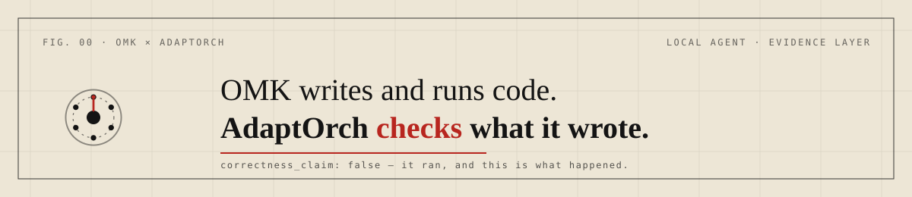

# OMK + AdaptOrch

OMK is this local, MIT-licensed coding agent. AdaptOrch is a separate
proprietary evidence service. Neither requires the other: installing OMK does
not create an AdaptOrch account or make calls to it by default.

For an optional integration, see the [WPL package and clients](../../../packages/adaptorch-wpl/README.md)
and [MCP setup](../../../packages/coding-agent/docs/mcp.md). The WPL package exposes
state, client, and adjudication primitives, not an automatic verification loop
for every CLI prompt.

AdaptOrch's reports carry `correctness_claim=false`; they are not semantic
correctness proofs or OMK harness benchmark results.
[Review AdaptOrch plans](https://adaptorch.com/?utm_source=github&utm_medium=readme&utm_campaign=omk#pricing)
· [Claim boundary](https://adaptorch.com/claim-boundary?utm_source=github&utm_medium=readme&utm_campaign=omk)

The AdaptOrch name and marks identify that separate proprietary product
and appear here with permission. They are excluded from this repository's MIT
grant — see [TRADEMARKS.md](../../../TRADEMARKS.md).
