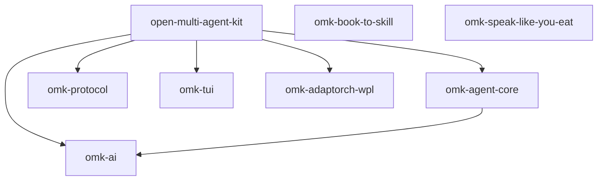
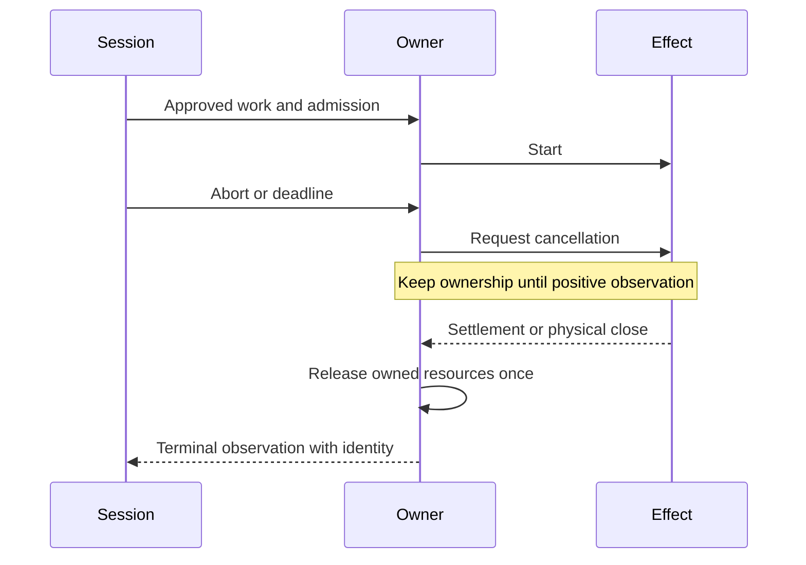
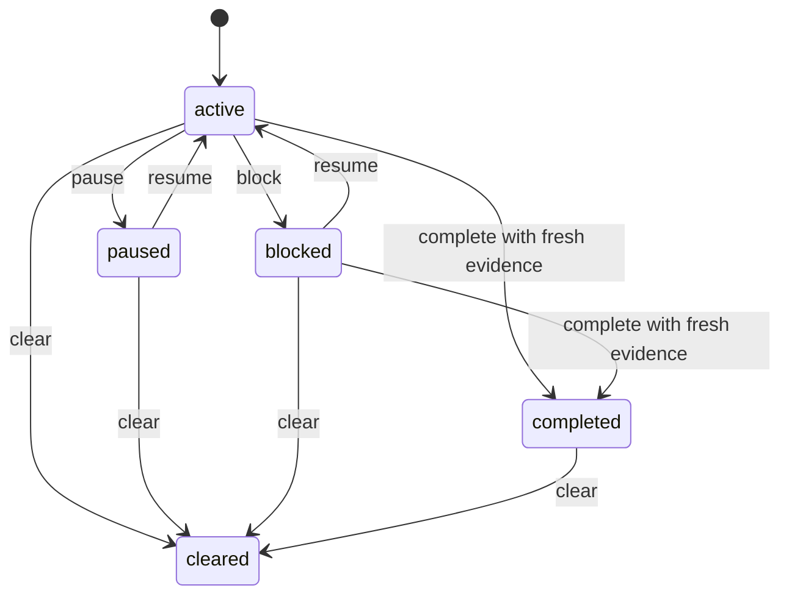
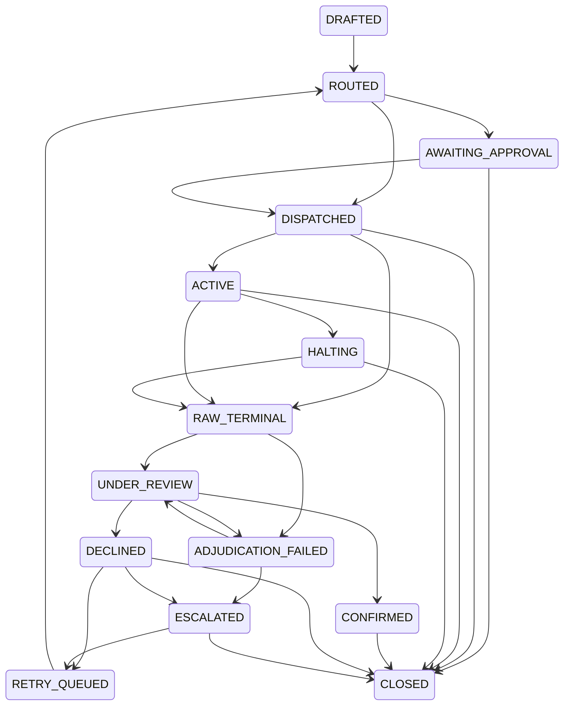

# Runtime architecture and verification boundaries

This document describes the source layout and the ownership contracts that must survive a runtime refactor. It is not evidence that every execution mode has passed these checks, or that a running installed CLI matches this checkout.

## Package boundaries

Arrows mean ordinary production `dependencies` among the eight top-level package manifests, not execution authority. Peer, development and optional dependencies, and nested example workspaces, are outside this graph.



The protocol package is not a declared production dependency of agent-core. Book-to-skill and Speak Like You Eat have no edges under `dependencies` in this graph, but declare the CLI and other host packages as peer/development dependencies. The Go modules `initcheck` and `promptguard` are outside the npm lockstep graph. Do not infer additional imports, call paths or shared locks from the picture.

The CLI's [service factory](../src/core/agent-session-services.ts) supplies dependencies to [AgentSession](../src/core/agent-session.ts). The session coordinates input, context, model selection, extensions, resource admission and persistence. [Agent execution](../../agent/src/agent-loop.ts) runs turns and tool batches; [provider streaming](../../ai/src/stream.ts) resolves the provider implementation. CLI, TUI, print, RPC and SDK behavior needs entry-point testing, not only unit tests for the underlying reducers.

## Three distinct execution graphs

| Graph | Nodes | Owner and contract | Limits that must not be borrowed by another graph |
|---|---|---|---|
| Tool DAG | Tool calls within an assistant batch | Agent loop, resource claims, hooks and terminal observations | Conflict edges and effective tool concurrency |
| Subagent lanes | Delegated work with a launcher callback | Session-bound lane authority and shared workload permit pool | Parent admission, lane width and heavy-work weight |
| Verified-run DAG | Command tasks producing candidate artifacts | Protocol contract and run coordinator | At most 16 tasks, at most two attempts per task, optional concurrency of one or two, disjoint writable scopes |

Sources: [tool reduction](../../agent/src/tool-dag-reduce.ts), [lane contract](../src/core/subagent-lane-contract.ts), [lane authority](../src/core/subagent-lane-authority.ts), [run DAG contract](../../protocol/src/run-dag.ts), [run coordinator](../src/core/verified-run/coordinator.ts).

Transitive reduction preserves predecessor reachability. It does not validate resource claims, authorize a command, prove that a hook preserved its claims, or prove that a timed-out process stopped. Verified-run task ordering determines artifact ancestry; unrelated successful branches are deliberately excluded from a task's ancestor inputs.

## Owners, mutation and observations

| State | Owner | Mutation boundary | Persistence and termination boundary |
|---|---|---|---|
| Prompt request budget | `RunBudget` | `admit`, returned release closure, `close`, exhaustion | In-memory prompt scope; monotonic deadline; `waitForIdle` observes active request accounting, not remote effect termination |
| Heavy-work weight and FIFO queue | `WorkloadPermitPool` | `acquire`, permit `release`, `setCapacity` | In-memory pool; duplicate release is a diagnostic no-op; lowering capacity drains existing permits without revoking them |
| Lane dispatch lease | Pool-keyed lease in `lane-dispatch-ownership` | Synchronous acquisition before awaiting dispatch, token-bound release | Process-local; a second pool or process is not covered |
| Unsettled lane children | Pool-keyed settlement set in lane authority | Record one stable settlement promise; release child counter after its fulfillment | A rejected observation retains ownership; a new authority instance over the same pool cannot forget it |
| MCP retirement | Manager runtime plus transport-retirement epoch | Publish retirement identity, request close, join physical observation | Direct-process/stdio close only; failure to observe close leaves retirement pending |
| Durable goal | `DurableGoalStore` and pure goal reducer | Current-ref command under the store lock | Goal journal; revision and generation checks, generation-bound evidence |
| Verified-run execution | `RunCoordinator` and `RunAuthorityPool` | Approved commands, durable authority grants, reconcile-before-admission | Authority journal and run journal; epoch/incarnation fencing and supervisor observations |
| Candidate verification | Verification phase and evidence binding | Checks bound to contract, candidate and execution observations | Check receipts and claim closure; publication has a separate approval boundary |
| Context plan and cache | Context-budget planner and cache invalidation owner | Immutable inputs, selection, invalidation snapshot | A cached plan is not provider billing authority; model/tokenizer/workspace changes must invalidate the appropriate entries |

Implementation references:

- [Request budget](../src/core/run-budget.ts) and [workload permits](../src/core/workload-permit-pool.ts).
- [Dispatch lease](../src/core/lane-dispatch-ownership.ts) and [lane authority](../src/core/subagent-lane-authority.ts).
- [MCP manager](../src/core/mcp/manager.ts) and [retirement](../src/core/mcp/transport-retirement.ts).
- [Goal store](../src/core/durable-goal-store.ts) and [goal reducer](../src/core/durable-goal-reducer.ts).
- [Durable run authority](../src/core/verified-run/authority-runtime.ts) and [evidence binding](../src/core/verified-run/evidence-binding.ts).
- [Context planner](../src/core/context-budget-v2-planner.ts).

The runtime also has built-in tools, extension-provided tools, bash execution, provider requests and several UI/session shutdown paths. Full positive-termination coverage of those adapters, descendant processes and remote side effects remains a separate verification task. A class name or a passing fake-client test is not proof of an operating-system or remote observation.

### Cancellation is not settlement



If the observation is absent or rejected, retain an unknown outcome rather than inventing a successful release. MCP stdio close says nothing about descendant or remote effects. See [bounded runtime ownership](phase3-runtime-boundaries.md) for the tested contract and its exclusions.

## State machines are not interchangeable

### Goal lifecycle



The diagram shows status-changing commands, not edit/checkpoint/evidence commands that preserve status. A cleared goal rejects further commands. Goal continuation adds user steering, queued input, scope, side-effect, budget and round-limit policy; it is not equivalent to a provider request finishing. [Continuation policy](../src/core/goal-continuation.ts) currently considers queued input first. Refactoring must preserve that distinction rather than silently changing automatic continuation or user-input authority.

### Verified-run projection

The [run projection](../src/core/verified-run/run-types.ts) keeps separate dimensions:

- Execution: `ready`, `running`, `paused`, `succeeded`, `failed`.
- Settlement: `open`, `draining`, `settled`, `quarantined`.
- Verification: `not_requested`, `verified`, `violated`, `inconclusive`.
- Application: `not_requested`, `candidate_ready`.
- Publication: `none`, `intent`, `accepted`, `failed`, `reconciliation_required`.

These are dimensions, not a single linear success sequence. A candidate, a verified candidate, a settled execution and an accepted publication must not be displayed or authorized as equivalent. Parsing a [run contract](../../protocol/src/run-contract.ts) is not approval. Recovery must reconcile authority and execution identity before new work; replay alone must not execute effects or recreate approval.

### WPL packet lifecycle

The [WPL state machine](../../adaptorch-wpl/src/state-machine.ts) has 14 states. `CLOSED` is its only terminal state. `CONFIRMED` still transitions to `CLOSED`; `ESCALATED` and `RETRY_QUEUED` are not terminal. There are retry/review cycles, so finding a path to `CLOSED` proves only existential reachability, not eventual termination of every run. Its state vocabulary does not replace the goal or verified-run state models.



The [advisory bridge](../src/core/adaptorch-bridge.ts) is a different integration. The session currently supplies a no-op advisory function. Advisory cache output cannot acquire execution authority or widen parent caps. This document makes no claim about external service capabilities or benchmark results.

## Invariants to preserve

| Boundary | Required check | What the check does not establish |
|---|---|---|
| DAG reduction | Output edges are a subset, closure is identical, retained edges are essential | General schedule optimality or resource conflict safety |
| Closure allocation | Exact triangular matrix allocation stays within its 16 MiB budget, otherwise exact traversal | Total RSS or a traversal time bound |
| Permit admission | New grants fit capacity, even during a capacity reduction | Immediate revocation of already granted work |
| Lane settlement | Unconfirmed children retain accounting across authority recreation | Cross-process coordination |
| Context | Feasible inputs fit; impossible hard-pin demand reports emergency without silently deleting hard items | Exact wire/image token cost or task success |
| Monetary policy | Unknown spend remains unknown and accepted settlements are not double-counted | A pre-billing hard-dollar cap from settled-cost checks alone |
| Evidence | Required observations bind to the correct contract, attempt and candidate | Authenticity from a hash alone or semantic truth of every check |
| Recovery | Stale revision/generation and unknown effects cannot authorize new work | Safe automatic retries for an uncertain remote effect |

For context capacity `B=max(0,W-responseReserve-safetyMargin)`, hard demand greater than B is an impossible input constraint, not an excuse to remove mandatory rules. The planner reports diagnostics/emergency; every sending path still needs verification of its response to that result.

For n nodes, the ancestor matrix alone needs `4*sum(ceil(i/32), i=0..n-1)` bytes. At n=16,369 this is exactly 16,777,216 bytes; at n=16,370 it exceeds the cap. Graphs already known to be reduced can avoid allocation entirely. The bitset and traversal paths must preserve the same exact graph semantics.

### Budget accounting is not one global counter

The [goal observer](../src/core/extensions/builtin/goal-autonomy.ts) accounts a settled message collection. The [request budget](../src/core/run-budget.ts) limits request admission; the [resource governor](../src/core/resource-admission.ts) limits concurrency under host pressure. Their units, scopes and exhaustion conditions differ.

| Observed input to the goal observer | Cost interpretation | Remaining verification |
|---|---|---|
| Assistant message | `usage.cost.total`; incomplete usage or an invalid cost makes the total unknown | Provider usage completeness and accuracy |
| `subagent` tool result | Sum of `details.results[].usage.cost`; missing results or invalid costs make the total unknown | Every launched child must be represented, including failures |
| Duplicate settlement | `GoalBudgetState.admit` deduplicates the settlement identity | Restart/legacy identity compatibility and caller identity correctness |
| Compaction, judge, advisory or other request | The reducer has no separate category for these requests | Trace whether each request reaches the observed message collection; do not assume inclusion |

No pre-request monetary reservation follows from those settled totals. A hard-dollar guarantee would require a true upper bound on every admitted charge, reservations for concurrent work, and a policy for usage that remains unknown after cancellation. Retain the current stop semantics until such a policy is separately specified and tested.

## Verification layers

1. A mathematical specification states assumptions and invariants.
2. An independent R oracle checks finite fixtures using different algorithms.
3. Actual TypeScript outputs are compared with that oracle and targeted runtime tests.
4. Controlled task evaluation measures completion, cost and latency under fixed conditions.

Passing one layer does not complete the others. Do not describe mathematical fixture checks as a production benchmark, a universal correctness proof or release authorization.

### Actual TypeScript to independent R fixtures

From the repository root, create a new bundle and verify it with an explicitly selected R executable:

```bash
node --experimental-strip-types scripts/architecture/export-fixtures.mjs /path/to/new-bundle
OMK_RSCRIPT=/absolute/path/to/Rscript node scripts/architecture/verify-fixtures.mjs /path/to/new-bundle
```

The exporter refuses to overwrite a bundle. Its parent captures source hashes before launching a fresh Node producer and rechecks them before finalizing the manifest. The producer calls the actual tool-DAG reducer and WPL predicates, derives WPL states from the source union, and writes fixed TSV files. Cached caller imports never produce the fixtures; caller Node preloads are not forwarded. A producer error, source drift or missing producer receipt prevents manifest creation. The child has configured time/output limits, not a proven process-tree termination guarantee.

The serializer rejects wrong-sized or sparse graphs, missing/nonarray rows and invalid predecessor shapes before writing a manifest. R additionally requires an exact decode/encode roundtrip, so dropped trailing components cannot disguise extra graph rows. The verifier checks manifest schema and current source/fixture hashes before and after invoking the base R oracle with `--vanilla` and requested single-thread BLAS/OMP settings. Missing R, semantic failure, stale inputs or missing PASS output makes verification fail. No R package installation is needed.

The corpus has 1,099 exhaustive fixed-order DAGs with one to five nodes, an empty graph, five deterministic larger examples and two cross-word branching cases with 34 and 66 nodes. Each runs under two closure budgets: 1,107 graphs and 2,214 DAG rows in total. The cross-word cases require actual redundant-edge decisions involving predecessors 31, 32 and 63, not just wider matrix allocation. Separate cases check allocation boundaries, observed invalid-JavaScript rejection and all 196 WPL state pairs. R independently checks decoded graph identities, closure, edge-removal minimality, memory formulas and the expected WPL transitions. Large memory cases use a known sparse graph and allocation formula rather than a huge R closure matrix. These are bounded source checks, not total-process memory or eventual-termination guarantees.

Run the verification tooling's regression tests with actual R enabled:

```bash
OMK_RSCRIPT=/absolute/path/to/Rscript node --experimental-strip-types --test scripts/test/architecture-oracle.test.mjs scripts/test/runtime-architecture.test.mjs
```

Without `OMK_RSCRIPT`, the oracle test file explicitly skips its R-dependent cases; its Node checks still run. The verifier CLI never treats an unavailable R executable as a pass. Negative controls recompute fixture hashes before corrupt data reaches R, so a hash mismatch cannot substitute for demonstrating semantic rejection. Scratch-source regressions also cover preloaded runtime implementations, source drift across the actual producer launch and malformed actual reducer returns.

The diagram guard compares ordinary package dependencies and canonical `-->` WPL edges with source. It is not a Mermaid renderer, does not cover alternate arrow syntax, and does not automatically verify the goal diagram, owner tables or surrounding prose. The six manifest source bindings do not include every installed dependency or runtime configuration. Hashes establish observed integrity/freshness, not authenticity or protection against every concurrent writer.

### Runtime regressions

The existing focused runtime regressions include:

- `packages/agent/test/phase3-dag-reduction.test.ts` and `tool-dag-reduction.test.ts`.
- `packages/coding-agent/test/phase3-lane-ownership.test.ts`, `phase3-lane-settlement-identity.test.ts` and `phase3-lane-input-boundaries.test.ts`.
- `packages/coding-agent/test/mcp/phase3-close-proof.test.ts` and `phase3-catalog-integration.test.ts`.
- `packages/protocol/test/run-dag-contract.test.ts` and `run-dag-properties.test.ts`.
- `packages/coding-agent/test/verified-run-dag-recovery.test.ts`.
- `packages/adaptorch-wpl/test/state-machine.test.ts` and `state-machine.property.test.ts`.

Run selected Vitest files from their package with `node ../../node_modules/vitest/dist/cli.js --run <files>`, then `npm run check` from the root for a non-documentation change. Do not run the full Vitest suite directly or regenerate baselines to hide a failure.

## Refactor direction, not an implemented replacement

Keep the existing packages and public `AgentSession` facade. Reuse service, snapshot, admission and settlement seams before adding another coordinator. Extract only responsibilities with a clear input, owner, terminal condition and regression test. Pure decisions and projections are safer first slices than moving pieces of shared asynchronous state.

The target is separation of interaction, control, execution, context and evidence responsibilities within the current modules, not five new services. New policies, hard-dollar reservations, shared cross-process scheduling, default changes and performance claims require their own acceptance evidence. No runtime behavior changes follow merely from this architecture map.
